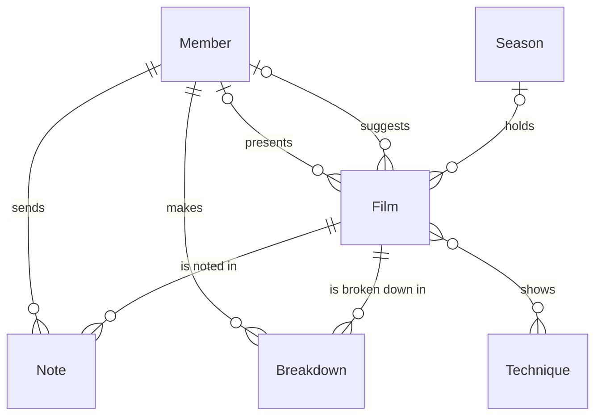

# Film study club

*A recipe from the Fibery Process Cookbook: the process in plain words, and the model to build it in any tool.*

**Watch films the way a director makes them: one craft at a time, one scene shot by shot, every technique named.** For a film club or class of five to thirty people who want to direct. Seasons of weekly meetings where everyone watches for the same thing, and a toolkit that grows with every film.

## The idea

Watching a lot of films doesn't teach directing on its own. An audience follows the story and forgets how it was told. A director watches for the choices: where the camera stands, when the cut comes, what we hear before we see it. Film schools and film clubs train that second way of watching, and it lasts best in a group, where a fixed evening and other people's eyes keep it going.

The club's year is a run of seasons. A **Season** is four to eight weeks on one director, movement or craft, built around one question. Each week the club discusses one **Film** that members watch at home with one **Focus**, the craft everyone watches for: staging (where people stand and move), camera, editing, sound, performance, light and color, or story. Before the meeting, every member sends a **Note**: one moment, one question. One member prepares a **Breakdown**, one scene taken apart shot by shot. At the meeting the group names what it saw, and every **Technique** it names goes into a toolkit the club keeps for good.

In any work tool, this becomes six kinds of linked records: seasons, films whose workflow runs from *Proposed* through *Programmed* to *Discussed*, the notes members send, scene breakdowns, techniques and members. Members never need to open the tool: they join, suggest films, send notes and hand in breakdowns through forms, and two or three organizers run the rest. The meeting runs from a list of the week's notes in film order, a reminder chases a missing breakdown before each meeting, and a formula turns each breakdown's shot count into the scene's average shot length. It's a curriculum the club writes as it watches, not a film diary.

## How it runs

Follow one film, *The Last Tram*, from a member's suggestion to the club's toolkit.

1. **Someone joins, someone suggests.** People join through the **Join the club** form and become **Member** records, *Active* from the start; most never open the tool. One member suggests *The Last Tram* through the **Suggest a film** form, with its director, its year and one line on **Why watch it**: "a tram stop at night, four minutes, and nothing happens". It lands on the **Watchlist** in *Proposed*.
2. **The programmer plans a season.** The **Programmer**, the organizer who plans the club's seasons (in a class, the teacher), sets up *Suspense* with its **Big question**, "How do directors make us wait?", and its **Dates**, six weeks starting next month. The season is *Planned* until its first meeting. The programmer picks six films from the Watchlist and links each to the season; the **Added to season** rule moves each to *Programmed*, off the watchlist. The programmer gives each a **Meeting date**, the evening the club discusses it. Suggestions are where the choice starts, not a vote: a film the programmer won't show moves to *Passed*, with a line why in its description, so whoever suggested it hears back.
3. **The host prepares the evening.** Each film has a **Host**, the organizer who runs its meeting; often one person hosts a whole season. Two weeks ahead, the host gives *The Last Tram* its focus, *Sound*, and asks a member to be its **Presenter**, the one who will break down a scene. To choose, the host opens **Members**: every active member with their **Times presented** and **Days since note**, so presenting goes round and nobody drifts off unnoticed. Then the host sends members the **Program**, every season not yet done with its films, meeting dates, focuses and presenters, and **Where to watch** each film.
4. **Everyone watches for the focus.** In the week before the meeting, members watch the film, twice if they can: once as an audience, once for the focus alone. Each sends a note through the **Send a note** form: the **Minute** of one moment, what they noticed there in one sentence, which becomes the note's name, and one **Question** for the group. One note on *The Last Tram*, at minute 41: "The bell rings a full shot before we see the tram." Its question: "Would it be as tense if we saw the tram first?"
5. **The presenter takes one scene apart.** The presenter picks the tram stop and breaks it down shot by shot: one line per shot with its size, how much of the frame a person fills, from extreme long shot to extreme close-up; its angle; its movement; its length in seconds; and what it shows. A paragraph follows on what the director chose and what else they could have done. The presenter hands it in through the **Submit a breakdown** form with its **Scene start**, the minute it begins, its **Scene length** in seconds and its number of **Shots**. The breakdown's **Average shot length**, the scene's seconds divided by its shots, says how fast it's cut: 252 seconds in 9 shots is 28 seconds a shot, slow for a thriller, and that's the point.
6. **Three days out**, if no breakdown has come in, the **Breakdown check** rule reminds the host, who checks in with the presenter. A film is **Not ready**, red on the Program, when it's a week out with no focus or no presenter, three days out with no breakdown, or past its meeting date and still *Programmed*.
7. **The meeting.** The host opens **Next meeting**: every note for the coming meeting, in film order. The presenter plays the scene and walks the group through it shot by shot, the breakdown on screen. Then the group goes through the notes from the earliest minute to the latest; each member says what they saw and asks their question. When the group agrees it has seen a move worth stealing, the host names it on the **Toolkit**, the club's techniques by **Craft**, and links it to the film. *Sound before picture* goes in under *Sound*, new; *Empty frame first*, already seen in two films, now counts three in its **Times seen**.
8. **After the meeting**, the host writes the evening's takeaways in the film's description and moves it to *Discussed*. A meeting that can't happen gets a new date from the host. When a breakdown never comes, the meeting runs on the notes alone, and the film stays without one for good.
9. **The season ends.** The programmer moved *Suspense* to *Running* at its first meeting; after its last, they move it to *Done* and write the club's answer to its big question in its description. The **Season ends** rule sends every film of it still *Programmed* back to *Proposed* and off the season, to wait on the Watchlist for another one. The **Cutting pace** report puts the average shot length of every scene the club has broken down side by side, colored by season: the difference between the patient films and the restless ones, in seconds.
10. **Members come and go.** When a member stops coming, the host moves them to *Left* and never deletes them, so their notes and breakdowns keep their name.

## What people look at

- **Every week, before the meeting** — **Next meeting**: who has sent a note, and what the evening will cover. The **Program**: what each coming film still needs, red when it isn't ready.
- **At the meeting** — **Next meeting** again, walked from the first minute to the last, with the breakdown on screen; and the **Toolkit**, every technique by craft, to find a name before adding one.
- **When planning a season** — the **Watchlist**: what members have suggested and why, oldest first. **Members**: who presents next, and who has gone quiet.
- **Any time** — the four forms members use: **Join the club**, **Suggest a film**, **Send a note** and **Submit a breakdown**. The **Cutting pace** report: how fast each scene the club studied is cut, season by season. And **How to run the film study club**, this process on one screen.

## The rules

These are all the automations; everything else in the story is done by people.

- **Added to season**: when a *Proposed* film is linked to a season, it moves to *Programmed*. The watchlist holds only films no season has claimed.
- **Breakdown check**: every day at 09:00, the host of every *Programmed* film whose meeting date is three days away and that has no breakdown yet is notified, to check in with its presenter.
- **Season ends**: when a season moves to *Done*, every film of it still *Programmed* moves back to *Proposed* and is unlinked from it. A film the club never got to waits on the watchlist, not in a finished season.

No automations in your tool? Then a person does each of these at the same moment, and the promises they keep below become practices.

## What must stay true

Whatever anyone edits, adapts or corrects, these hold; each says what keeps it so.

- ★ Every film is watched for one thing. A programmed film has one focus, known to members a week before its meeting, and the notes and the talk stay on it. Shown by **Not ready**, red on the **Program** for a film a week out with no focus or no presenter; keeping the talk on the focus is a practice, the host's.
- ★ Every meeting takes one scene apart, shot by shot, with its shot list, its scene length and its shots. Kept by **Breakdown check**, which reminds the host three days ahead; shown by **Not ready**, red until the breakdown is in. A meeting held without one leaves its film with none.
- ★ The toolkit holds what the club has seen, not what it has read about: every technique links to the films where the group saw it. Shown on the **Toolkit**, where a technique seen in no film is red.
- One move, one name. Before adding a technique, the host looks for it on the Toolkit; a second name for the same move is merged into the first, its films moved over. A practice.
- The programmer chooses, and every suggestion gets an answer: programmed, or *Passed* with a line why. A practice; the **Watchlist** lists the oldest suggestions first.
- A finished season holds only films the club discussed. Kept by **Season ends**, which sends the rest back to the watchlist; a film discussed but never moved to *Discussed* is red on the Program once its date has passed, shown by **Not ready**, so the host moves it on before the season ends.
- People leave; their work stays. A member who leaves moves to *Left* and is never deleted, so their notes and breakdowns keep their name. A practice.

## Making it yours

Decide these before you set it up; each has a default if you shrug.

| Question | Default | If not the default |
|---|---|---|
| Do members open the tool themselves? | No: they use the four forms | Yes, as in a class where everyone has an account: each member writes notes and breakdowns in place and reads the toolkit. Drop the Member database and the four forms; the member on a note or a breakdown, and a film's presenter, point at the people themselves, and Breakdown check reminds the presenter too |
| Does the club run seasons? | Yes: four to eight weeks on one theme | No: one film a week, a mixed year, as many film societies plan it. Drop the Season database with Added to season and Season ends; the Program becomes a list of programmed films by meeting date |
| Does a teacher give written feedback on breakdowns? | No: the group discusses them | Yes: every breakdown gets feedback before its meeting. Add a Feedback field on Breakdown, filled by the host, and a To review list of breakdowns without it |
| Do you already keep a members list or a film list in your tool? | — | Notes and breakdowns link to what you have: point the Member fields at your members, or the Film fields at your film list, and add only the fields here it lacks |

- **Other words:** "Screening", "Class" or "Seminar" for meeting; "Term" or "Module" for season; "Lens" for focus; "Scene study" for breakdown. Rename freely; the mechanics stay.
- **Watching together**: a club that screens films at its meetings screens each one the week before it's discussed, so notes still come before the talk.
- **Everyone presents**: in a class, every student can break down a scene each week. Nothing in the model changes; Times presented then counts the work handed in.
- **Sound off, picture off**: a common trick. A staging focus works best with one scene watched again without sound; a sound focus, with eyes closed. It's a way of watching, not a field.
- **Directors as records**, when seasons keep returning to the same names: a Director database linked from Film, each director with their films beneath them.
- **Shot by shot as data**, when the club wants numbers across films, such as how often a director cuts to a close-up: a Shot database under Breakdown, one record per shot with its size, angle, movement and length. Past a few films a season, it's a research project, not a club.
- **Shooting what you named**: clubs that want to try their techniques add an Exercise database linked to Technique: one technique, one short scene shot on a phone, shown at the next meeting. This recipe stops at watching on purpose.
- **Public screenings** usually need a license from the rights holder; a License field on Film keeps it with the film.
- **Too far**: two focuses at once and nobody watches for either; two breakdowns in one evening and the notes never get their turn.

## Details for building

What follows is what the process is built from, in words any tool can follow; the story above is enough to run it.

Each kind of record (Film, Note, Breakdown, Technique) is a database or a table, depending on the tool, or a tab in a spreadsheet. A relation links two kinds; its inverse is the name it has on the other side. A state is a step in a workflow, and a finished state ends it. A rule is an automation, a button is an automation someone presses, and a formula is a field the tool computes. A nested view shows each record's children beneath it; where a tool can't nest, group the children by their parent instead.

A season holds the films the club discusses in it. A film collects the notes members send about it, the breakdowns of its scenes and the techniques seen in it, and a technique can be seen in many films. Every note and breakdown names the member who made it; a film names the member who suggested it and the one who presents it.

### Film

One record per film suggested to the club, programmed or discussed; its name is the film's title. The description holds why it was suggested and, after its meeting, the evening's takeaways. Comments on.

| Field | Type | Why |
|---|---|---|
| Director | text | Who made it; on the Watchlist |
| Year | integer | When it came out; on the Watchlist |
| Why watch it | text | One line from whoever suggested it; what the programmer chooses by |
| Suggested by | relation, many-to-one → Member; inverse **Suggested films** | Filled by the Suggest a film form; on the Watchlist |
| Season | relation, many-to-one → Season; inverse **Films** | The season it's discussed in; what Added to season watches and Season ends unlinks |
| Meeting date | date | The evening it's discussed; Next meeting, the Program, Not ready and Breakdown check run on it |
| Host | person; inverse **Hosted films** | The organizer who runs its meeting; Breakdown check notifies them |
| Focus | single select: Staging, Camera, Editing, Sound, Performance, Light and color, Story | The one craft everyone watches for; read by Not ready |
| Presenter | relation, many-to-one → Member; inverse **Films to present** | The member asked to break down a scene; read by Not ready |
| Where to watch | url | Where members can find the film; on the Program |
| Techniques | relation, many-to-many → Technique; inverse **Seen in** | What the group named at its meeting; linked by the host, counted by Times seen |

States: Proposed → Programmed → Discussed (finished) · Passed (finished). Default: Proposed. Source of truth: **Season**. A film in a season is *Programmed* or *Discussed*; Added to season and Season ends keep the state in step with it, and a film taken out of a season by hand goes back to *Proposed* by hand.

Formulas:
- **Not ready** — yes when the film is *Programmed* and one of these holds: its meeting date has passed; it is seven days away or less and the film has no focus or no presenter; it is three days away or less and the film has no breakdown. No otherwise, and no with no meeting date. Colors the film red on the Program.

### Note

One member's note on one film: one moment, what they saw there, one question. Its name is what they noticed, in one sentence; the description holds anything longer. Comments off.

| Field | Type | Why |
|---|---|---|
| Film | relation, many-to-one → Film; inverse **Notes** | The film it's about; Next meeting filters on it |
| Member | relation, many-to-one → Member; inverse **Notes sent** | Who sent it; read by Days since note |
| Minute | integer, minutes into the film | Where the moment is; Next meeting sorts by it |
| Question | text | One question for the group |

### Breakdown

One scene of one film, taken apart shot by shot by one member; its name is the scene's ("The tram stop"). The description holds the shot list, one line per shot: its number; its size, from extreme long shot through long, medium and close-up to extreme close-up; its angle, high, eye level, low or tilted; its movement, still, pan, tilt, tracking, crane, handheld or zoom; its length in seconds; and what it shows. Then a paragraph on what the director chose and what else they could have done. Comments on.

| Field | Type | Why |
|---|---|---|
| Film | relation, many-to-one → Film; inverse **Breakdowns** | The film the scene is from; read by Not ready and Breakdown check |
| Member | relation, many-to-one → Member; inverse **Breakdowns made** | Who made it; counted by Times presented |
| Scene start | integer, minutes into the film | Where to find the scene at the meeting |
| Scene length | integer, seconds | Read by Average shot length |
| Shots | integer | The number of shots in the scene, counted by the member; read by Average shot length |

Source of truth: the breakdown's **Member** says who made it, and it's what Times presented counts; the film's Presenter says who was asked. They usually match.

Formulas:
- **Average shot length** — Scene length divided by Shots, in seconds, a decimal with one decimal place; 0 when Shots is 0 or empty. On the breakdown, and charted by Cutting pace.
- **Season name** — the name of its film's season, text; "No season" when the film has none. Colors the Cutting pace report.

### Technique

A directing choice the club has named; its name is the club's name for it ("Sound before picture"). The description holds what it does, when it fails, and the minute where it shows in each film. Comments on.

| Field | Type | Why |
|---|---|---|
| Craft | single select: Staging, Camera, Editing, Sound, Performance, Light and color, Story | The craft it belongs to; the Toolkit's columns |
| Frames | files | One or two frame grabs that show it; the card cover on the Toolkit |

Seen in, the films it was seen in, is the inverse of Techniques on Film.

Formulas:
- **Times seen** — how many films it is linked to through Seen in, all of them, since the host links a technique only at a film's meeting; a whole number, 0 with none. On the Toolkit cards, red at 0.

### Season

Four to eight weeks of meetings on one director, movement or craft; its name says what it's about ("Suspense"). The description holds why the club chose it and, once it's done, the club's answer to its big question. Comments on.

| Field | Type | Why |
|---|---|---|
| Big question | text | What the season asks; on the Program |
| Dates | date range | When it runs; the Program sorts by it |
| Programmer | person; inverse **Seasons planned** | The organizer who plans it |

States: Planned → Running → Done (finished). Default: Planned.

### Member

One person in the club, who joins through the Join the club form and may never open the tool; its name is the member's name. No description. Comments off.

| Field | Type | Why |
|---|---|---|
| Email | email | Where the host sends the Program; filled by the Join the club form, on Members |

States: Active → Left (finished). Default: Active.

Formulas:
- **Times presented** — how many breakdowns the member has made, all of them; a whole number, 0 with none. On Members, which sorts by it to pick the next presenter.
- **Days since note** — days from the creation of the member's latest note to today, a whole number, 999 with no note. On Members, to see who has gone quiet.

### Views

Nine views, one past the usual eight, because members do everything through the four forms.

| View | Type | Of | Grouping | Shows | Filter | Sort |
|---|---|---|---|---|---|---|
| Next meeting | grid | Note | | Minute, Member, Question, Film | Film is Programmed and its Meeting date is today or within the next 7 days | Minute asc |
| Program | grid | Season | Films nested, by Meeting date: Meeting date, Host, Focus, Presenter, Where to watch; a film red when Not ready | Big question, Dates, State | State is not Done | Dates asc |
| Watchlist | grid | Film | | Director, Year, Why watch it, Suggested by, creation date | State is Proposed | creation date asc |
| Toolkit | board | Technique | columns Craft | Times seen; Frames as the cover; red when Times seen is 0 | | Times seen desc |
| Members | grid | Member | | Email, Times presented, Days since note | State is Active | Times presented asc |
| Join the club | form | Member | | Name (required), Email (required) | | |
| Suggest a film | form | Film | | Name (required), Director, Year, Why watch it (required), Suggested by (required) | | |
| Send a note | form | Note | | Film (required), Member (required), Minute (required), Name, what you noticed (required), Question | | |
| Submit a breakdown | form | Breakdown | | Film (required), Member (required), Name, the scene (required), Scene start (required), Scene length (required), Shots (required), Description, the shot list (required) | | |
| How to run the film study club | document | | | the process on one screen, linking to this recipe | | |

### App

None needed. The central moment is the meeting, and Next meeting carries it with the breakdown's own shot list beside it. The app it would take, a strip of every shot with its frame and length, needs one record per shot; Making it yours says when that's worth it.

### Reports

**Cutting pace** — source Breakdown, current, every breakdown: a bar chart of Average shot length, averaged per film, one bar per Film, colored by Season name.

### Sample story

The Suspense season is three meetings in, three to go. The Last Tram meets in three days: four notes are in, the earliest at minute 12, but the breakdown of the tram stop isn't, so it shows not ready. The two films already discussed have a breakdown each, one cut nearly four times as fast as the other, and next week's film has its focus and its presenter. The toolkit holds a dozen techniques; one, named last week, still waits to be linked to its film. Long takes ended last month and sent one film back to the watchlist, where eight films wait, the oldest unanswered for a month. One suggestion was passed; one member left.

## Sources

- [Film Analysis](https://filmanalysis.yale.edu/), Yale University: the words for a shot list, from shot scale to angle and camera movement, and the crafts a focus can take.
- [Picking a Program](https://www.acofs.org.au/Film%20Screening%20Handbook/Ch10%20program.pdf), chapter 10 of the Film Society Handbook, Australian Council of Film Societies, 2010: a programmer who chooses from members' suggestions rather than by vote, and a program set well ahead.
- [Cinemetrics quantifies creativity in film](https://news.uchicago.edu/story/cinemetrics-quantifies-creativity-film), Susie Allen, University of Chicago News, 2015, on Yuri Tsivian's Cinemetrics: average shot length as a measure of a film's cutting pace.

## Build it

In Fibery, open Claude with the Fibery plugin, attach this recipe and say "set up the film study club". Claude asks a few questions, then sets it up in about ten minutes.

Anywhere else, give this recipe to your AI assistant and name your tool, or build it by hand from Details for building.

---

*From the Fibery Process Cookbook (https://github.com/Fibery-inc/process-cookbook), licensed CC BY 4.0 (https://creativecommons.org/licenses/by/4.0/): copy, adapt and build it anywhere, crediting the cookbook.*
