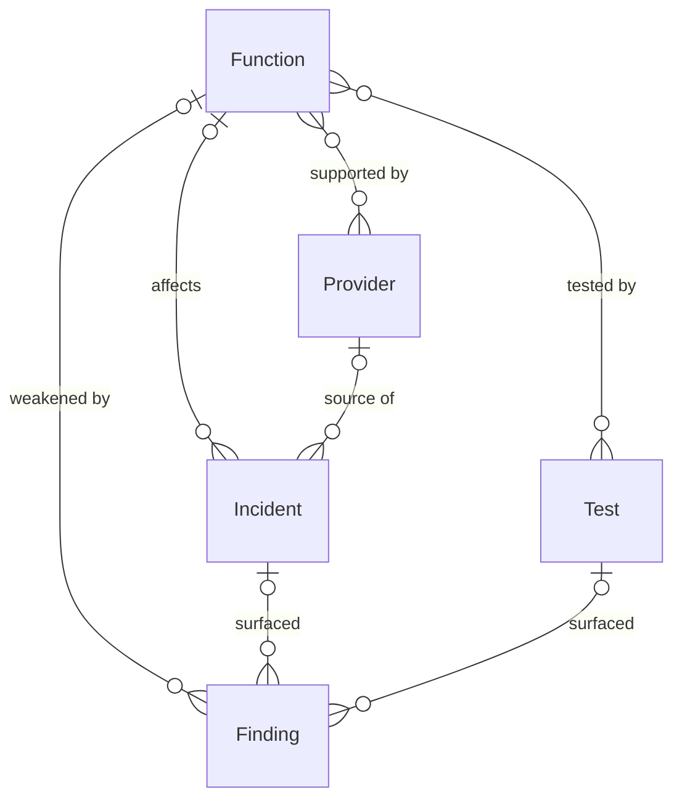

# DORA compliance

*A recipe from the Fibery Process Cookbook: the process in plain words, and the model to build it in any tool.*

**Prove the entity can keep running, and never miss the incident clock.** For an EU financial entity in scope of the Digital Operational Resilience Act. Critical functions mapped and tested, every ICT provider in one register, and every major incident reported inside its 24-hour, 72-hour and one-month deadlines.

## The idea

DORA, the Digital Operational Resilience Act, is the EU's law that makes banks, insurers, investment firms and the other financial entities prove they can keep running when their technology is attacked or fails. It rests on five pillars: manage ICT risk, handle and report incidents, test resilience, control the third parties that run the technology, and share threat intelligence. The thread tying them together is the **critical or important function**, the handful of services the entity can't afford to lose, like payments, trading or custody, because DORA judges everything by the harm to those functions. New in DORA, the **management body**, the directors who answer for the entity, approve the framework and can be held personally liable, so sign-off is part of the process, not a formality.

The hard part isn't the five pillars; it's two standing habits and one register. Every critical function has to be tested on a cadence and every provider that runs it reviewed on a cadence, so resilience is shown, not assumed. The **register of information**, a complete inventory of every ICT provider arrangement mapped to the functions it supports, has to be kept current and handed to the authority. And when a **major incident** lands, the team races a three-stage clock: an initial notification within hours, an intermediate report within 72 hours, a final report within a month. Miss one and the penalty is real.

In any work tool, this becomes a few kinds of linked records: functions that each carry an owner, a risk rating and a management sign-off; providers in a register, each mapped to the functions it supports and reviewed on a cycle; tests scheduled and findings tracked to closure; and incidents that run on a three-deadline clock with a button for each report sent. People live on a reporting clock that counts down every open incident's next deadline, and a posture board of functions colored by whether they're assessed, due or overdue. It's a standing resilience habit with an emergency lane, not a file written for an examiner.

## How it runs

Follow one incident, *Outage in the core payments function*, and the resilience behind it.

1. **The critical functions are mapped.** The **ICT risk and compliance lead**, who runs the program, lists the functions the entity depends on and marks each one. They set each **Function** to *Critical*, *Important* or *Supporting*, give it an owner and a risk rating, and set how often its ICT risk is reassessed. Payments and trading are *Critical*; an internal reporting tool is *Supporting*.
2. **The management body approves them.** The **management body**, the directors who answer for the entity, review the critical and important functions and approve each one. They sign off the ICT risk framework behind them too; the lead records who approved each function and when, and an *Active* function with no sign-off shows red, because under DORA the board's approval is a legal duty, not a courtesy.
3. **The register is built.** For every function, the lead records the ICT providers that run it. Each **Provider** carries its identifier, service type, how substitutable it is and when its contract ends, and is mapped to the functions it supports. A provider that supports a critical or important function is flagged, because those carry DORA's heaviest obligations, and each is given a next review date.
4. **Resilience is tested on a schedule.** Each function is exercised by **Tests** that run on a cadence. Vulnerability scans and penetration tests happen through the year, and a threat led penetration test, DORA's advanced test, every three years for the most critical. A test past its scheduled date shows red on the Testing schedule, so nothing quietly lapses.
5. **An incident is detected.** Payments start failing and the on-call sees the core payments function degraded. Anyone raises it through the **Report an incident** form, or the incident owner adds it straight away; they set **Detected at** to the moment the entity became aware, because the 24-hour clock starts there, and link the **Function** affected and, if it came through one, the **Provider**.
6. **The team classifies it.** The **incident owner** judges whether it's a major incident, and if it is, the three deadlines come alive. They weigh DORA's criteria, the clients affected, the downtime, any data loss, the economic and reputational impact and the geographic spread. This one is major: payments are down. They tick **Major** and set **Classified major at**. An incident judged below the threshold is moved to *Not major* and no clock starts.
7. **The initial notification.** Within four hours of classifying it major, the owner presses **Send initial notification**, which stamps the time and moves the incident to *Initial sent*. The deadline is four hours from classification and in any case 24 hours from becoming aware. The initial notification tells the authority an incident has happened; on the **Reporting clock** the card is red until it's sent.
8. **The intermediate report.** Within 72 hours of the initial notification, the owner sends the fuller account and presses **Send intermediate report**. It stamps the time and moves the incident to *Intermediate sent*; even if little has changed, the report still goes. Through every stage the **Deadline nudge** rule chases the owner each hour while the next deadline is near or past, so no stage slips while people sleep.
9. **The final report, and a finding.** Within a month of the intermediate report, the owner sends the final write-up and the incident closes. They write up the root cause, the harm and the fixes and press **Send final report**; the incident moves to *Final sent*, then *Closed* once the authority is satisfied. The lesson, a single provider with no failover, becomes a **Finding** on the payments function, with an owner and a due date; the owner fixes it and moves it to *Verified*, or to *Accepted* with the rationale for living with it.
10. **Providers, tests and sharing stay watched.** Between incidents, the register, the tests and the sharing community keep the entity ready. Each provider that supports a critical function turns red on the register once its review is due, and the **Review nudge** chases the owner on Mondays. Tests run on their cadence. Through a **Sharing arrangement**, the entity's membership in a sector threat intelligence community, the team trades indicators and intelligence, so a known attack pattern isn't met cold.

## What people look at

- **Every morning** — the **Reporting clock**: every open major incident by its next deadline, the soonest first, red when due soon or overdue. Is anything on the clock right now, and how long is left.
- **Every week** — **Resilience posture**: active functions grouped by criticality, colored by assessment status, with the owner, management sign-off and open findings beside each. The weekly review, and the board the lead lives on. **Open findings**: every finding by state, red past its due date. The remediation queue. **Testing schedule**: every test by when it's due, red when overdue. What's coming and what's slipped.
- **At the board review** — **Resilience posture** again: the management body sees every critical and important function, whether it's approved and when, and whether its assessment is current. What the directors sign off and watch.
- **Any time** — the **Register of information** for every provider arrangement and the functions it supports, red when a review is due, DORA's third-party deliverable; **My functions** for your own and their status; **Sharing arrangements** for the intelligence communities the entity is in; **Report an incident**, a form, so anyone can raise one fast; and the **Resilience by criticality** report for how ready each tier of functions is.
- **How to run DORA compliance** — this process on one screen, kept where the team works.

## The rules

These are all the automations; everything else in the story is done by people.

- **Send initial notification** (a button on an incident): stamps Initial notification sent at to now and moves the incident to *Initial sent*. One click records exactly when the authority was first told, so the deadline is provably met.
- **Send intermediate report** (a button on an incident): stamps Intermediate report sent at to now and moves the incident to *Intermediate sent*.
- **Send final report** (a button on an incident): stamps Final report sent at to now and moves the incident to *Final sent*.
- **Deadline nudge**: every hour, the owner of every major incident whose Reporting status is *Due soon* or *Overdue* is notified of its next deadline, so no stage lapses overnight.
- **Review nudge**: every Monday at 09:00, the owner of every active provider whose review is overdue is notified to review it and refresh its attestations.

No automations in your tool? Then a person does each of these at the same moment, and the promises they keep below become practices.

## What must stay true

Whatever anyone edits, adapts or corrects, these hold; each says what keeps it so.

- ★ Every critical or important function has an owner and is approved by the management body. Shown on **Resilience posture**, where a function with no owner or no sign-off is red; under DORA the management body bears ultimate responsibility for the ICT risk framework, so a gap in approval is visible before a regulator finds it.
- ★ The register of information is complete: every ICT provider arrangement is recorded and mapped to the functions it supports. Shown on the **Register of information**, where a provider with no linked function or no identifier is red; the register is DORA's core third-party deliverable, kept current for the authority.
- ★ A major incident's reports are never late: the initial notification by 24 hours from awareness and 4 hours from classifying it major, the intermediate report by 72 hours after it, the final report by one month after that. Shown on the **Reporting clock**, where an incident with a near or past unmet deadline is red; kept by the **Deadline nudge** that chases the owner every hour and the three send buttons that stamp exactly when each report went out.
- ★ The clock starts when the entity became aware, not when the record was made. A practice: the incident owner sets Detected at to the moment of awareness, and every deadline formula counts from it; a record created late still shows its true remaining time.
- The resilience testing program runs on schedule, the advanced threat led test included. Shown on the **Testing schedule**, where a test past its scheduled date is red; running the test and setting the next one is the owner's.
- Each provider that supports a critical function is reviewed on a cycle. Shown on the **Register of information**, where a provider past its next review is red; kept by the **Review nudge**, and an incident that came through a provider links back to it, so the third-party picture stays honest.
- A finding is tracked to closure or formally accepted, never lost. Shown on **Open findings**, where a finding past its due date is red; a finding the entity chooses to carry moves to *Accepted* with a rationale, so nothing just disappears from the board.

## Making it yours

Decide these before you set it up; each has a default if you shrug.

| Question | Default | If not the default |
|---|---|---|
| Full regime or the simplified ICT risk framework? | Full | A small, non-interconnected entity on the simplified regime: drop Threat led penetration test from the Test type options and lighten the testing cadence, and record the regime in How to run DORA compliance; the register, the incident clock and the functions stay |
| Which functions are critical or important? | You designate them | Mark each Function Critical, Important or Supporting; Resilience posture groups by it and the register's Supports CIF flag follows, so the designation drives the whole model |
| Do you already track vendors, systems or people in your tool? | — | Point Provider at your existing vendor register, and link functions and incidents to the people and systems you already track, so the recipe adds only what DORA needs on top |
| Do you run several legal entities under one group program? | One | Add an Entity field on Function and on Incident for which one it covers, and filter Resilience posture and the Reporting clock by it |

- **A small compliance team instead of a large entity:** one or two people own everything, so the owner fields all point at them; keep the register and the clock, drop the My functions view, and the Resilience posture and Reporting clock are the whole job.
- **Other frameworks alongside DORA** (NIS2, ISO 27001, SOC 2): one function or provider can serve several regimes, so add a Framework field on Function rather than a second register; the register and the clock do double duty.
- **Other words:** "Services" for functions, "Suppliers" for providers, "Issues" or "Non-conformities" for findings: rename freely. The mechanics are the register, the three-deadline clock and the testing cadence, not the vocabulary.
- **Classification by DORA's criteria:** the reporting rules score seven criteria (clients affected, downtime, data loss, economic and reputational impact, geographic spread and the criticality of services hit); add them as fields on Incident if you want the major-or-not call computed rather than judged. Judging it instead is a common and accepted simplification, and the fields are left out so the first setup stays on the clock.
- **What teams add once it runs:** a concentration report counting critical functions per provider to spot where too much rides on one, a drill that walks a fake incident through the clock to time the team, nudges for function assessments and tests, and a link from each function to the systems and policies that implement it. Each is left out so the first months stay on the register, the tests and the clock.

## Details for building

What follows is what the process is built from, in words any tool can follow; the story above is enough to run it.

Each kind of record (Function, Provider, Incident) is a database or a table, depending on the tool, or a tab in a spreadsheet. A relation links two kinds; its inverse is the name it has on the other side. A state is a step in a workflow, and a finished state ends it. A rule is an automation, a button is an automation someone presses, and a formula is a field the tool computes. A nested view shows each record's children beneath it; where a tool can't nest, group the children by their parent instead.

A function is supported by any number of providers, and a provider supports any number of functions; a function is exercised by any number of tests and weakened by any number of findings; an incident affects one function and may come through one provider; a finding may trace to one incident and one test. Sharing arrangements stand on their own.

**Who sees what.** Incident and Finding: the resilience and compliance team and each item's owner, because they describe live incidents and unremediated weaknesses that shouldn't be open to everyone. Function, Provider, Test and Sharing arrangement are open to everyone who runs the program.

### Function

A critical or important business service the entity runs. Comments on. The description holds what the function does and its ICT risk assessment.

| Field | Type | Why |
|---|---|---|
| Criticality | single select: Critical, Important, Supporting; default Important | Whether losing it would seriously harm the entity; Resilience posture groups by it and the register's Supports CIF flag follows |
| Owner | person; inverse **Owned functions** | Who keeps the function resilient; My functions filters on it |
| Risk rating | single select: Low, Medium, High; no default | The ICT risk the function carries, judged at each assessment |
| Approved by | person; inverse **Approved functions** | The member of the management body who signed it off; empty until the board approves |
| Approved on | date | When management approved it; empty until then, so an unapproved function is visible |
| Assessment cadence | single select: Quarterly, Annually; default Annually | How often its ICT risk is reassessed; the interval the clock counts |
| Last assessed | date | When its ICT risk was last assessed, set by the owner; what Assessment due on reads |

States: Mapping → Active → Retired (finished). Default: Mapping.

Formulas:
- **Assessment due on** — Last assessed (today when there's none) plus the cadence interval (Quarterly 92 days, Annually 366), a date; a function never assessed is due now.
- **Assessment status** — *Overdue* when the function is *Active* and Assessment due on is today or past, *Due soon* when it's within 30 days, else *Fresh*; the value Resilience posture colors by.
- **Approved** — yes when Approved by is set and Approved on has a date, no otherwise; the flag Resilience posture shows red when it's no for an *Active* function.
- **Open findings** — how many of the function's findings aren't finished, a whole number, 0 with none; shown beside the function on Resilience posture.

### Provider

One ICT third-party provider and its arrangement in the register. Comments on. The description holds what it provides, the access it has and the subcontracting beneath it.

| Field | Type | Why |
|---|---|---|
| Functions | relation, many-to-many → Function; inverse **Providers** | The functions this provider supports; the heart of the register |
| Identifier | text | The legal entity identifier or registration number the register requires |
| Owner | person; inverse **Owned providers** | Who owns the relationship and its review; the Review nudge goes to them |
| Service type | single select: Cloud, Software, Data, Network, Security, Other; no default | What it provides; the register classifies by it |
| Substitutability | single select: Easy, Hard, Not substitutable; no default | How hard it would be to replace, the measure of concentration and exit risk |
| Contract end | date | When the arrangement ends; the register requires contractual dates, and this flags renewals |
| Next review | date | When its security is due to be checked again, set by the owner at each review; the register sorts by it |
| Report | files | The provider's audit reports, attestations or questionnaire |

States: Prospective → Active → Offboarded (finished). Default: Prospective.

Formulas:
- **Supports CIF** — yes when any function it supports is *Critical* or *Important*, no otherwise; the register flags it, because such providers carry DORA's heaviest obligations.
- **Review overdue** — yes when the provider is *Active* and Next review is past, no otherwise and no with no date; colors the register red.

### Incident

One ICT-related incident, from detection through the reporting clock. Comments on. The description holds what happened, the classification, and what each report to the authority said.

| Field | Type | Why |
|---|---|---|
| Detected at | date-time | The moment the entity became aware; the 24-hour clock counts from here, so it's the true time, not when the record was made |
| Major | checkbox; default off | Whether it's a major incident under DORA; only then do the deadlines apply |
| Classified major at | date-time | When the team classified it major; the 4-hour clock for the initial notification counts from here |
| Impact | single select: Low, Medium, High, Critical; no default | How bad the disruption is; sorts and colors the Reporting clock |
| Owner | person; inverse **Owned incidents** | Who drives the incident and its deadlines; the Deadline nudge goes to them |
| Function | relation, many-to-one → Function; inverse **Incidents** | The critical or important function affected |
| Provider | relation, many-to-one → Provider; inverse **Incidents** | The provider involved, when the incident came through one |
| Initial notification sent at | date-time | When the initial notification went out; stamped by Send initial notification |
| Intermediate report sent at | date-time | When the intermediate report went out; stamped by Send intermediate report |
| Final report sent at | date-time | When the final report went out; stamped by Send final report |

States: Detected → Classified major → Initial sent → Intermediate sent → Final sent → Closed (finished) · Not major (finished). Default: Detected.

Formulas:
- **Initial due** — while unclassified, Detected at plus 24 hours; once Classified major at is set, the earlier of Detected at plus 24 hours and Classified major at plus 4 hours; a date-time, 999 days out with no Detected at.
- **Intermediate due** — Initial notification sent at plus 72 hours, a date-time; 999 days out until the initial notification is sent.
- **Final due** — Intermediate report sent at plus 30 days, a date-time; 999 days out until the intermediate report is sent.
- **Next deadline** — the due time of the next unsent stage: Initial due while the initial notification is unsent, then Intermediate due, then Final due, a date-time; empty, far in the future, when the incident is *Not major*, *Closed* or has all three reports sent, so only live obligations show. Drives the Reporting clock sort.
- **Reporting status** — *Overdue* when the incident is major and open and Next deadline is today or past, *Due soon* when Next deadline is within 8 hours, *Done* when the final report is sent or the incident is closed, else *On track*; colors the Reporting clock cards and the Deadline nudge fires on it.

### Test

One resilience test, planned or completed. Comments on. The description holds the scope, the method and the result.

| Field | Type | Why |
|---|---|---|
| Test type | single select: Vulnerability scan, Penetration test, Scenario test, Threat led penetration test; no default | What kind of test; the threat led penetration test is DORA's advanced, every-three-years test |
| Owner | person; inverse **Owned tests** | Who runs it and sets the next one |
| Functions | relation, many-to-many → Function; inverse **Tests** | The functions it exercises |
| Scheduled for | date | When it's due to run; Testing schedule sorts by it |
| Completed on | date | When it was done; empty until then |
| Cadence | single select: Quarterly, Annually, Every three years; default Annually | How often this kind of test repeats; threat led penetration tests run every three years |
| Report | files | The test report and its findings |

States: Planned → Running → Completed (finished) · Cancelled (finished). Default: Planned.

Formulas:
- **Test status** — *Overdue* when the test isn't completed or cancelled and Scheduled for is today or past, *Due soon* when it's within 30 days, *Done* when Completed on has a date, else *Planned*; colors Testing schedule red when overdue.

### Finding

One weakness in a function, to close before it bites. Comments on. The description holds what's wrong and the remediation plan.

| Field | Type | Why |
|---|---|---|
| Function | relation, many-to-one → Function; inverse **Findings** | Which function the finding weakens |
| Incident | relation, many-to-one → Incident; inverse **Findings** | The incident that surfaced it, when it came from one |
| Test | relation, many-to-one → Test; inverse **Findings** | The test that surfaced it, when it came from one |
| Severity | single select: Low, Medium, High; no default | How bad it is; the remediation queue sorts by it |
| Owner | person; inverse **Owned findings** | Who fixes it |
| Due date | date | When it must be closed by |

States: Open → In progress → Verified (finished) · Accepted (finished). Default: Open. An *Accepted* finding carries the rationale for living with it.

Formulas:
- **Overdue** — yes when the finding isn't finished and Due date is past, no otherwise and no with no date; colors the Open findings cards red.

### Sharing arrangement

One membership in a cyber threat intelligence sharing community. Comments on. The description holds what the arrangement covers and its terms.

| Field | Type | Why |
|---|---|---|
| Community | text | The name of the sharing community or arrangement |
| What is shared | single select: Threat intelligence, Indicators of compromise, Tools, Procedures; no default | What the entity exchanges through it |
| Joined on | date | When the entity joined |

States: Evaluating → Active → Left (finished). Default: Evaluating. The lead owns these, so there's no owner field.

### Views

| View | Type | Of | Grouping | Shows | Filter | Sort |
|---|---|---|---|---|---|---|
| Reporting clock | board | Incident | columns State | Impact, Detected at, Next deadline, Owner, Function, Provider; cards red when Reporting status is Due soon or Overdue | Major is on; State is not Closed or Not major | Next deadline asc |
| Resilience posture | board | Function | columns Criticality | Owner, Assessment status, Approved, Open findings; color by Assessment status, red when not Approved | State is Active | |
| Register of information | grid | Provider | | Identifier, Service type, Substitutability, Supports CIF, Functions, Contract end, Next review; red when Review overdue | State is Active | Next review asc |
| Testing schedule | grid | Test | | Test type, Functions, Scheduled for, Completed on, Owner; red when Test status is Overdue | State is not Cancelled | Scheduled for asc |
| Open findings | board | Finding | columns State | Function, Severity, Owner, Due date; cards red when Overdue | State is Open or In progress | Severity desc |
| My functions | list | Function | | Criticality, Assessment status, Assessment due on, Open findings | Owner is me; State is Active | Assessment due on asc |
| Sharing arrangements | grid | Sharing arrangement | | Community, What is shared, Joined on, State | | |
| Report an incident | form | Incident | | Name (required), Detected at (required), Impact, Function, Description | | |
| How to run DORA compliance | document | | | the process on one screen, linking to this recipe | | |

### App

None needed. The central moment is the morning look at the Reporting clock, every open major incident counting down to its next deadline, which a board sorted by that deadline and colored by urgency shows; the standing resilience is the Resilience posture board, functions by criticality colored by assessment status, and readiness per tier at a glance is the Resilience by criticality report.

### Reports

**Resilience by criticality** — source Function, current, only *Active* functions: a stacked bar of functions by Criticality, colored by Assessment status. Each bar is one criticality tier, and the fresh share is how current its assessments are.

### Sample story

The program is five months old. Twelve functions are mapped; the four marked *Critical* are board-approved, but one *Important* function, client reporting, is still unapproved and overdue for its assessment. The register holds nine providers, two of them supporting critical functions, and one cloud host is a week overdue for review. An outage in the core payments function was detected six days ago, classified major, and its initial and intermediate reports went out on time, so it sits in *Intermediate sent* with the final report due in three weeks, linked to the payments provider it came through. Three findings are open, one overdue and one accepted. A penetration test is overdue, and the sector sharing arrangement is active.

## Sources

- [Regulation (EU) 2022/2554 (the DORA Regulation)](https://eur-lex.europa.eu/eli/reg/2022/2554/oj), European Parliament and Council, 2022: the regulation itself, its five pillars, ICT risk management (Articles 5–16), incident management and reporting (Articles 17–23), resilience testing (Articles 24–27), third-party risk and the register of information (Articles 28–30) and information sharing (Article 45); the law the recipe is built on.
- [DORA Incident Reporting: 4h, 72h and 1-Month Deadlines for Major ICT Incidents](https://financialregulations.eu/blog/dora-incident-reporting-timeline), financialregulations.eu: how the initial notification, intermediate report and final report deadlines (set in Commission Delegated Regulation (EU) 2025/301) run in practice, and when the clock starts.
- [DORA Register of Information: Complete Guide](https://www.surecloud.com/blog-hub/dora-register-of-information-guide), SureCloud: what the register of information must record for each ICT provider arrangement and how critical or important functions drive it.

## Build it

In Fibery, open Claude with the Fibery plugin, attach this recipe and say "set up DORA compliance". Claude asks a few questions, then sets it up in about ten minutes.

Anywhere else, give this recipe to your AI assistant and name your tool, or build it by hand from Details for building.

---

*DORA is Regulation (EU) 2022/2554 of the European Parliament and of the Council (the Digital Operational Resilience Act), available at eur-lex.europa.eu. This recipe describes the process in its own words and isn't affiliated with or endorsed by the European Union or any national authority; it is not legal advice. From the Fibery Process Cookbook (https://github.com/Fibery-inc/process-cookbook), licensed CC BY 4.0 (https://creativecommons.org/licenses/by/4.0/): copy, adapt and build it anywhere, crediting the cookbook.*
