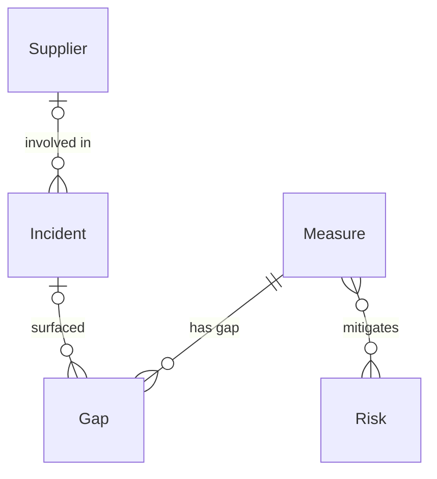

# NIS2 compliance

*A recipe from the Fibery Process Cookbook: the process in plain words, and the model to build it in any tool.*

**Prove the measures are in place, and never miss the incident clock.** For a company in scope of the EU's NIS2 directive. The ten risk-management measures kept effective and signed off by management, and every significant incident reported inside its 24-hour, 72-hour and one-month deadlines.

## The idea

NIS2 is the EU's cybersecurity law for the sectors a country can't afford to see go dark: energy, transport, health, water, digital infrastructure and more. It splits the companies it covers into **essential** and **important entities**, and asks three things of both. First, put in place ten **risk-management measures**: risk analysis, incident handling, business continuity, supply-chain security, secure development, a check that the measures actually work, cyber hygiene and training, cryptography, access control, and multi-factor authentication. Second, report a significant incident fast, on a clock with three stages. Third, and new in NIS2, the **management body** must approve those measures and can be held personally liable, so sign-off is part of the process, not a formality.

The hard part isn't knowing the ten measures; it's two standing habits. Each measure has to be shown to work and reviewed on a cadence, not written once and forgotten. And when a significant incident lands, the team is racing three deadlines at once: an early warning within 24 hours of becoming aware, a full notification within 72 hours, and a final report within one month. Miss one and the fine is real.

In any work tool, this becomes a few kinds of linked records: measures that each carry an owner, an effectiveness review date and a management sign-off; incidents that run on a three-deadline clock with a button for each report sent; gaps and risks tracked to closure; and suppliers reviewed on a cycle. People live on a reporting clock that counts down every open incident's next deadline, and a readiness board of measures colored by whether they're effective, due for review or overdue. It's a standing cybersecurity habit with an emergency lane, not a binder written for an auditor.

## How it runs

Follow one incident, *Ransomware on the billing server*, and the measures behind it.

1. **The measures are set and owned.** The **Compliance lead**, who runs the program, lists the ten **Measures** NIS2 requires and gives each an owner. They map each measure to the article point it answers and pick an owner on the team that runs it: *Incident handling* to the security lead, *Supply chain security* to IT, *Cyber hygiene and training* to HR. Each measure that applies is marked **In scope**.
2. **Management approves them.** The **management body**, the directors who answer for the company, review the measures and approve each one. The lead records who approved it and when; an in-scope measure with no sign-off shows red, because under NIS2 the board's approval is the law's, not a courtesy.
3. **Each measure is kept effective.** Every measure carries an **Effectiveness cadence**, how often it must be reviewed, and the owner attaches the proof it works. A measure sits in *Operating* while it runs; its **Review status** turns *Due soon* as the next review nears and *Overdue* once the cadence lapses, and on Mondays the **Review nudge** chases whoever let one go stale. A measure the company stops relying on is moved to *Retired*.
4. **An incident is detected.** The security team sees transactions failing and files on the billing server encrypted. Anyone raises it through the **Report an incident** form, or the incident owner adds it straight away; they set **Detected at** to the moment the company became aware, because that is when every clock starts.
5. **The team decides if it's significant.** The incident owner judges whether it's a significant incident, one that causes serious operational disruption or financial loss, or could affect others. This one is: billing is down. They tick **Significant**, and the three deadlines come alive. An incident judged minor is moved to *Not significant* and the clocks never start.
6. **The 24-hour early warning.** The owner presses **Send early warning**: it stamps **Early warning sent at** to now and moves the incident to *Early warning sent*. The early warning tells the authority an incident has happened and whether it looks malicious or cross-border, nothing more. On the **Reporting clock** the card is red until it's sent, counting down from Detected at.
7. **The 72-hour notification.** Within three days the owner sends the fuller account and presses **Send notification**, which stamps the time and moves the incident to *Notification sent*. The notification carries an initial assessment with severity, impact and any indicators of compromise; if the attack came through a supplier, they link the **Supplier** so the supply-chain picture stays honest.
8. **The one-month final report.** Within a month the owner writes up the root cause, the harm and the fixes, and presses **Send final report**. The incident moves to *Final report sent*. Through all three stages the **Deadline nudge** rule chases the owner every hour while the next deadline is near or past, so no stage slips while people sleep.
9. **It closes, and leaves a gap behind.** Once the authority is satisfied, the owner moves the incident to *Closed*. The lesson, weak backups on the billing server, becomes a **Gap** on the *Business continuity* measure, with an owner and a due date; the owner fixes it and moves it to *Verified*. A gap the company chooses to live with is moved to *Accepted risk* and written up as a **Risk**.
10. **Suppliers and risks are watched.** Each **Supplier** that touches the company's systems carries the date its security was last checked, and turns red on **Supplier reviews** once it's due. A **Risk** in the register names the measures that mitigate it and a treatment, so a known weakness can stay open on purpose without anyone losing track of it.

## What people look at

- **Every morning** — the **Reporting clock**: every open significant incident by its next deadline, the soonest first, red when due soon or overdue. Is anything on the clock right now, and how long is left.
- **Every week** — **Readiness**: in-scope measures grouped by their category, colored by review status, with the owner, management sign-off and open gaps beside each. The weekly review, and the board the lead lives on. **Open gaps**: every gap by state, red when past its due date. The remediation queue.
- **At the board review** — **Management oversight**: every in-scope measure with its owner, whether management has approved it and when, and its review status. What the directors sign off and watch.
- **Any time** — **My measures** for your own measures and their status; **All incidents** for the history, with how each clock was met; **Supplier reviews** for what's due for its security check, red when overdue; the **Risk register** for what the company has chosen to carry; **Report an incident**, a form, so anyone can raise one fast; and the **Readiness by category** report for how ready each group of measures is.
- **How to run NIS2 compliance** — this process on one screen, kept where the team works.

## The rules

These are all the automations; everything else in the story is done by people.

- **Send early warning** (a button on an incident): stamps Early warning sent at to now and moves the incident to *Early warning sent*. One click records exactly when the authority was told, so the 24-hour deadline is provably met.
- **Send notification** (a button on an incident): stamps Notification sent at to now and moves the incident to *Notification sent*.
- **Send final report** (a button on an incident): stamps Final report sent at to now and moves the incident to *Final report sent*.
- **Deadline nudge**: every hour, the owner of every significant incident whose Reporting status is *Due soon* or *Overdue* is notified of its next deadline, so no stage lapses overnight.
- **Review nudge**: every Monday at 09:00, the owner of every in-scope measure whose Review status is *Overdue* is notified to review it and refresh its proof.

No automations in your tool? Then a person does each of these at the same moment, and the promises they keep below become practices.

## What must stay true

Whatever anyone edits, adapts or corrects, these hold; each says what keeps it so.

- ★ Every in-scope measure has an owner and is approved by the management body. Shown on **Management oversight** and **Readiness**, where a measure with no owner or no sign-off is red; under NIS2 the board's approval is a legal duty, so a gap in it is visible before a regulator finds it.
- ★ A measure counts only while it's shown to work: it's reviewed on its cadence, not written once. Kept by the **Review status** formula, which turns *Overdue* the moment the cadence lapses, and the **Review nudge** that chases it; a measure is never green on memory alone.
- ★ A significant incident's three deadlines are never missed: early warning by 24 hours, notification by 72, final report by one month, all counted from Detected at. Shown on the **Reporting clock**, where an incident with an unmet deadline that is near or past is red; kept by the **Deadline nudge** that chases the owner every hour, and the three send buttons that stamp exactly when each report went out.
- ★ The clock starts when the company became aware, not when the record was made. A practice: the incident owner sets Detected at to the moment of awareness, and every deadline formula counts from it; a record created late still shows its true remaining time.
- A gap is tracked to closure or formally accepted, never lost. Shown on **Open gaps**, where a gap past its due date is red; a gap the company accepts becomes a *Risk* with a named treatment, so nothing just disappears from the board.
- Direct suppliers are assessed on a cycle. Shown on **Supplier reviews**, where a supplier past its next review date is red; the review itself, and setting the next date, is the owner's. An incident caused through a supplier links back to it, so the supply-chain picture stays honest.

## Making it yours

Decide these before you set it up; each has a default if you shrug.

| Question | Default | If not the default |
|---|---|---|
| Essential entity or important entity? | Essential | Important: supervision is lighter and fines lower, but the ten measures and the incident clock are the same, so set the entity's own classification in How to run NIS2 compliance and change nothing in the model |
| Which measures are in scope? | All ten | Mark any the company doesn't need out of scope on Measure; Readiness and the Review nudge only ever show in-scope ones |
| Do you already track vendors, people or teams in your tool? | — | Link measures and incidents to the owners you already track, and point Supplier at your existing vendor or supplier database instead of a new one |
| Do you run several legal entities or sites under one program? | One | Add an Entity field on Measure and on Incident for which one it covers, and filter Readiness and the Reporting clock by it |

- **A small security team instead of a large company:** one or two people own everything, so the owner fields all point at them; keep the registers, drop the My measures view, and the Readiness board and Reporting clock are the whole job.
- **Other frameworks alongside NIS2** (ISO 27001, SOC 2, DORA): add their names as options on Category, or a Framework field on Measure, and one measure can satisfy several; a second full register is rarely worth it.
- **Other words:** "Controls" or "Safeguards" for measures, "Findings" or "Non-conformities" for gaps: rename freely. The mechanics are the ten measures, the review cadence and the three-deadline clock, not the vocabulary.
- **A management training log** (Article 20 asks the board to be trained, not just to approve): add a Training database, or a Trained on date on each management person you track, and a reminder when it's due; left out so the first setup stays on the measures and the clock.
- **What teams add once it runs:** a drill that walks a fake incident through the clock to time the team, a My gaps list for each owner, a monthly report of how readiness moved, and a link from each measure to the system or policy that implements it. Each is left out so the first months stay simple.

## Details for building

What follows is what the process is built from, in words any tool can follow; the story above is enough to run it.

Each kind of record (Measure, Incident, Gap) is a database or a table, depending on the tool, or a tab in a spreadsheet. A relation links two kinds; its inverse is the name it has on the other side. A state is a step in a workflow, and a finished state ends it. A rule is an automation, a button is an automation someone presses, and a formula is a field the tool computes. A nested view shows each record's children beneath it; where a tool can't nest, group the children by their parent instead.

A measure has many gaps and is mitigated by any number of risks, and a risk by any number of measures; an incident may surface any number of gaps, and a gap may trace to one incident; an incident may involve one supplier, and a supplier any number of incidents.

**Who sees what.** Incident, Gap and Risk: the security and compliance team and each item's owner, because they describe live attacks and unremediated weaknesses that shouldn't be open to everyone in the company. Measure and Supplier are open to everyone who runs the program.

### Measure

One of the risk-management measures NIS2 requires, mapped to the law. Comments on. The description holds what the measure requires and how the company meets it.

| Field | Type | Why |
|---|---|---|
| Category | single select: Risk analysis, Incident handling, Business continuity, Supply chain security, Secure development, Effectiveness assessment, Cyber hygiene and training, Cryptography, Access control, Multi-factor authentication; default Risk analysis | Which of the ten measures it is; Readiness groups and the report colors by it |
| Reference | text | The article point it answers, like Article 21(2)(d); what a regulator cites |
| Owner | person; inverse **Owned measures** | Who runs the measure and keeps its proof; the Review nudge goes to them |
| In scope | checkbox; default on | Whether it's part of the program; Readiness and the Review nudge show only in-scope measures |
| Approved by | person; inverse **Approved measures** | The member of the management body who signed it off; empty until the board approves |
| Approved on | date | When management approved it; empty until then, so an unapproved measure is visible |
| Effectiveness cadence | single select: Monthly, Quarterly, Annually; default Quarterly | How often the measure must be reviewed to show it still works; the interval the clock counts |
| Last reviewed | date | When its effectiveness was last checked; set by the owner at each review; what Review due on reads |
| Proof | files | The latest evidence the measure operates, attached by the owner |

States: Planned → Operating → Retired (finished). Default: Planned.

Formulas:
- **Review due on** — Last reviewed (today when there's none) plus the cadence interval (Monthly 31 days, Quarterly 92, Annually 366), a date; so a measure never reviewed is due now.
- **Review status** — *Overdue* when the measure is *Operating* and Review due on is today or past, *Due soon* when it's within 14 days, else *Fresh*; the value Readiness colors by and the Review nudge fires on.
- **Approved** — yes when Approved by is set and Approved on has a date, no otherwise; the flag Management oversight and Readiness show red when it's no for an in-scope measure.
- **Open gaps** — how many of the measure's gaps aren't finished, a whole number, 0 with none; shown beside the measure on Readiness.

### Incident

One security incident, from detection through the reporting clock. Comments on. The description holds what happened, the assessment, and what each report to the authority said.

| Field | Type | Why |
|---|---|---|
| Detected at | date-time | The moment the company became aware; every deadline counts from here, so it's set to the true time, not when the record was made |
| Significant | checkbox; default off | Whether it's a significant incident under NIS2; only then do the deadlines apply |
| Impact | single select: Low, Medium, High, Severe; no default | How bad the disruption is; sorts and colors the Reporting clock |
| Owner | person; inverse **Owned incidents** | Who drives the incident and its deadlines; the Deadline nudge goes to them |
| Early warning sent at | date-time | When the 24-hour early warning went out; stamped by Send early warning |
| Notification sent at | date-time | When the 72-hour notification went out; stamped by Send notification |
| Final report sent at | date-time | When the one-month final report went out; stamped by Send final report |
| Supplier | relation, many-to-one → Supplier; inverse **Incidents** | The supplier involved, when the incident came through the supply chain |

States: Detected → Early warning sent → Notification sent → Final report sent → Closed (finished) · Not significant (finished). Default: Detected.

Formulas:
- **Early warning due** — Detected at plus 24 hours, a date-time; 999 days out with no Detected at, so nothing looks urgent.
- **Notification due** — Detected at plus 72 hours, a date-time; 999 days out with no Detected at.
- **Final report due** — Detected at plus 30 days, a date-time; 999 days out with no Detected at.
- **Next deadline** — the earliest of the three due times whose stage hasn't been sent yet (Early warning due while not past *Detected*, then Notification due, then Final report due), a date-time; empty, far in the future, when the incident is *Not significant*, *Closed* or has all three reports sent, so only live obligations show. Drives the Reporting clock sort.
- **Reporting status** — *Overdue* when the incident is significant and open and Next deadline is today or past, *Due soon* when Next deadline is within 8 hours, *Done* when the final report is sent or the incident is closed, else *On track*; colors the Reporting clock cards and the Deadline nudge fires on it.

### Gap

One weakness in a measure, to close before it bites. Comments on. The description holds what's wrong and the remediation plan.

| Field | Type | Why |
|---|---|---|
| Measure | relation, many-to-one → Measure; inverse **Gaps** | Which measure the gap is in |
| Incident | relation, many-to-one → Incident; inverse **Gaps** | The incident that surfaced it, when it came from one |
| Severity | single select: Low, Medium, High; no default | How bad it is; sorts the remediation queue |
| Owner | person; inverse **Owned gaps** | Who fixes it |
| Due date | date | When it must be closed by |

States: Open → In progress → Verified (finished) · Accepted risk (finished). Default: Open. An *Accepted risk* gap is written up as a Risk.

Formulas:
- **Overdue** — yes when the gap isn't finished and Due date is past, no otherwise and no with no date; colors the Open gaps cards red.

### Risk

One risk in the register. Comments on. The description holds the risk and its rationale.

| Field | Type | Why |
|---|---|---|
| Owner | person; inverse **Owned risks** | Who answers for it |
| Level | single select: Low, Medium, High; no default | Its severity, judged from likelihood and impact; the Risk register groups by it |
| Treatment | single select: Mitigate, Accept, Transfer, Avoid; no default | What the company does about it |
| Measures | relation, many-to-many → Measure; inverse **Risks** | The measures that mitigate it |

States: Open → Treated → Accepted (finished) · Closed (finished). Default: Open.

### Supplier

One third party whose products or access touch the company's systems. Comments on. The description holds what it provides and the access it has.

| Field | Type | Why |
|---|---|---|
| Owner | person; inverse **Owned suppliers** | Who owns the relationship and its review |
| Criticality | single select: Low, Medium, High; no default | How much the company depends on it; sorts the review list |
| Last reviewed | date | When its security was last checked |
| Next review | date | When it's due again, set by the owner at each review; Supplier reviews sorts by it |
| Report | files | The supplier's own security attestations or questionnaire |

States: Prospective → Approved → Offboarded (finished). Default: Prospective.

Formulas:
- **Review overdue** — yes when the supplier is *Approved* and Next review is past, no otherwise and no with no date; colors Supplier reviews red.

### Views

| View | Type | Of | Grouping | Shows | Filter | Sort |
|---|---|---|---|---|---|---|
| Reporting clock | board | Incident | columns State | Impact, Detected at, Next deadline, Owner, Supplier; cards red when Reporting status is Due soon or Overdue | Significant is on; State is not Closed or Not significant | Next deadline asc |
| Readiness | board | Measure | columns Category | Owner, Review status, Approved, Open gaps; color by Review status, red when not Approved | In scope is on | |
| Open gaps | board | Gap | columns State | Measure, Severity, Owner, Due date; cards red when Overdue | State is Open or In progress | Severity desc |
| Management oversight | grid | Measure | Category | Owner, Approved by, Approved on, Approved, Review status | In scope is on | Category |
| My measures | list | Measure | | Category, Review status, Review due on, Open gaps | Owner is me; In scope is on | Review due on asc |
| All incidents | grid | Incident | | Impact, Detected at, Early warning sent at, Notification sent at, Final report sent at, Supplier, State | | Detected at desc |
| Supplier reviews | grid | Supplier | | Owner, Criticality, Last reviewed, Next review; red when Review overdue | State is Approved | Next review asc |
| Risk register | grid | Risk | Level | Owner, Treatment, Measures, State | State is Open or Treated | |
| Report an incident | form | Incident | | Name (required), Detected at (required), Impact, Description | | |
| How to run NIS2 compliance | document | | | the process on one screen, linking to this recipe | | |

### App

None needed. The central moment is the morning look at the Reporting clock, every open significant incident counting down to its next deadline, which a board sorted by that deadline and colored by urgency shows; the standing readiness is the Readiness board, measures by category colored by review status, and readiness per category at a glance is the Readiness by category report.

### Reports

**Readiness by category** — source Measure, current, only in-scope measures: a stacked bar of measures by Category, colored by Review status. Each bar is one of the ten measures' categories, and the fresh share is how ready it is.

### Sample story

The program is four months old. Nine of the ten measures are *Operating* and board-approved; Cryptography is still *Planned* and unapproved, and Supply chain security is overdue for its quarterly review with an open high gap. Ransomware on the billing server was detected eight days ago: it's significant, the early warning and notification went out on time, so it sits in *Notification sent* with its final report due in three weeks, linked to the hosting supplier it came through. Three gaps are open, one overdue and one accepted as a medium risk. Of six approved suppliers, one is a week overdue for its check. Readiness sits near eighty percent, and the lead is clearing the reds before the review.

## Sources

- [Directive (EU) 2022/2555 (the NIS2 Directive)](https://eur-lex.europa.eu/eli/dir/2022/2555/oj), European Parliament and Council, 2022: the directive itself, its measures (Article 21), its incident reporting stages (Article 23) and management accountability (Article 20); the law the recipe is built on.
- [NIS2 Directive Overview: an in-depth look at Articles 21 and 23](https://eye.security/blog/nis2-directive-articles-21-23/), Eye Security: how the ten risk-management measures and the three reporting deadlines work in practice.
- [NIS2 Applicability: Essential vs Important Entities](https://www.glocertinternational.com/resources/guides/nis2-applicability-essential-vs-important-entities/), Glocert International: how the two entity classes differ in scope and supervision, which the recipe keeps to a setup choice.

## Build it

In Fibery, open Claude with the Fibery plugin, attach this recipe and say "set up NIS2 compliance". Claude asks a few questions, then sets it up in about ten minutes.

Anywhere else, give this recipe to your AI assistant and name your tool, or build it by hand from Details for building.

---

*NIS2 is Directive (EU) 2022/2555 of the European Parliament and of the Council, available at eur-lex.europa.eu. This recipe describes the process in its own words and isn't affiliated with or endorsed by the European Union or any national authority; it is not legal advice. From the Fibery Process Cookbook (https://github.com/Fibery-inc/process-cookbook), licensed CC BY 4.0 (https://creativecommons.org/licenses/by/4.0/): copy, adapt and build it anywhere, crediting the cookbook.*
