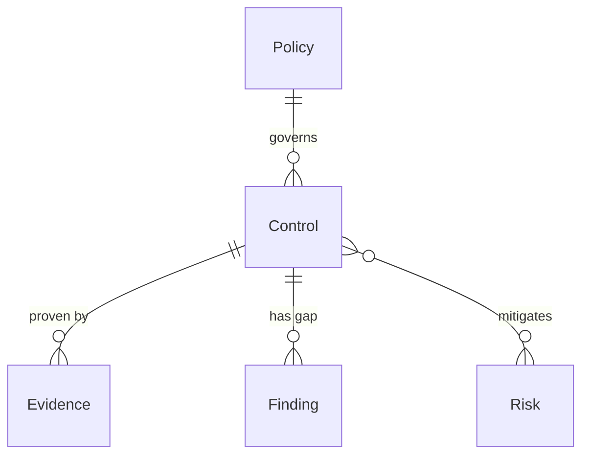

# SOC 2 compliance

*A recipe from the Fibery Process Cookbook: the process in plain words, and the model to build it in any tool.*

**Know you're audit ready every day, not the week before.** For a company getting a SOC 2 Type II report. Every control mapped to a criterion, its evidence kept fresh and its gaps closed, so the observation window holds no surprises.

## The idea

Most teams fail their first SOC 2 the same way: they gather evidence in a panic the month before, and the auditor finds a control that quietly lapsed in the middle of the period. A Type II report doesn't ask whether a control exists today; it asks whether it operated across a window of three to twelve months. So readiness is a habit, not a sprint. Every requirement is a **Control**, mapped to one of the five **Trust Services Criteria**: Security, the common criteria every company needs, plus Availability, Processing Integrity, Confidentiality and Privacy. Each control has an **Owner** and a cadence, and is backed by **Evidence**, the proof it operated, which goes stale on that cadence and has to be refreshed. A gap is a **Finding**, tracked to closure or formally accepted. The **Audit** frames the observation window and its deadline.

In any work tool, this becomes a few kinds of linked records: controls whose evidence carries a freshness clock, evidence and findings under each control, policies and vendors reviewed on a cycle, and risks the controls mitigate. People live on a readiness board of controls by criterion, colored by whether the evidence is fresh, due soon or overdue, and a weekly nudge chases whoever let a control go stale. It's a standing habit of proof, not a binder assembled the night before fieldwork.

## How it runs

Follow one control, *Quarterly access reviews*, through a window.

1. **The scope is set.** The **Compliance lead**, who owns the program, decides which controls are in scope for this audit and maps each to its criterion. Quarterly access reviews is a Security control, marked *In scope*, tied to the current **Audit**, whose observation window runs the next twelve months.
2. **A control gets an owner and a cadence.** The lead gives each control an owner on the team that runs it, here the IT lead, and an **Evidence cadence**, how often proof must be refreshed: *Quarterly* for this one. The cadence is the clock the whole process runs on.
3. **Evidence is logged.** Every quarter the owner runs the access review and presses **Log evidence**, a button that creates an **Evidence** record dated today; they attach the export and name what it shows. The control sits in *Operating* while the window runs, and fresh proof resets its clock; a control the company stops using is moved to *Retired* and dropped from scope.
4. **The clock ticks.** Each control shows an **Evidence status**: *Fresh* while the last evidence is within its cadence, *Due soon* in the last stretch, *Overdue* once the cadence has passed or no evidence exists. On Mondays the **Evidence nudge** rule tells the owner of every overdue in-scope control to collect proof, so nothing lapses unseen mid-window.
5. **The auditor checks the evidence.** During fieldwork the auditor samples evidence across the whole window, not just the latest. The lead marks each sampled record *Accepted* or, if it won't do, *Rejected*; rejected evidence stops counting, so the control goes overdue until it's re-collected.
6. **A gap becomes a finding.** When a control has no working evidence, or anyone spots a weakness through the **Report a gap** form, it's a **Finding** on that control, with a severity, an owner and a due date. The owner remediates and moves it to *Verified*; the **Finding nudge** rule chases any that run past their date. A gap the company chooses to live with is moved to *Accepted risk* and written up as a **Risk**.
7. **Policies and vendors come due.** Each **Policy**, once *Published*, names the controls it governs and carries a next review date; each **Vendor**, an *Approved* third party that touches customer data, carries the date its security was last checked. Both turn red on their review lists once the date passes, and the owner reviews and sets the next date.
8. **Risks are weighed.** A **Risk** in the register names the controls that mitigate it and a treatment, mitigate, accept, transfer or avoid; once there's a plan it moves to *Treated*. An accepted risk is why a known gap can stay open without failing the program.
9. **The readiness review.** Every week the lead and owners open the readiness board: controls by criterion, colored by evidence status, with open findings beside each. **Ready**, the share of in-scope controls with fresh evidence and no open findings, is the one number that says whether the window is safe. They fix the reds before the auditor samples them.

## What people look at

- **Every morning** — **Evidence due**: every in-scope control whose evidence is overdue or due soon, by owner, the most overdue first. What to collect today.
- **Every week** — **Readiness**: in-scope controls grouped by criterion, colored by evidence status, with the owner and open findings. The readiness review, and the one board the lead lives on. **Open findings**: every gap by state, red when past its due date. The remediation queue.
- **Any time** — **My controls** for your own controls and their status; **Policy reviews** and **Vendor reviews** for what's due for its yearly look, red when overdue; the **Risk register** for what the company has chosen to carry; **Audits** for the window and the days left in it; **Report a gap**, a form, so anyone can raise a weakness; and the **Readiness by criterion** report for how ready each category is.
- **How to run SOC 2 compliance** — this process on one screen, kept where the team works.

## The rules

These are all the automations; everything else in the story is done by people.

- **Log evidence** (a button on a control): creates an Evidence record linked to the control, dated today, and in *Pending*. The owner attaches the proof and says what it shows. Collecting evidence is one click, and the date is never typed.
- **Evidence nudge**: every Monday at 09:00, the owner of every in-scope control whose Evidence status is *Overdue* is notified to collect fresh evidence.
- **Finding nudge**: every Monday at 09:00, the owner of every finding that is still open and past its due date is notified.

No automations in your tool? Then a person does each of these at the same moment, and the promises they keep below become practices.

## What must stay true

Whatever anyone edits, adapts or corrects, these hold; each says what keeps it so.

- ★ Every in-scope control maps to a Trust Services Criterion and has an owner. Shown on **Readiness**, where a control with no owner or no criterion sits in its own column, so a gap in the scope is visible before the auditor finds it.
- ★ A control counts as met only with current evidence; across a Type II window the evidence has to stay fresh, not just exist today. Kept by the **Evidence status** formula, which turns *Overdue* the moment the cadence lapses, and the **Evidence nudge** that chases it; a control is never green on memory alone.
- Rejected evidence doesn't count. Kept by **Evidence due on**, which ignores *Rejected* evidence, so a control the auditor pushed back on goes overdue until fresh proof is collected.
- ★ A gap is tracked to closure or formally accepted, never lost. Shown on **Open findings**, where a finding past its due date is red; a gap the company accepts becomes a *Risk* with a named treatment, so nothing just disappears from the board.
- Readiness is visible before the window closes, not after. Shown on **Readiness** and the **Readiness by criterion** report, where **Ready**, the share of in-scope controls with fresh evidence and no open findings, is the number the lead watches against the days left on the **Audit**.
- Policies and vendors are reviewed on their cycle. Shown on **Policy reviews** and **Vendor reviews**, where anything past its next review date is red; the review itself, and setting the next date, is the owner's.

## Making it yours

Decide these before you set it up; each has a default if you shrug.

| Question | Default | If not the default |
|---|---|---|
| Which Trust Services Criteria are in scope? | Security only | Add Availability, Processing Integrity, Confidentiality or Privacy: they're already options on Criteria, so mark the extra controls in scope and the Readiness board gains their columns |
| Type II, or a Type I point in time? | Type II | Type I: evidence is gathered once, so drop the cadence, the Evidence nudge and the freshness clock, and read the control as met when it has any accepted evidence |
| Do you already track vendors, people or teams in your tool? | — | Link controls to the owners you already track, and point Vendor at your existing vendor or supplier database instead of a new one |
| Do you run several products or legal entities under one program? | One | Add a Scope field on Control for which entity it covers, and filter Readiness by it |

- **A small security team instead of a company:** one or two people own everything, so the owner fields all point at them; keep the registers, drop the My controls view, and the Readiness board is the whole job.
- **A compliance platform already pulling evidence** (an automated scanner): keep this as the control, owner and readiness layer, and paste or link the scanner's exports as Evidence; the cadence and the findings still live here.
- **Other words:** "Requirements" or "Safeguards" for controls, "Exceptions" or "Gaps" for findings: rename freely. The mechanics are the criteria, the evidence clock and the findings, not the vocabulary.
- **Other frameworks alongside SOC 2** (ISO 27001, HIPAA): add their names as options on Criteria, or a Framework field on Control, and one control can satisfy several; a second full register is rarely worth it.
- **What teams add once it runs:** an evidence request list exported for the auditor, a My findings list for each owner, a monthly report of how readiness moved, and a link from each control to the system it runs on. Each is left out so the first window stays simple.

## Details for building

What follows is what the process is built from, in words any tool can follow; the story above is enough to run it.

Each kind of record (Control, Evidence, Finding) is a database or a table, depending on the tool, or a tab in a spreadsheet. A relation links two kinds; its inverse is the name it has on the other side. A state is a step in a workflow, and a finished state ends it. A rule is an automation, a button is an automation someone presses, and a formula is a field the tool computes. A nested view shows each record's children beneath it; where a tool can't nest, group the children by their parent instead.

A policy governs any number of controls, and each control is governed by at most one; a control has many pieces of evidence and many findings; a risk is mitigated by any number of controls, and a control mitigates any number of risks. The Audit record frames the window, and Vendor is a standalone register.

**Who sees what.** Finding and Risk: the compliance team and each item's owner, because they describe unremediated weaknesses that shouldn't be open to everyone in the company. Control, Evidence, Policy, Vendor and Audit are open to everyone who runs the program.

### Control

One requirement the audit will test, mapped to a criterion. Comments on. The description holds what the control requires and how it's met.

| Field | Type | Why |
|---|---|---|
| Criteria | single select: Security, Availability, Processing Integrity, Confidentiality, Privacy; default Security | Which Trust Services Criterion it serves; Readiness groups and the report colors by it |
| Reference | text | The criterion point it maps to, like CC6.1 or A1.2; what the auditor cites |
| Owner | person; inverse **Owned controls** | Who runs the control and collects its evidence; the Evidence nudge goes to them |
| Evidence cadence | single select: Continuous, Monthly, Quarterly, Annually; default Quarterly | How often evidence must be refreshed; the interval the clock counts |
| In scope | checkbox; default on | Whether it's part of the current audit; Readiness and Evidence due show only in-scope controls |
| Policy | relation, many-to-one → Policy; inverse **Controls** | The policy that governs it |

States: Planned → Operating → Retired (finished). Default: Planned.

Formulas:
- **Evidence due on** — the latest date among the control's evidence that isn't *Rejected* (today when there's none) plus the cadence interval (Continuous 7 days, Monthly 31, Quarterly 92, Annually 366), a date; so a control with no evidence is due now, and a rejected item doesn't push the date out.
- **Evidence status** — *Overdue* when Evidence due on is today or past, *Due soon* when it's within 14 days, else *Fresh*; the value Readiness and Evidence due color by and the Evidence nudge fires on.
- **Open findings** — how many of the control's findings aren't finished, a whole number, 0 with none; shown beside the control on Readiness.
- **Ready** — yes when In scope, Evidence status is *Fresh* and Open findings is 0; no otherwise; what the Readiness by criterion report counts.

### Evidence

One piece of proof that a control operated, on a date. Comments on.

| Field | Type | Why |
|---|---|---|
| Control | relation, many-to-one → Control; inverse **Evidence** | What it proves |
| Collected on | date | The day the proof is dated; set to today by Log evidence; what Evidence due on reads |
| Collected by | person; inverse **Collected evidence** | Who produced it |
| Proof | files | The export, screenshot or report the auditor will sample |

States: Pending → Accepted (finished) · Rejected (finished). Default: Pending. Rejected evidence is left out of Evidence due on, so a pushed-back item makes its control overdue.

### Finding

One gap in a control, to close before the audit. Comments on. The description holds what's wrong and the remediation plan.

| Field | Type | Why |
|---|---|---|
| Control | relation, many-to-one → Control; inverse **Findings** | Where the gap is |
| Severity | single select: Low, Medium, High; no default | How bad it is; sorts the remediation queue |
| Owner | person; inverse **Owned findings** | Who fixes it; the Finding nudge goes to them |
| Due date | date | When it must be closed by |

States: Open → In progress → Verified (finished) · Accepted risk (finished). Default: Open. An *Accepted risk* finding is written up as a Risk.

Formulas:
- **Overdue** — yes when the finding isn't finished and Due date is past, no otherwise and no with no date; colors the Open findings cards red and drives the Finding nudge.

### Policy

One policy document the program maintains. Comments on. The description holds the policy text.

| Field | Type | Why |
|---|---|---|
| Owner | person; inverse **Owned policies** | Who maintains and reviews it |
| Last reviewed | date | When it was last reviewed |
| Next review | date | When it's due again, set by the owner at each review; Policy reviews sorts by it |

States: Draft → Published → Retired (finished). Default: Draft.

Formulas:
- **Review overdue** — yes when the policy is *Published* and Next review is past, no otherwise and no with no date; colors Policy reviews red.

### Vendor

One third party that touches customer data. Comments on. The description holds what data it handles and how.

| Field | Type | Why |
|---|---|---|
| Owner | person; inverse **Owned vendors** | Who owns the relationship and its review |
| Last reviewed | date | When its security was last checked |
| Next review | date | When it's due again, set at each review; Vendor reviews sorts by it |
| Report | files | The vendor's own SOC 2 or security documents |

States: Prospective → Approved → Offboarded (finished). Default: Prospective.

Formulas:
- **Review overdue** — yes when the vendor is *Approved* and Next review is past, no otherwise and no with no date; colors Vendor reviews red.

### Risk

One risk in the register. Comments on. The description holds the risk and its rationale.

| Field | Type | Why |
|---|---|---|
| Owner | person; inverse **Owned risks** | Who answers for it |
| Level | single select: Low, Medium, High; no default | Its severity, judged from likelihood and impact; the Risk register groups by it |
| Treatment | single select: Mitigate, Accept, Transfer, Avoid; no default | What the company does about it |
| Controls | relation, many-to-many → Control; inverse **Risks** | The controls that mitigate it |

States: Open → Treated → Accepted (finished) · Closed (finished). Default: Open.

### Audit

One audit engagement and its observation window. No description. Fields: Type (single select: Type I, Type II; default Type II); Window (date range, the observation period the controls must operate across); Auditor (text, the firm). States: Planning → Observation → Fieldwork → Reported (finished). Default: Planning.

Formulas:
- **Days left** — days from today to the end of Window, a whole number, negative once it's over, 999 with no window so nothing looks urgent; shown on Audits, the countdown the readiness review watches.

### Views

| View | Type | Of | Grouping | Shows | Filter | Sort |
|---|---|---|---|---|---|---|
| Evidence due | grid | Control | | Owner, Criteria, Evidence cadence, Evidence due on, Evidence status | In scope is on; Evidence status is Due soon or Overdue | Evidence due on asc |
| Readiness | board | Control | columns Criteria | Owner, Evidence due on, Open findings; color by Evidence status | In scope is on | |
| Open findings | board | Finding | columns State | Control, Severity, Owner, Due date; cards red when Overdue | State is Open or In progress | Severity desc |
| My controls | list | Control | | Criteria, Evidence status, Evidence due on, Open findings | Owner is me; In scope is on | Evidence due on asc |
| Policy reviews | grid | Policy | | Owner, Last reviewed, Next review; red when Review overdue | State is Published | Next review asc |
| Vendor reviews | grid | Vendor | | Owner, Last reviewed, Next review; red when Review overdue | State is Approved | Next review asc |
| Risk register | grid | Risk | Level | Owner, Treatment, Controls, State | State is Open or Treated | |
| Audits | list | Audit | | Type, Window, Auditor, Days left, State | | Days left asc |
| Report a gap | form | Finding | | Name (required), Control (required), Severity, Description | | |
| How to run SOC 2 compliance | document | | | the process on one screen, linking to this recipe | | |

### App

None needed. The central moment is the weekly readiness review, and the Readiness board, controls by criterion colored by evidence status, shows it; the one thing a board can't give, readiness per category at a glance, is the Readiness by criterion report.

### Reports

**Readiness by criterion** — source Control, current, only in-scope controls: a stacked bar of controls by Criteria, colored by Ready. Each bar is a category, and the green share is how ready it is for the auditor.

### Sample story

The twelve-month window opened two months ago, ten to go. Security has fourteen in-scope controls: most are fresh, Quarterly access reviews was just logged, two are due soon and one, log retention, is overdue with an open high finding on it. Availability and Confidentiality are in scope too, Processing Integrity and Privacy are not. Three findings are open, one past its due date; a fourth was accepted last week and carried into the register as a medium risk. Two policies are published with one due for review next month, and of five approved vendors one is a week overdue for its yearly check. Readiness across the in-scope controls sits near eighty percent, and the lead is clearing the reds before fieldwork.

## Sources

- [2017 Trust Services Criteria (with revised points of focus, 2022), TSP Section 100](https://www.aicpa-cima.com/resources/download/2017-trust-services-criteria-with-revised-points-of-focus), AICPA: the five categories, the common criteria and what each control must address; the standard the recipe is built on.
- [SOC 2 Trust Services Criteria: 5 Categories, 61 Criteria](https://soc2auditors.org/insights/soc-2-trust-services-criteria/), SOC 2 Auditors: how Security's common criteria and the four added categories break down in practice, and which are optional.
- [A SOC 2 Evidence Collection Guide for a Successful Audit](https://soc2auditors.org/insights/soc-2-evidence-collection-guide/), SOC 2 Auditors: evidence gathered across the observation window and sampled by the auditor, which is why Type II needs the freshness clock.

## Build it

In Fibery, open Claude with the Fibery plugin, attach this recipe and say "set up SOC 2 compliance". Claude asks a few questions, then sets it up in about ten minutes.

Anywhere else, give this recipe to your AI assistant and name your tool, or build it by hand from Details for building.

---

*SOC 2® is a framework of the American Institute of Certified Public Accountants (AICPA), defined by its Trust Services Criteria (TSP Section 100), available at aicpa-cima.com. This recipe describes the process in its own words and isn't affiliated with or endorsed by the AICPA. From the Fibery Process Cookbook (https://github.com/Fibery-inc/process-cookbook), licensed CC BY 4.0 (https://creativecommons.org/licenses/by/4.0/): copy, adapt and build it anywhere, crediting the cookbook.*
