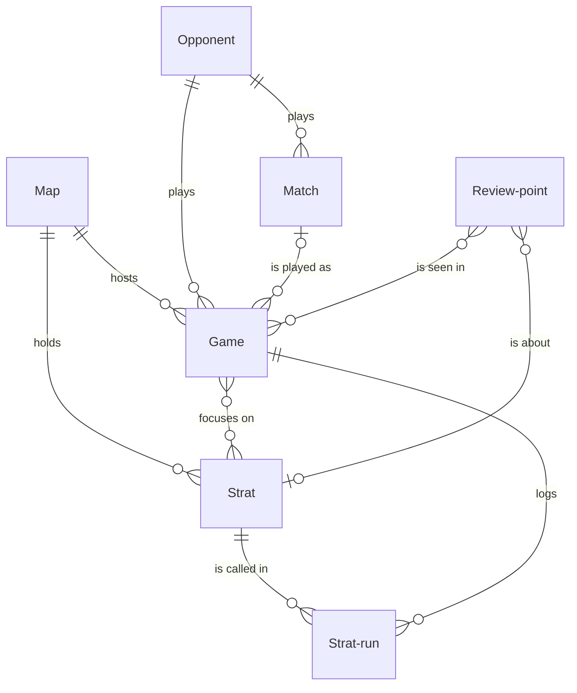

# CS2 team practice

*A recipe from the Fibery Process Cookbook: the process in plain words, and the model to build it in any tool.*

**Every scrim has a purpose, every game is reviewed by the next morning, and every strat earns its place in officials.** For a professional Counter-Strike 2 team: coach, in-game leader, analyst and five players. How such a team practises, from the strat book to match day. Source: a coach's account of the pro practice day, https://community.skin.club/en/news/scrim-culture-in-counter-strike-how-pro-teams-improve-faster-by-golden

## The idea

Teams rarely fall behind for lack of practice hours. They fall behind when scrims, the practice games against other teams, become games played for the score, demos, the recordings of those games, go unwatched, the same mistake costs the same round every week, and a strat reaches an official, a match that counts, because it worked once in practice. Coaches describe the cure in much the same terms: decide what each game is for, play it, review it by the next morning, and change the plays and habits from what the review found.

A **Strat** is one play the team owns: a T side default, execute or fake, a CT setup or retake, or a pistol or anti eco plan for either side. Together the strats are the team's strat book; each moves from idea to theory to testing in scrims, and none reaches an official by accident. Every map played, scrim or official, is a **Game**, with a focus before it and a review after. Each call of a strat in a game is a **Strat run**, won or lost, so the book knows what works. What a review finds is a **Review point**, open until it stops happening. Each **Map** of the competitive pool carries the team's stance on it for the veto, where the two teams remove maps in turn before a match. Before each **Match**, an official series, the analyst preps against the **Opponent**, any team the team scrims or plays. Four roles run it. The **coach** runs the loop. The **IGL**, the in-game leader who calls the strats, keeps the book. The **analyst** reviews and scouts. Each of the five **players** owns their review points.

In any work tool, this becomes several kinds of linked records: strats whose workflow runs from *Idea* through *Testing* to *Match ready*, games planned with focus strats and reviewed round by round on a tab of their own, review points that reopen when the mistake returns, and a board of the strat book that shows green only the strats with the runs to show for it. It's a practice system, not a stats tool: the demo tool counts the kills, and this is where the team decides what to practise next.

## How it runs

Follow one strat, *Palace split*, from an idea to an official.

1. **An idea is written down.** After watching another team's demo, the IGL adds a strat in *Idea*: Palace split, a Mirage A take through palace and ramp at once. It has its map, its **Side**, *T*, and its **Form**, *Execute*. The IGL is its **Owner** and keeps it current.
2. **It's drawn up and walked through.** The IGL writes it in the Description under five headings, Setup, Utility, Timing, Calls and If it fails, and moves it to *Theory*. In the daily theory hour the five players walk it through on an empty server until the smokes land on time.
3. **The week is planned.** The coach gives every opponent a **Scrim rating**, *Good*, *Fine* or *Avoid*, the last for teams that cancel, and on Monday books the week's scrims with good and fine ones. The coach adds each map to be played as a game in *Planned*, with its date, its **Kind** and its **Reviewer**, usually the analyst. An *Improvement scrim* tests new things and may well be lost; a *Result scrim*, near an event, is played like an official with ready strats only; an *Official* is a map of a match. Tuesday's Mirage scrim against Kestrel is for improvement, and its **Focus strats**, what the game is for, are Palace split and two CT setups; three is the most a game can test. A scrim that falls through, the coach moves to *Cancelled*.
4. **The scrim.** At Tuesday's morning meeting the team opens **Today**, the day's games with their focus. In the scrim the IGL calls Palace split three times. Kestrel now has the demo, as every scrim partner does, and a play spreads fast once it's been shown. That is why the IGL ticks **Pocket** on some strats: walked through, but kept out of scrims until an official that matters.
5. **The review.** The reviewer opens the game's demo and **Round review**, the app on every game, with the team. They set the **Starting side**, *CT*, so rounds 13 to 24 are the T half, and enter both scores; Round review moves the game to *Played*. Then they tag the rounds where a book strat was called: Palace split in rounds 14, 18 and 21, won, lost, won. Each tag is a strat run, and the first one makes the **Testing starts** rule move Palace split to *Testing*; had Palace split been a pocket strat, the **Pocket shown** rule would untick Pocket, because Kestrel now has the demo. The reviewer presses Done in Round review, which moves the game to *Reviewed*; a game still unreviewed at 10:00 the next morning sends its reviewer the **Review reminder**, every morning until it's reviewed.
6. **What the review found.** In round 18 the jungle smoke landed late. The reviewer adds a review point, "Late jungle smoke on Palace split", with its strat, its **Players**, the support who throws it, and its **Area**, *Utility*; the other areas are *Positioning*, *Timing*, *Comms*, *Economy* and *Mechanics*. The support drills the lineup as homework and moves the point from *Open* to *Working on*. When it happens again two days later, the reviewer adds that game to its **Seen in**, so it has now been seen in two games; at three it turns red on the board, because recurring mistakes matter more than one-off misplays. After a clean week the coach moves it to *Fixed*, and the **Seen again** rule reopens it if it comes back. A point not worth the time, the coach moves to *Dropped*.
7. **The strat earns its place.** Two weeks later Palace split has **Runs** 7 and a **Win rate** of 57 percent, and on the **Strat book**, every strat by stage, map by map, its card is green: at least five runs with at least half of them won is the bar for a proven strat. That bar is a common choice, not a rule of the game; teams set their own. Once the coach agrees, the IGL presses **Clear for officials**, and the strat moves to *Match ready* with its numbers in a comment. The button checks nothing; the green card is the check, and a pocket strat in *Theory* is cleared without runs on purpose, the one deliberate exception. A strat that keeps losing, the IGL sends back to *Theory*; one that opponents have read, or that leaked through scrim demos, the IGL moves to *Retired*.
8. **An official is prepared.** The analyst adds Thursday's match against Ironvale in *Scheduled*, with its date and **Format**, *Bo1*, *Bo3* or *Bo5*, the most maps the series can run to; this one is a Bo3. Three days out the analyst, its **Prep owner**, moves it to *Prep* and writes the prep in its Description: their maps and veto habits, their T and CT sides on the likely maps, and our bans, pick and strats. The analyst also adds what's learned to Ironvale's own Description. The day before, the analyst moves the match to *Ready*.
9. **Match day.** After the veto the analyst adds each map as a game of Kind *Official*, linked to the match and its opponent, with a reviewer. Mirage is our pick, and Palace split wins both rounds it's called in. The next morning the reviewer logs both runs, as after a scrim, and the analyst moves the match to *Played*.
10. **Every Monday, the map pool.** The coach sets each map's **Veto stance**: *Pick*, *Playable*, *Learning* or *Ban*. In a Bo3 each team removes two of the seven maps under [Valve's veto rules](https://github.com/ValveSoftware/counter-strike_rules_and_regs/blob/main/major-supplemental-rulebook.md), so a team needs five it can play. After asking the players, the coach sets each map's **CT confidence** and **T confidence**, *Green*, *Yellow* or *Red*, beside its **Scrim win rate** over the last 30 days. Two weeks into Palace split, Mirage's T side turns green.

## What people look at

- **Every morning** — **Today**: the day's games in order, with kind, map, opponent and focus strats. What are we playing, and why.
- **After every block** of two or three maps against one opponent — **Round review**, the app on each game: the score, the strats called round by round, and what the review found. Until the app is built, **Review queue** does the job: the games waiting for review, oldest first, with strat runs added in place.
- **Every Monday** — **Map pool**: which maps are we ready for, with each map's stance, lights and scrim win rate side by side. **Strat book**: every strat by stage, map by map, proven ones green; what can we call. **Week plan**: who we play, and when.
- **Before an official** — **Match prep**: is the prep done, match by match. **Opponents**: what we know about each team, and whether its scrims are worth booking.
- **Any time** — **My review points**: a player's own open points, most seen first. **Points board**: where the mistakes cluster, recurring ones red. The **Strat success** report: which strats win when called. The **Map form** report: results by map over eight weeks.
- **How to run team practice** — this process on one screen, kept where the team works.

## The rules

These are all the automations; everything else in the story is done by people.

- **Clear for officials** (a button on a strat): moves the strat to *Match ready* with a comment recording its Runs, its Win rate and whether it is a Pocket strat. It checks nothing: the Strat book shows green the strats that have the runs, and clearing one that isn't green is a visible choice.
- **Testing starts**: when a strat run is created and the strat it calls is still in *Idea* or *Theory*, that strat moves to *Testing*.
- **Pocket shown**: when a strat run is created and the strat it calls has Pocket ticked, Pocket is unticked: the demo of that game now has it.
- **Review reminder**: every day at 10:00, the Reviewer of each game dated before today that is neither *Reviewed* nor *Cancelled* is notified, one message per game.
- **Seen again**: when a *Fixed* review point gets another game in Seen in, it moves back to *Open*, with a comment that it was seen again; the newest game in Seen in is the one.

No automations in your tool? Then a person does each of these at the same moment, and the promises they keep below become practices.

## What must stay true

Whatever anyone edits, adapts or corrects, these hold; each says what keeps it so.

- ★ A strat is *Match ready* only with at least five runs and at least half of them won, or as a pocket decision made on purpose. Shown on the **Strat book**, where a strat with the runs is green; **Clear for officials** records the numbers in its comment and checks nothing, so clearing only green strats, or a pocket on purpose, is a practice.
- ★ Every scrim is played for something: a game has its focus strats before it starts, three at most. A practice; the coach sets them when planning the week, and Today shows them at the morning meeting, so a game without any is seen before the server starts.
- ★ Every game is reviewed by the next morning. A practice; the **Review reminder** asks the reviewer at 10:00 each day a past game stays unreviewed, nothing enforces it.
- The strat numbers come from tagged rounds and nothing else. Kept by the formulas **Runs** and **Win rate**: they count the strat's runs, so a run changed or removed in Round review changes the numbers with it, and a round nobody tagged doesn't count. A win rate on fewer than five runs means little; the bar in Clear for officials is there for that.
- ★ A fixed mistake that comes back is open again. Kept by **Seen again**. A point's Seen in keeps every game, before and after the fix, so the count on Points board is its whole history.
- A game is *Played* once both scores are in and *Reviewed* only when its reviewer presses Done. Kept by **Round review**; a reviewer working in Review queue moves the game by hand, a practice. A score corrected later changes the win rates, and the state stays.
- ★ The map pool is set every Monday from the scrim win rates and the players' confidence, not from memory. A practice; Map pool shows the numbers beside each stance, nothing enforces the Monday.

## Making it yours

Decide these before you set it up; each has a default if you shrug.

| Question | Default | If not the default |
|---|---|---|
| Do you play official matches most weeks? | Yes | No, in an off-season or between leagues: there is no prep to run, so drop the Match database and the Match prep view; official games keep Kind *Official* and their opponent, and what you learn about a team goes in the opponent's Description |
| Does your analysis tool already tag rounds with your own strat names? | No | Yes: nobody tags rounds twice; import strat runs from its export, and Round review keeps the score, the halves and the review points |
| Do players keep individual development plans? | No; review points carry the individual work | Yes: each player's points serve a goal; add a Goal database with a player, an area, a target and a review date, and a Goal field on Review point |
| Do you already track opponents or events in your tool? | — | Teams stay where they are: link Game and Match to the existing teams database instead of creating Opponent, and Match to the existing events database |

- **No analyst**: the coach reviews and preps, tags only the rounds where focus strats were called, and keeps the prep to the veto plan and three things per opponent.
- **Two rosters, one strat book**, a main team and an academy: add a Roster field on Game and Review point, and filter Today, Review queue and Points board by it.
- **Bootcamps**: the same model with more games a day; the bootcamp's theme becomes every game's focus strats, and reviews happen the same evening.
- **Valve rotates the pool**: set the departing map's Veto stance to *Out of pool* and keep its strats, because maps come back; Overpass returned in 2025, Anubis and Cache in 2026.
- **Pushed too far**: tagging every round turns review into data entry, so tag only book strats. More than three focus strats in a game, and none gets tested properly. A win rate on fewer than five runs is noise.

## For AI agents

- When asked before the morning meeting, summarize yesterday's games: scores, runs won and lost per strat, new review points, and points seen again.
- Flag strats in *Testing* with five or more runs under a 40 percent win rate, strats in *Testing* past the bar of five runs and half won that aren't cleared yet, result scrims whose focus strats aren't *Match ready*, and scrim win rates built on fewer than three scrims.
- Before an official, draft the prep headings in the match's Description from the opponent's Description and our past games against them, and list which of our strats they have seen. Offer veto options with the numbers; never choose.
- Never log a run nobody tagged, clear or retire a strat, change a map's veto stance or confidence lights, or move a point to *Fixed*: those calls belong to the coach, the IGL and the players.
- Try asking: "Summarize yesterday's scrims for the morning meeting", "Which strats in Testing are past the bar and not yet cleared for officials?", "Draft the prep for Thursday's match against Ironvale from what we know about them".

## Details for building

What follows is what the process is built from, in words any tool can follow; the story above is enough to run it.

Each kind of record (Strat, Game, Strat run, Review point) is a database or a table, depending on the tool, or a tab in a spreadsheet. A relation links two kinds; its inverse is the name it has on the other side. A state is a step in a workflow, and a finished state ends it. A rule is an automation, a button is an automation someone presses, and a formula is a field the tool computes. A nested view shows each record's children beneath it; where a tool can't nest, group the children by their parent instead.

Each strat and each game is on one map, and each game is against one opponent; an official game also belongs to one match, which is against one opponent too. A strat run joins one strat to one game, and a game names up to three focus strats. A review point is about one strat at most and is seen in any number of games.

### Strat

One play in the strat book. The Description holds it under five headings: Setup, Utility, Timing, Calls, If it fails. Comments on; Clear for officials writes there.

| Field | Type | Why |
|---|---|---|
| Map | relation, many-to-one → Map; inverse **Strats** | Rows on Strat book; Round review offers the map's strats |
| Side | single select: T, CT | Round review offers a strat only in its side's half |
| Form | single select: Default, Execute, Fake, Pistol, Anti eco, Setup, Retake | What kind of play it is; Setup and Retake are CT plays, Pistol and Anti eco fit either side |
| Owner | person; inverse **Owned strats** | Who drew it up and keeps it current |
| Pocket | checkbox | Kept out of scrims on purpose; cleared without runs, unticked by its first run |

States: Idea → Theory → Testing → Match ready → Retired (finished). Default: Idea.

Formulas:
- **Runs** — how many strat runs it has, a whole number, 0 with none; on Strat book cards and in Clear for officials' comment, and with Win rate it colors the Strat book green.
- **Win rate** — the share of its runs with Round won ticked, a whole number from 0 to 100, 0 with no runs; on Strat book cards and in Clear for officials' comment, and with Runs it colors the Strat book green.

### Game

One map played: a scrim, or a map of an official match, named after its map and opponent ("Mirage vs Kestrel"), because the Week plan calendar shows the name alone. The Description holds the review notes: what worked, what didn't, the rounds worth rewatching. Comments on. It has eleven fields, three past the usual eight, because one record carries the game's plan, its score and its review.

| Field | Type | Why |
|---|---|---|
| Map | relation, many-to-one → Map; inverse **Games** | Scrim win rate and Map form |
| Kind | single select: Improvement scrim, Result scrim, Official; default Improvement scrim | What kind of game; colors Week plan; Scrim win rate counts the two scrim kinds |
| Date | date-time | Today, Week plan, Review reminder and Scrim win rate read it |
| Opponent | relation, many-to-one → Opponent; inverse **Games** | Who has the demo now |
| Match | relation, many-to-one → Match; inverse **Games** | Official games only; the analyst links each map of a match |
| Focus strats | relation, many-to-many → Strat; inverse **Focus games** | What the game is for; set when planning |
| Starting side | single select: CT, T | Round review labels the halves with it |
| Our score | integer | Entered in Round review; Won compares the two scores |
| Their score | integer | Entered in Round review; Won compares the two scores |
| Demo | url | The demo in the team's analysis tool; Round review links to it |
| Reviewer | person; inverse **Reviewed games** | Leads the review; the Review reminder goes to them |

States: Planned → Played → Reviewed (finished) · Cancelled (finished). Default: Planned. Round review moves a planned game to *Played* once both scores are in, and to *Reviewed* on Done. Source of truth for an official game's opponent: its match's Opponent, which the analyst copies when adding the game; the match wins when the two disagree.

Formulas:
- **Won** — yes when Our score is higher than Their score, no when either score is missing; counted by Scrim win rate, colors Map form.

### Strat run

One call of a strat in a game, created in Round review and named after the strat and round ("Palace split R14"). Description off, comments off. Fields: Strat (relation, many-to-one → Strat; inverse **Strat runs**; Runs and Win rate count through it); Game (relation, many-to-one → Game; inverse **Strat runs**; Review queue nests through it); Round (integer; the round it was called in, 1 to 24 and overtime; set in Round review); Round won (checkbox; set in Round review; Win rate counts it). No states.

### Review point

Something a review found that the team or a player must fix. The Description holds what happened, what good looks like and the rounds to rewatch. Comments on. Fields: Area (single select: Positioning, Utility, Timing, Comms, Economy, Mechanics; rows on Points board); Players (people; inverse **Review points**; empty for the whole team; people so My review points works); Strat (relation, many-to-one → Strat; inverse **Review points**; the play it's about, if any); Seen in (relation, many-to-many → Game; inverse **Review points**; every game it happened in; Seen again fires on it).

States: Open → Working on → Fixed (finished) · Dropped (finished). Default: Open.

Formulas:
- **Times seen** — how many games are in Seen in, a whole number, 0 with none; red at 3 or more on Points board, sorts My review points.

### Map

One map of the competitive pool. The Description holds who plays where on each side. Comments off. Fields: Veto stance (single select: Pick, Playable, Learning, Ban, Out of pool; default Learning; the stance at the veto, set every Monday; sorts Map pool); CT confidence and T confidence (single selects: Green, Yellow, Red; no default; the players' confidence on each side, asked every Monday). No states.

Formulas:
- **Scrim win rate** — the share of its games of Kind *Improvement scrim* or *Result scrim*, in *Played* or *Reviewed*, dated in the last 30 days, that are Won, a whole number from 0 to 100, 0 with none; on Map pool.

### Match

One official series against one opponent. The Description holds the prep under three headings: Their maps and veto, Their T and CT sides, Our plan. Comments on. Fields: Opponent (relation, many-to-one → Opponent; inverse **Matches**); Date (date-time; sorts Match prep); Format (single select: Bo1, Bo3, Bo5; default Bo3); Prep owner (person; inverse **Prepped matches**). States: Scheduled → Prep → Ready → Played (finished). Default: Scheduled. Its maps come through the inverse Games.

### Opponent

Any team the team scrims or plays. The Description is the dossier: their maps, players and habits on each side, and notes from every meeting. Comments on. Field: Scrim rating (single select: Good, Fine, Avoid; no default). No states.

### Views

Nine views, one past the usual eight, because Review queue stands in for Round review where the app isn't built.

| View | Type | Of | Grouping | Shows | Filter | Sort |
|---|---|---|---|---|---|---|
| Today | list | Game | | Date, Kind, Map, Opponent, Focus strats, State | Date is today | Date asc |
| Review queue | list | Game | Strat runs nested: Strat, Round, Round won | Date, Map, Opponent, Reviewer, Our score, Their score | Date before now; State is Planned or Played | Date asc |
| Map pool | grid | Map | | Veto stance, CT confidence, T confidence, Scrim win rate | Veto stance is not Out of pool | Veto stance |
| Strat book | board | Strat | columns State, rows Map | Side, Form, Owner, Runs, Win rate, Pocket; green when Runs is at least 5 and Win rate at least 50 | State is not Retired | |
| Week plan | calendar | Game | dates Date | name only; color by Kind | State is not Cancelled | |
| Match prep | board | Match | columns State | Opponent, Date, Format, Prep owner | | Date asc |
| Opponents | grid | Opponent | | Scrim rating, Matches | | Name |
| My review points | list | Review point | | Area, Strat, Times seen, State | Players is me; State is Open or Working on | Times seen desc |
| Points board | board | Review point | columns State, rows Area | Players, Strat, Times seen; red when Times seen is 3 or more | State is not Dropped | |
| How to run team practice | document | | | the process on one screen, linking to this recipe | | |

### App

**Round review**, a layout app: a tab on every Game. It shows the Demo, both scores, the Focus strats with their runs here, rounds 1 to 24 in two halves labeled from Starting side, overtime in sixes, and the points seen in this game. Clicking a round offers the map's strats for that half's side, focus strats first, *Retired* hidden, won or lost, and creates a Strat run; clicking a tagged round changes or removes it. Add point creates a Review point seen in this game; one click adds the game to an open point from the same map. Both scores move a *Planned* game to *Played*; Done moves it to *Reviewed*; it asks for a Starting side first.

**Reads** Game (Name, Map, Kind, Opponent, Date, Starting side, Focus strats, Our score, Their score, Demo, State); Strat (Name, Map, Side, State); Strat run (Strat, Game, Round, Round won); Review point (Name, Area, Players, Strat, Seen in, State, Times seen). **Writes** Game (Starting side, Our score, Their score, State); Strat run (Name, Strat, Game, Round, Round won; deletes); Review point (Name, Area, Players, Strat, Seen in). **Fallback**: Review queue, with strat runs added in its nested list and review points from the game's page.

### Reports

- **Strat success** — source Strat run, current, runs of strats that aren't *Retired*: a horizontal stacked bar of runs per Strat, colored by Round won.
- **Map form** — source Game, current, *Played* and *Reviewed* games dated in the last eight weeks: a stacked bar of games per Map, colored by Won.

### Sample story

Palace split is in Testing with seven runs, four won: green, but not yet cleared. Other strats sit at every stage, a pocket strat in Theory, one retired. Mirage is a pick, its T side still yellow. A week ago the Mirage scrim against Kestrel was reviewed with notes; its late jungle smoke is being worked on. An open point, seen in three games, is red; one is fixed, one dropped. Last week's match is played, both maps reviewed. Yesterday's two scrims wait for review. Two more are today, two in three days; one with the team rated Avoid fell through. Tomorrow's Bo1 is ready, the Ironvale Bo3, in two days, is in Prep, and another is scheduled.

## Build it

In Fibery, open Claude with the Fibery plugin, attach this recipe and say "set up CS2 team practice". You'll see a one-screen design first; nothing is created until you say yes, and the build takes about ten minutes.

Anywhere else, give this recipe to your AI assistant and name your tool, or build it by hand from Details for building.

---

*From the Fibery Process Cookbook (https://github.com/Fibery-inc/process-cookbook), licensed CC BY 4.0 (https://creativecommons.org/licenses/by/4.0/): copy, adapt and build it anywhere, crediting the cookbook.*
