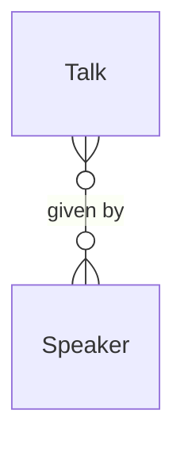

# Tech conference

*A recipe from the Fibery Process Cookbook: the process in plain words, and the model to build it in any tool.*

**From a call for proposals to a clash-free schedule.** For a few organizers running one annual conference. The program is the heart: proposals reviewed on merit, speakers confirmed, talks placed in rooms and slots, with sponsors and sign-ups alongside.

## The idea

A conference falls apart in spreadsheets: proposals in one sheet, speakers in email, the schedule in a third, so nobody knows which accepted talks still lack a confirmed speaker, or whether two sessions clash in the same room at the same hour. The fix is one place where a proposal lives its whole life.

Every submission is a **Talk**: a proposal that moves from submitted through review to accepted, confirmed and scheduled, or rejected along the way. Each talk names its **Speakers**, the people who will give it. **Reviewers**, the program committee led by a **program chair**, score proposals and accept the best at a program review, not on arrival. Accepted talks are placed on a **Schedule**, a room and a time slot each, drawn as a timeline so a clash shows at a glance. Alongside the program, a **Sponsor** pipeline runs from prospect to confirmed, and an **Attendee** is anyone who registers. Speakers submit through one form, attendees register through another; the organizers are the few who open the tool.

In any work tool, this becomes a few kinds of linked records: talks whose workflow runs from *Submitted* to *Delivered*, speakers the talks link to, a board of proposals to review, and a timeline of rooms where clashes show. People live on the review board while the call is open and on the schedule while the program takes shape; buttons turn accept and reject into dated decisions with a note. It's the single source of truth for the program, not a ticketing or budgeting tool.

## How it runs

Follow one talk, *Scaling Postgres to a billion rows*, from proposal to stage.

1. **A proposal comes in.** Someone submits through the **Submit a talk** form: a title, an abstract, a **Format** (*Talk*, *Workshop* or *Lightning talk*), a **Track** and a **Level**. It lands in *Submitted*, the **Submitted stamp** rule sets **Submitted on** to today, and its **Speakers**, one or several people with a bio and a photo, are linked. No date, no room yet.
2. **The committee reviews it.** The program chair moves it to *Under review* and assigns its **Reviewers**, members of the program committee. They read it and agree a **Score** from 1 to 5, the committee's rating. On the **Review board**, proposals sit by state, sorted by score, so the strongest rise to the top.
3. **It's accepted, or rejected.** At the program review the chair accepts each talk worth a slot and rejects the rest, both with a button. **Accept** moves the talk to *Accepted*, sets **Decided on** to today and adds a comment; **Reject** does the same into *Rejected*. A declined proposal isn't deleted; it stays so the funnel is honest.
4. **The speaker confirms.** The talk's **Owner**, the organizer shepherding it, tells the speaker they're in and waits for a yes. When it comes, the owner moves the talk to *Confirmed* and sets **Confirmed on**. Until then the **Confirmation reminder** nudges the owner each day the talk sits accepted and unconfirmed. A speaker who pulls out leaves the talk *Withdrawn*.
5. **It gets a room and a slot.** With the speaker confirmed, the chair places the talk on the **Schedule**: a **Room** and a **Slot**, the start-to-end time of the session. The talk moves to *Scheduled*. The Schedule is a timeline with a row per room, so two talks overlapping in one room show as overlapping bars, and the chair moves one.
6. **The program is published.** Scheduled talks go on the **Program**, the agenda by track, and their speakers on the **Speakers** gallery. Each has a confirmed speaker and a bio; a talk whose speaker still has no photo or bio stands out there before anything goes on the site.
7. **Sponsors are signed.** In parallel, the **sponsor lead** works the **Sponsors** pipeline. Each **Sponsor** moves from *Prospect* to *Contacted* to *Confirmed*, with a **Tier** and a pledged **Amount**, then to *Paid* once the invoice clears, or *Dropped* if they pass. A confirmed sponsor's **Logo** goes on the site.
8. **Attendees register.** Anyone signs up through the **Register** form, becoming an **Attendee** with a **Ticket type**. The **Registered stamp** rule dates it, and the **Attendees by ticket type** report shows the mix and the pace. On the day, the organizers check people in.
9. **The conference runs, and talks are delivered.** As each session ends, the chair moves its talk to *Delivered*. The program becomes history: what ran, who gave it, in which room and when.

## What people look at

- **While the call is open** — **Review board**: every proposal by state, sorted by score. What's worth a slot, and what's still unread.
- **Building the program** — **Schedule**, a timeline with a row per room: where a clash shows as two overlapping bars. **Needs confirmation**: accepted talks whose speaker hasn't said yes, so none is scheduled on a maybe.
- **Any time** — **Program**, the agenda by track, for what's on; **Speakers**, a gallery, for who's speaking and whose photo is missing; **Sponsors**, the pipeline board; **Submit a talk** and **Register**, the two intake forms; and the **CFP funnel** and **Attendees by ticket type** reports.
- **How to run the conference** — this process on one screen, kept where the organizers work.

## The rules

These are all the automations; everything else in the story is done by people.

- **Submitted stamp**: when a talk is created, its Submitted on is set to today.
- **Accept** (a button on a talk): moves the talk to *Accepted*, sets Decided on to today, and adds a comment that it was accepted. It checks nothing; accepting is a click that leaves a trace.
- **Reject** (a button on a talk): moves the talk to *Rejected*, sets Decided on to today, and adds a comment that it was declined.
- **Confirmation reminder**: every day at 09:00, the owner of each talk that is *Accepted* with no Confirmed on is notified to chase the speaker.
- **Registered stamp**: when an attendee is created, their Registered on is set to today.

No automations in your tool? Then a person does each of these at the same moment, and the promises they keep below become practices.

## What must stay true

Whatever anyone edits, adapts or corrects, these hold; each says what keeps it so.

- ★ A talk reaches the Schedule only after it is accepted and its speaker has confirmed. Shown on **Needs confirmation**, which lists accepted talks still waiting, and on the **Schedule**, which shows only *Confirmed* and *Scheduled* talks; placing one is the chair's call.
- ★ No two talks share a room at the same time. Shown on the **Schedule** timeline, where rows are rooms and a clash is two bars that overlap, so the chair moves one. A speaker booked into two talks at once is caught the same way, by grouping the timeline by speaker; that part is a practice when placing.
- ★ Every accepted talk has a confirmed speaker with a bio and a photo before it's published. Shown on **Needs confirmation** for the confirmation, and on the **Speakers** gallery, where a speaker with no photo or bio stands out before the program goes live.
- A decision is dated and leaves a trace: when a talk was accepted or rejected, and that it was. Kept by **Accept** and **Reject**, which set Decided on and write the comment; a card dragged into *Accepted* on the board skips both, so deciding means pressing the button.
- *Rejected* and *Withdrawn* are real endings: a proposal the committee declines is *Rejected*, one a speaker pulls is *Withdrawn*, neither deleted, so the Review board and the CFP funnel stay honest. Shown on the **Review board** and counted by the **CFP funnel** report.
- A confirmed sponsor has a tier and a pledged amount. Shown on **Sponsors**, where a *Confirmed* sponsor's tier and amount sit on the card and a blank one is plain to see; chasing the amount to *Paid* is the sponsor lead's. A practice.

## Making it yours

Decide these before you set it up; each has a default if you shrug.

| Question | Default | If not the default |
|---|---|---|
| How many tracks and rooms? | 3 tracks, 3 rooms | Replace the Track and Room options with yours; a single-track event keeps one Room, and the clash check quietly falls away |
| Open call, or invited speakers? | Open call through Submit a talk | Invite-only: drop the form and the Score, and organizers create talks in *Accepted*, then confirm the speaker as usual |
| Do you charge for tickets? | No; Register records who's coming, counts only | A paid-ticket tool takes the money; paste its numbers, or add an Amount and a Paid checkbox on Attendee if you reconcile here |
| Do you already track companies or people in your tool? | — | Link Sponsor to the companies you already have, and Speaker to the people, instead of creating new databases |

- **Other words:** "Session" or "Submission" for talks, "Partners" for sponsors, "Stages" for tracks: rename freely. The flow is the mechanics, not the vocabulary.
- **Volunteers:** a Volunteer database with shifts and a sign-up form, when helpers on the day need rostering. Left out so the program stays the focus.
- **Online or hybrid:** add an *Online* option to Room and a stream link field on Talk; the Schedule treats it as another row.
- **Multi-day:** the Slot date range already carries the day, so a timeline spanning two or three days just works.
- **Per-reviewer scores:** a Review database linking a reviewer to a talk, when one agreed Score isn't enough; the committee's average then replaces the single field.
- **Check-in on the day:** the Checked in field is already on Attendee; add a list filtered to today's arrivals when you want one at the door.
- **What this recipe leaves out:** speaker travel and logistics, catering, AV and the budget are each their own tracker or tool. Keeping them out is what keeps the schedule clean and the program the thing everyone looks at.

## Details for building

What follows is what the process is built from, in words any tool can follow; the story above is enough to run it.

Each kind of record (Talk, Speaker, Sponsor, Attendee) is a database or a table, depending on the tool, or a tab in a spreadsheet. A relation links two kinds; its inverse is the name it has on the other side. A state is a step in a workflow, and a finished state ends it. A rule is an automation, a button is an automation someone presses, and a formula is a field the tool computes. A nested view shows each record's children beneath it; where a tool can't nest, group the children by their parent instead.

A talk is given by one or more speakers, and a speaker gives any number of talks. Sponsor and Attendee stand on their own, linked to nothing.

### Talk

One record per proposed talk, from submission to delivered. The description holds the proposal under three headings, Abstract, Outline, Takeaways, then the organizers' notes. Comments on.

| Field | Type | Why |
|---|---|---|
| Format | single select: Talk, Workshop, Lightning talk; default Talk | What kind of session it is; on the Program and the Review board |
| Track | single select: Development, Operations, Security, Data; no default | The theme it belongs to; the Program groups by it and the Schedule colors by it |
| Level | single select: Beginner, Intermediate, Advanced; no default | Who it's pitched at; on the Program |
| Speakers | relation, many-to-many → Speaker; inverse **Talks** | Who gives it, one or several; linked on the form |
| Reviewers | people; inverse **Talks to review** | The committee members reading it; each filters the Review board to their own |
| Score | integer, 1 to 5 | The committee's agreed rating; sorts the Review board |
| Room | single select: Main Hall, Room A, Room B; no default | Where it's given; the Schedule's rows |
| Slot | date range | Start to end of the session; the Schedule runs on it |
| Owner | person; inverse **Owned talks** | The organizer shepherding it; the Confirmation reminder goes to them |
| Submitted on | date | Set by Submitted stamp; when the proposal came in |
| Decided on | date | Set by Accept or Reject; when the committee ruled |
| Confirmed on | date | When the speaker said yes; set by the owner |

States: Submitted → Under review → Accepted → Confirmed → Scheduled → Delivered (finished) · Rejected (finished) · Withdrawn (finished). Default: Submitted. Source of truth: **Room** and **Slot**, set by people; the Schedule places a talk only once both are filled, and a talk with an empty Slot simply doesn't appear on the timeline.

Formulas:
- **Needs confirmation** — yes when the talk is *Accepted* and Confirmed on is empty, no otherwise; colors the Needs confirmation list and is the gap the Confirmation reminder chases.

### Speaker

One record per person giving a talk. The description holds their bio. Comments on.

| Field | Type | Why |
|---|---|---|
| Email | email | How the owner reaches them to confirm |
| Phone | phone | Day-of contact, for when a session is about to start |
| Organization | text | Where they work; on the Program and the Speakers gallery |
| Photo | files (photos) | Headshot for the site and the gallery; a blank one flags an unfinished speaker |
| Website | url | Their link, for the site |

No states. Their talks come through the inverse **Talks**.

### Sponsor

One record per sponsoring company. The description holds the agreement and notes. Comments on.

| Field | Type | Why |
|---|---|---|
| Tier | single select: Platinum, Gold, Silver, Community; no default | What they get and what they pay; on the Sponsors board |
| Amount | money | The pledged sum; the sponsor lead tracks it to Paid |
| Owner | person; inverse **Owned sponsors** | The organizer chasing it |
| Contact name | text | Who to talk to at the company |
| Contact email | email | How to reach them |
| Logo | files | For the site, from a Confirmed sponsor |

States: Prospect → Contacted → Confirmed → Paid (finished) · Dropped (finished). Default: Prospect.

### Attendee

One record per person who registers. No description. Comments off.

| Field | Type | Why |
|---|---|---|
| Email | email | Their sign-up and the only contact |
| Ticket type | single select: Regular, Student, Speaker, Sponsor, Volunteer; default Regular | What they hold; the Attendees by ticket type report groups by it |
| Registered on | date | Set by Registered stamp; when they signed up |
| Checked in | checkbox | Marked at the door on the day |

No states.

### Views

| View | Type | Of | Grouping | Shows | Filter | Sort |
|---|---|---|---|---|---|---|
| Review board | board | Talk | columns State | Score, Track, Format, Speakers, Reviewers | State is Submitted, Under review, Accepted, Rejected or Withdrawn | Score desc |
| Schedule | timeline | Talk | dates Slot, rows Room | Speakers, Format; color by Track | State is Confirmed or Scheduled | |
| Needs confirmation | list | Talk | | Decided on, Owner, Speakers, Track | Needs confirmation is yes | Decided on asc |
| Program | board | Talk | columns Track | Slot, Room, Level, Speakers | State is Scheduled or Delivered | Slot asc |
| Speakers | gallery | Speaker | | Photo, Organization, Talks | | Name asc |
| Sponsors | board | Sponsor | columns State | Tier, Amount, Owner, Contact name | | |
| Submit a talk | form | Talk | | Title (required), Description (required), Format (required), Track (required), Level, Speakers | | |
| Register | form | Attendee | | Name (required), Email (required), Ticket type (default: Regular) | | |
| How to run the conference | document | | | the process on one screen, linking to this recipe | | |

### App

None needed. The two central moments, reviewing proposals and placing them without a clash, are a board sorted by score and a timeline with a row per room, both of which a work tool draws out of the box.

### Reports

**CFP funnel** — source Talk, current: a stacked bar of talks by State, colored by Track. Shows how the call converted, from submitted through accepted and scheduled to rejected, and which tracks drew the most.

**Attendees by ticket type** — source Attendee, current: a stacked bar of attendees by month of Registered on, colored by Ticket type. Shows the sign-up pace and the mix of who's coming.

### Sample story

The call closed last week with forty proposals in. Scaling Postgres to a billion rows is accepted and its speaker confirmed, waiting for a slot; a dozen more are accepted, three of them still chasing a confirmation past a week. Half the submissions sit under review, sorted by score, and six are already rejected, one withdrawn. The Schedule has Main Hall and Room A half full, with one clash in Room B the chair hasn't resolved. Eight speakers have photos, two don't. Four sponsors are confirmed with their tiers and logos, two more in contact, one dropped. A hundred and ten attendees have registered, mostly Regular with a handful of students, climbing a few a day.

## Sources

- [Speakers and Call for Proposals](https://www.writethedocs.org/organizer-guide/confs/cfp/), Write the Docs organizer guide: the CFP timeline, the review by a small committee, and confirming speakers before the program is set.
- [Call for Speakers: How to Run One](https://www.sessionboard.com/learn/call-for-speakers), Sessionboard: the five stages, from publishing the call and collecting structured proposals to scoring, notifying and confirming, then collecting bios.
- [How to organize a tech/design conference for 1000+ attendees from scratch](https://wiredcraft.com/blog/how-to-organize-a-conference-from-scratch/), Wiredcraft, 2018: the organizing roles, the program committee, and the run-up from call to schedule to sponsors and registration.

## Build it

In Fibery, open Claude with the Fibery plugin, attach this recipe and say "set up the tech conference". Claude asks a few questions, then sets it up in about ten minutes.

Anywhere else, give this recipe to your AI assistant and name your tool, or build it by hand from Details for building.

---

*From the Fibery Process Cookbook (https://github.com/Fibery-inc/process-cookbook), licensed CC BY 4.0 (https://creativecommons.org/licenses/by/4.0/): copy, adapt and build it anywhere, crediting the cookbook.*
