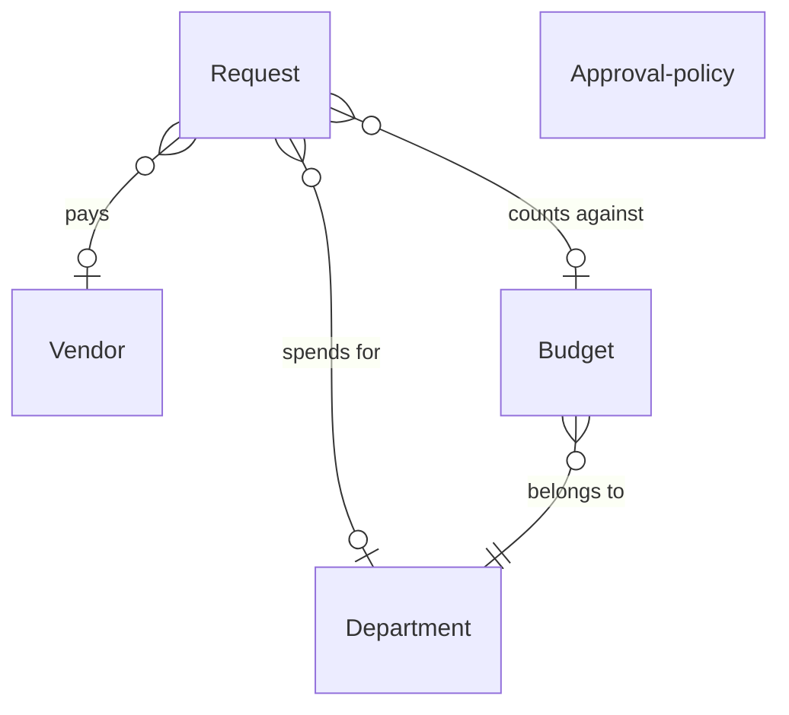

# Purchase requests

*A recipe from the Fibery Process Cookbook: the process in plain words, and the model to build it in any tool.*

**Every purchase gets a yes from whoever owns the money, finance pays only vendors it has checked, and each department sees what it has already committed this quarter.** For a company of about 200 people: how it asks for, approves and pays for things, without a spreadsheet and a chain of emails.

## The idea

At 200 people, buying stops being a conversation. A tool gets ordered on a company card, and an "updated bank details" email gets paid because nobody called. Three habits fix it: every purchase is asked for before it's bought, the yes comes from whoever owns the money, with more signatures as the amount grows, and finance checks the vendor before anything is paid.

Every ask is a **Request**, one record for one purchase from the first line to the paid invoice, and anyone in the company may ask. A request belongs to a **Department**, whose **Budget owner** says yes to its spending. Money lives in **Budgets**, which finance adds before each quarter, one per department, with the quarter's dates and an allocated amount; a request counts against its quarter when it's approved, not when the invoice arrives. The **Vendor** is who gets paid; finance checks it once. The signatures an amount needs are written in one record, the **Approval policy**, so a threshold change is an edit, not a project.

In any work tool, this becomes a few kinds of linked records: requests whose workflow runs from *Draft* to *Paid*, budgets that add up what each department has committed and what still waits for a yes, and vendors finance checks once. People live in a list of the requests waiting on them; a button signs a request with the name of whoever pressed it, and a request whose vendor isn't checked shows red before anyone pays it. It's the company's book of asks and promises, not its accounting system; invoices and payments live there.

## How it runs

Follow one request, *Booth at SaaS Summit*, from the ask to the paid invoice.

1. **Someone asks.** Dana in marketing fills in the **New request** form: a name, her department and its budget for the quarter, the **Amount**, 18,000, a **Needed by** date, and the ask under What, Why and Alternatives in the Description. She is its **Requester**, the one who asked and who will place the order. From the policy's thresholds she sets its **Tier**, how many signatures the amount needs, *One signature*, *Two signatures* or *Three signatures*: 18,000 is two signatures. She adds the vendor, Summit Expo Services, with its website and contact email; a new vendor starts in *New*. The form submits into *Submitted*; a request started by hand waits in *Draft* until its requester moves it on.
2. **The rule routes it.** The **Route for approval** rule makes Marketing's budget owner its **Approver**, whose turn it is, and notes the day it was submitted.
3. **The budget owner decides.** The head of marketing, Marketing's budget owner, opens **Awaiting my approval**: the requests whose turn is hers, each with its **Room left**, what the quarter would have left after a yes, red when negative. She presses **Approve**, which comments who approved and when. At two signatures, she then moves the request to *Finance review* and makes the policy's **Finance approver** its approver. A no is a move to *Rejected* by the approver, with the reason in a comment.
4. **Finance signs.** The head of finance, the finance approver, presses Approve and moves the request to *Approved*; Approve has stamped the date on it. Three signatures would have passed through *Executive review* and the policy's **Executive approver** first, handed on the same way. The 18,000 stops waiting and joins Marketing's **Committed**, the total the quarter has said yes to, and the quarter's room shrinks by the same; **This quarter** shows it, one row per department.
5. **Finance checks the vendor.** In **Vendors to verify**, finance collects the vendor's tax form and ticks **Tax form received**, confirms the bank details by phone, on a number it already had, and enters **Bank details verified on**. With both set, finance presses **Verify vendor**, which moves the vendor to *Verified* with a comment; a blank in either says the check isn't done. A vendor finance won't work with goes to *Blocked*.
6. **The invoice arrives and gets paid.** Dana places the order; the approved request is the purchase order, the written yes the vendor can rely on. When the invoice comes, finance enters **Due on** and moves the request to *Invoiced*. On Thursday, in **Payment run**, the week's payments in one sitting, finance pays and presses **Record payment**, which stamps the paid date and moves the request to *Paid*, with a comment for the payment reference. A request whose vendor is still *New* is red there, and waits for the check.
7. **Or it stops.** A request no longer needed is moved to *Cancelled* by its requester or the budget owner, and its amount leaves Committed the same moment. A request waiting for a signature shows its **Days waiting**, red past 3 days, and from then on the **Approval reminder** nudges its approver every weekday morning until it moves.

## What people look at

- **Every morning** — **Awaiting my approval**: the requests waiting on you, with their room left and days waiting. What must I decide today.
- **Every Thursday** — **Payment run**: approved and invoiced requests, due dates first, red when the vendor isn't *Verified*. What do we pay this week. Then **Vendors to verify**: new vendors and the requests waiting on them.
- **Every Monday** — **This quarter**: each department's quarter: allocated, committed, pending, left. Who is running out of room.
- **Any time** — **My requests**, your own asks; **Open requests**, every unfinished one by state; **Paid requests**, newest first; **New request**, the form; and the **Committed by department** and **Paid by vendor** reports.
- **How to run purchase requests** — this story, kept where the team works.

## The rules

These are all the automations; everything else in the story is done by people.

- **Route for approval**: when a request moves to *Submitted*, its department's budget owner becomes its approver and Submitted on is set to today.
- **Approve** (a button on a request): adds a comment that the request was approved, with the name of whoever pressed it and the day, and sets Approved on to today. It checks nothing: a press out of turn shows under its presser's name, and the approver moves the request on. A yes is a click that leaves its name.
- **Verify vendor** (a button on a vendor): moves the vendor to *Verified* and adds a comment with the name of whoever pressed it and the day. It checks nothing: a missing tax form or bank check is a blank on Vendors to verify.
- **Record payment** (a button on a request): moves the request to *Paid*, sets Paid on to today and adds a comment for the payment reference. It checks nothing: a request whose vendor isn't *Verified* is red on Payment run.
- **Approval reminder**: every weekday at 09:00, the approver of every request that has waited more than 3 days is notified, one message per request.

No automations in your tool? Then a person does each of these at the same moment, and the promises they keep below become practices.

## What must stay true

Whatever anyone edits, adapts or corrects, these hold; each says what keeps it so.

- ★ A signature is a press of Approve by whoever's turn it is, and it leaves a comment naming who and when. Kept by **Approve**, whose comment carries the name of whoever pressed it, so a press out of turn shows. Handing the request to the policy's next approver, and pressing before moving it on, are practices: a request moved on without a press carries no signature.
- ★ The signatures an amount needs come from the policy's thresholds, read when the request is submitted, not from anyone's memory. A practice: the requester sets the tier from the policy, and the budget owner checks it beside the amount on **Awaiting my approval** before signing. An amount corrected while the request waits is sent back to *Draft* by its requester and submitted again, with its tier set afresh: a practice.
- ★ A request counts against the quarter it was submitted in, and as committed from the last signature, not from the invoice or the payment. The requester links it to the department's budget for the quarter, which the form asks for: a practice. Kept by **Committed**, which adds up only *Approved*, *Invoiced* and *Paid* requests, so a request cancelled after approval leaves it the same moment.
- ★ No vendor is paid before finance has checked it. Shown on **Payment run**, where a request whose vendor isn't *Verified* is red, and on **Vendors to verify**, where a missing tax form or bank check is a blank; finance pays nothing red and verifies no vendor with a blank: a practice. A vendor whose bank details change goes back to *New* and is checked again, however the news arrived: a practice.
- A paid, rejected or cancelled request is never reopened; the same purchase asked again is a new request, so the history of what was declined stays honest. A practice.
- Nothing waits unseen. Shown by **Days waiting**, red past 3 days on Awaiting my approval and Open requests; the **Approval reminder** asks the approver every weekday morning, and whether they act is theirs.

## Making it yours

Decide these before you set it up; each has a default if you shrug.

| Question | Default | If not the default |
|---|---|---|
| Signatures above the budget owner, and from what amounts? | Two: finance from 5,000, the executive from 25,000 | One, finance alone above the budget owner: drop the *Executive review* state, and Executive from and Executive approver from the policy |
| Do you already track departments, teams or vendors in your tool? | — | Requests spend from the departments and pay the vendors the company already has: link Request and Budget to those databases instead of creating Department or Vendor |
| Does money belong to departments only, or to projects or cost centers too? | Departments | A project's owner signs for its spending: add Project, with its own Budget owner and its own budgets, linked from Request; Route for approval becomes two rules, one for requests with a project and one for the rest |

- **Under 50 people:** one signature is enough: drop *Finance review*, *Executive review*, the Tier field and the Approval policy, so Route for approval sends every request to the budget owner and there's nothing left for a policy to say; finance keeps the vendor check and the payment run.
- **Budget owners' own requests:** a common choice is that the finance approver signs them first: the budget owner hands their own request to finance instead of approving it.
- **Subscriptions and renewals:** one request per renewal, the previous one linked in the Description; a Subscription database only when you want warnings before auto-renewals.
- **Pushed too far:** a state per signature, manager, director, VP, CFO, CEO, is a relay nobody finishes; three is plenty at 200 people.

## For AI agents

- Every morning, list the requests waiting more than 3 days and whose turn they are; never approve, reject or cancel one.
- Before the Monday look, summarize each department's quarter: allocated, committed, pending, left, the largest pending requests; flag a department whose committed plus pending is above its allocation, and, two weeks before the quarter ends, a department with no budget for the next one.
- Flag an *Invoiced* request whose vendor is still *New*, and an *Approved* one older than 60 days with no invoice; ask whether it still stands.
- Never mark a vendor *Verified*, record a payment or change the policy; those are finance's.
- Try asking: "Which requests have waited more than three days, and on whom?", "How much room does Marketing have left this quarter?", "Which invoiced requests are waiting on an unverified vendor?"

## Details for building

What follows is what the process is built from, in words any tool can follow; the story above is enough to run it.

Each kind of record (Request, Budget, Vendor) is a database or a table, depending on the tool, or a tab in a spreadsheet. A relation links two kinds; its inverse is the name it has on the other side. A state is a step in a workflow, and a finished state ends it. A rule is an automation, a button is an automation someone presses, and a formula is a field the tool computes. A nested view shows each record's children beneath it; where a tool can't nest, group the children by their parent instead.

Each request spends for one department, pays one vendor and counts against one budget; each budget is one department's money for one quarter. The Approval policy is a single record that nothing links to: people read it.

### Request

One purchase, from the ask to the paid invoice; its public id serves as the purchase order number. The Description holds the ask under What, Why, Alternatives. Comments on; Approve and Record payment write there.

| Field | Type | Why |
|---|---|---|
| Requester | people; inverse **Requested** | Who asked; people so My requests works |
| Department | relation, many-to-one → Department; inverse **Requests** | Whose money it is |
| Vendor | relation, many-to-one → Vendor; inverse **Requests** | Who gets paid; Payment run is red while its state isn't Verified |
| Budget | relation, many-to-one → Budget; inverse **Requests** | The quarter it counts against; picked by the requester on the form |
| Amount | money | What it costs; the tier and the budget numbers run on it |
| Needed by | date | Urgency, for the approver |
| Tier | single select: One signature, Two signatures, Three signatures; no default | How many approvals the amount needs; set by the requester from the policy's thresholds |
| Approver | people; inverse **To approve** | Whose turn it is; set by Route for approval, then by each approver who hands the request on; Awaiting my approval filters on it |
| Submitted on | date | Set by Route for approval; Days waiting counts from it |
| Approved on | date | Set by Approve at every signature, so on an approved request it holds the day of the last; on Payment run and Paid requests |
| Due on | date | The invoice's due date, entered when it arrives; Payment run sorts by it |
| Paid on | date | Set by Record payment; Paid requests sorts by it |

States: Draft → Submitted → Finance review → Executive review → Approved → Invoiced → Paid (finished) · Rejected (finished) · Cancelled (finished). Default: Draft; the New request form submits into *Submitted*. Source of truth: **State**, which each approver moves after pressing Approve; a request moved on without a press carries no approval comment for that step, so the guide says approvals are pressed, then moved.

Formulas:
- **Days waiting** — days since Submitted on while the request is *Submitted*, *Finance review* or *Executive review*, a whole number; 0 in any other state or with no Submitted on; on Awaiting my approval and Open requests, red above 3; the Approval reminder runs on it.
- **Room left** — the budget's Left minus the request's Amount, money; 0 without a budget; what the quarter would have left after this request, meaningful while it waits; on Awaiting my approval, red when negative.

### Budget

One department's money for one quarter, named by both ("Marketing Q4 2026"); finance adds them before each quarter. Description off, comments off.

| Field | Type | Why |
|---|---|---|
| Department | relation, many-to-one → Department; inverse **Budgets** | Whose quarter it is |
| Quarter | date range | The quarter; This quarter and the Committed by department report filter on it |
| Allocated | money | What the department may commit |

No states.

Formulas:
- **Committed** — the total Amount of the budget's requests that are *Approved*, *Invoiced* or *Paid*, money; 0 with none; on This quarter and in Left.
- **Pending** — the total Amount of the budget's requests that are *Submitted*, *Finance review* or *Executive review*, money; 0 with none; on This quarter.
- **Left** — Allocated minus Committed, money, negative when overspent; minus Committed when nothing is allocated; on This quarter, red when negative; Room left uses it.

### Department

Who owns money. The Description holds what the department buys and any standing rules. Comments off. Fields: Budget owner (people; inverse **Budget owner of**; one person, by rule; the first signature on the department's requests, copied into Approver by Route for approval). No states. Its budgets come through the inverse Budgets, its requests through Requests.

### Vendor

Who gets paid; checked once by finance, then reused. The Description holds the check notes and contacts. Comments on; Verify vendor writes there.

| Field | Type | Why |
|---|---|---|
| Website | url | For the check and the order |
| Contact email | email | Where the order and the payment notice go |
| Tax form received | checkbox | Ticked by finance when the form is in; a blank on Vendors to verify means not yet |
| Bank details verified on | date | Confirmed by a call to a number finance already had; a blank on Vendors to verify means not yet |

States: New → Verified (finished) · Blocked (finished). Default: New. Source of truth: **Tax form received** and **Bank details verified on**; finance presses Verify vendor only once both are set, and a state set by hand carries no check comment.

### Approval policy

One record: the thresholds and the people above the budget owner. Description off, comments off. Fields: Finance from (money; the amount from which finance signs too); Executive from (money; the amount from which the executive signs too); Finance approver (people; inverse **Finance approver of**; one person, by rule); Executive approver (people; inverse **Executive approver of**; one person, by rule). No states. People read it: the requester for the tier, each approver for whom to hand a request on to; only finance edits it.

### Views

| View | Type | Of | Grouping | Shows | Filter | Sort |
|---|---|---|---|---|---|---|
| Awaiting my approval | list | Request | | Requester, Department, Amount, Tier, Needed by, Room left, Days waiting; red when Days waiting above 3 or Room left negative | Approver is me; State is Submitted, Finance review or Executive review | Days waiting desc |
| Payment run | board | Request | columns State | Vendor, Department, Amount, Due on, Approved on; red when the Vendor isn't Verified | State is Approved or Invoiced | Due on asc |
| Vendors to verify | grid | Vendor | Requests nested: State, Amount, Department | Contact email, Tax form received, Bank details verified on | State is New | |
| This quarter | grid | Budget | | Department, Allocated, Committed, Pending, Left; red when Left is negative | Quarter includes today | Department |
| My requests | list | Request | | State, Amount, Vendor, Approver, Needed by | Requester is me; State is not Paid, Rejected or Cancelled | Needed by asc |
| Open requests | board | Request | columns State | Requester, Department, Amount, Tier, Approver, Days waiting; red when Days waiting above 3 | State is not Paid, Rejected or Cancelled | |
| Paid requests | grid | Request | | Vendor, Department, Amount, Approved on, Paid on | State is Paid | Paid on desc |
| New request | form | Request | | Name (required), Requester (required), Department (required), Budget (required), Vendor, Amount (required), Tier (required), Needed by, Description | | |
| How to run purchase requests | document | | | the story, through What must stay true | | |

### App

None needed. The central moments are a yes on a request and the Thursday payment run; the Approve button on the record, Awaiting my approval with Room left, and the Payment run board show them. A budget bar per department was considered; Room left on the approver's list is the same number.

### Reports

**Committed by department** — source Request, current, only requests in *Approved*, *Invoiced* or *Paid* whose budget's Quarter includes today: a stacked bar of total Amount by Department, colored by State.

**Paid by vendor** — source Request, current, only *Paid* with Paid on in the last twelve months: a bar of total Amount by Vendor, largest first.

### Sample story

Five weeks into the quarter, Booth at SaaS Summit is invoiced: 18,000 against the Marketing budget, its ask under What, Why and Alternatives, both signatures in its comments. Its vendor, Summit Expo Services, is verified with check notes; the next payment run pays it. Another invoiced request is red on Payment run, its vendor still new; one vendor is blocked. The policy: finance from 5,000, the executive from 25,000. A small request has waited five days for its budget owner; others sit in finance or executive review or await invoices; two are drafts. One department is over budget. Last quarter's purchases are paid; this quarter one ask was rejected with its reason, one cancelled after approval.

## Build it

In Fibery, open Claude with the Fibery plugin, attach this recipe and say "set up purchase requests". You'll see a one-screen design first; nothing is created until you say yes, and the build takes about ten minutes.

Anywhere else, give this recipe to your AI assistant and name your tool, or build it by hand from Details for building.

---

*From the Fibery Process Cookbook (https://github.com/Fibery-inc/process-cookbook), licensed CC BY 4.0 (https://creativecommons.org/licenses/by/4.0/): copy, adapt and build it anywhere, crediting the cookbook.*
