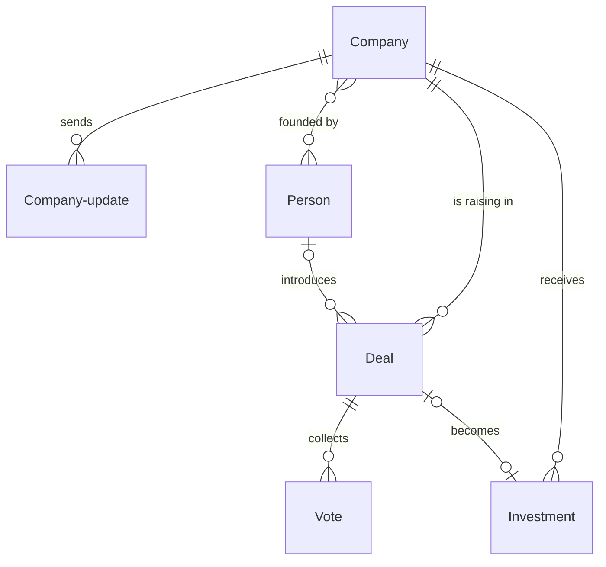

# Venture fund

*A recipe from the Fibery Process Cookbook: the process in plain words, and the model to build it in any tool.*

**No deal lost, no decision made on one partner's enthusiasm.** For a seed fund of two to four partners and one or two analysts, looking at a few hundred startups a year and backing about ten.

## The idea

A small fund sees far more startups than it can meet, and far more than it can remember. Without a system, decks sit in someone's inbox, nobody knows why a company was turned down a year ago, and the loudest partner in the room decides. After the money goes out, founders' numbers arrive by email, if they arrive at all.

The method is a funnel with one gate. Every opportunity to invest is a **Deal**: one round of one startup, which moves from a first deck to *Invested* or *Passed*, and a pass always has its reason. Every startup is a **Company**, tracked before and after the money. A partner who wants a deal becomes its **Champion**: they do the work and write the memo. Before the partners discuss it, each one records a **Vote**, a private score and a key risk, so the discussion starts from independent opinions. A deal that is backed becomes an **Investment**, the fund's cheque in that round, and the company sends a **Company update** every quarter.

In any work tool, this becomes a deal pipeline whose workflow runs from *New* to *Invested* or *Passed*, companies that move into the portfolio by themselves when a deal is invested, and a weekly board for the partner meeting where scores stay hidden until every partner has voted. A button records the terms the partners approved, a rule turns an invested deal into an investment, and a Monday reminder chases the companies whose numbers are late. It's the fund's memory and its decision table, not a fund accounting system.

## How it runs

Follow one deal, *Fernleaf Seed*, a seed round for a carbon accounting startup, from deck to portfolio.

1. **A deck arrives.** Someone adds the deal in *New*, through the **New deal** form or straight on the board, with its pitch deck. A scout, a person who sends the fund startups, introduced it, so its **Source** is *Scout*. Every deal records where it came from, because a fund learns which sources bring the deals it backs.
2. **The analyst screens it.** The **Analyst** checks Fernleaf against the fund's thesis: stage, sector, country and round size. It fits, so they look the company up first, since the same startup often arrives twice, create it and its founders as people, link the scout as **Introduced by**, book a first call and move the deal to *Screening*. A deck that doesn't fit gets a short, polite no within the week: the analyst writes to the founders and moves the deal to *Passed* with its **Pass reason**, the one main reason it was turned down. The **Stage changed** rule notes the day of every move, so every deal shows **Days in stage**. Each state has its limit: a week in *New*, two in *Screening*, a month in *Due diligence*, two weeks in *Committee*, six in *Closing*. A deal past it is **Stuck** and turns red, because founders deserve a quick answer, and a stalled deal is usually a quiet no.
3. **A partner picks it up.** At the Monday partner meeting, the **Partners**, who decide on investments, go through the **Partner meeting** board. It shows the new and screened deals, the stuck ones, the ones up for a decision, and every deal passed in the last seven days, so a second partner can catch a good company turned down too fast. One partner wants Fernleaf, becomes its champion and moves it to *Due diligence*.
4. **The champion builds the case.** With the analyst, the champion calls customers, checks references on the founders, sizes the market and reads the numbers. They record the **Round size**, the fund's planned cheque as **Our ticket**, and the **Pre money valuation**, the company's price before the new money, and write the **Memo**: what the company does, why now, why this team, the risks, and the cheque.
5. **It goes to the committee.** The champion moves the deal to *Committee*. A deal in *Committee* without a memo or a champion is **Not ready** and shows red on the Partner meeting board, so it waits for next week.
6. **Every partner scores it first.** Before the meeting, each partner fills in the **My vote** form: a **Score** and the **Key risk**, in one line. The score runs from 1, strong no, through 2, no, and 3, yes, to 4, strong yes: there is no middle to hide in. The board shows **Votes in**, how many partners have voted. The deal's **Lowest score**, like every score on view, stays at 0 until every vote is in, so no partner reads the others' scores before writing their own.
7. **The partners decide.** Once every vote is in, **Votes revealed** shows the scores and key risks side by side. The discussion starts from the lowest score, and nobody edits a score afterwards: it is the first opinion, and the fund learns from it later. The fund decides by consensus. When every partner is for it, the champion presses **Approve**, a button on the deal: it moves to *Closing*, and a comment records the ticket and price the partners approved. The champion signs the term sheet, the short agreement on the round's main terms, and finishes the legal work with the founders. When a partner stays against it, the champion tells the founders and moves the deal to *Passed* with its reason.
8. **The money goes out.** When the money is wired, the champion moves the deal to *Invested*. The **Into portfolio** rule creates the investment, with the company, the round and the ticket, and moves Fernleaf into the *Portfolio*. The analyst corrects the amount and the date to what was wired, adds the **Instrument**, the **Post money valuation** and the **Ownership**, and sets the champion as the company's **Lead partner**, who answers for it from now on.
9. **The company reports every quarter.** The founders fill in the **Quarterly update** form: revenue, cash, monthly burn, runway, headcount, and what went well and where they need help. A portfolio company with no update in 120 days, a quarter plus a month to write it up, is **Update overdue**, and the **Update reminder** asks its lead partner every Monday to chase it. A company whose last update shows under 6 months of cash is **Low runway**. Both show red on **Portfolio companies**, which the partners read every Monday, so help comes while there's still time to raise.
10. **It ends.** A year later Fernleaf raises a Series A, and the fund takes its pro rata, its right to keep its share. That's a new deal for the same company, starting in *Due diligence* with the lead partner as champion, and ending in a second investment. When a company is sold or goes public, the lead partner moves it to *Exited*; when it shuts down, to *Written off*. Deals the fund never backed stay as they ended, with their reasons, for the next time the founders come back.

## What people look at

- **Every morning** — **Pipeline**, every open deal by state, red when stuck: what's in flight, and what's waiting. **My deals** for the deals you champion or screen.
- **Before the Monday meeting** — **My vote**, a form, for every deal in *Committee*.
- **At the Monday meeting** — **Partner meeting**, a board of the new deals, the stuck ones, the ones up for a decision and last week's passes, with the votes counted: what do we decide today, and did we turn down anything we shouldn't have. **Votes revealed**, each partner's score and key risk beside the others, once everyone has voted. **Portfolio companies**, every company in the portfolio with its latest numbers: who's running out of cash, who hasn't reported.
- **Any time** — **New deal**, a form for decks from scouts, founders and the fund's website; **Quarterly update**, a form the founders fill in each quarter; the **Deal sources** report, where the deals the fund backs come from; the **Deployment** report, how much money the fund has put to work, quarter by quarter.
- **How to run the venture fund** — this process on one screen, kept where the team works.

## The rules

These are all the automations; everything else in the story is done by people.

- **Stage changed**: when a deal is created or moves to another state, its Stage changed on is set to today, which is what Days in stage counts from.
- **Approve** (a button on a deal): moves the deal to *Closing* and adds a comment that the partners approved it today, with its ticket and its pre money valuation; the comment carries the name of whoever pressed it. It checks nothing: a deal that is Not ready is red on Partner meeting. A decision leaves a trace of its terms.
- **Into portfolio**: when a deal moves to *Invested*, a linked investment is created with the deal's company, its round, its ticket as the amount and today as the closing date, and the deal's company is moved to *Portfolio*.
- **Update reminder**: every Monday at 08:00, the lead partner of every company that is Update overdue is notified.

No automations in your tool? Then a person does each of these at the same moment, and the promises they keep below become practices.

## What must stay true

Whatever anyone edits, adapts or corrects, these hold; each says what keeps it so.

- ★ Every deal ends: it is *Invested* or *Passed*, never deleted and never left open, and a passed deal has its pass reason. Shown on **Partner meeting**, where every deal passed in the last seven days comes back once for a second look, red when it has no reason.
- Founders hear back fast: a deck is answered within a week, and a deal moves on or ends within its state's limit. Shown on **Pipeline** and **Partner meeting**, where a deal past its state's limit is red as Stuck.
- ★ Partners score before they discuss, nobody reads a score before writing their own, and no score changes after the reveal. Shown on **Votes revealed**, which lists a deal only once Votes in reaches Votes needed, and on every other view through **Shown score** and **Lowest score**, both 0 until then; opening a colleague's vote early, or editing your own later, is a practice nothing stops.
- ★ No deal is decided without a champion and a memo, and an approval records what was approved. Shown on **Partner meeting**, where a deal in *Committee* that is Not ready is red; kept by **Approve**, which writes the approved ticket and price into the deal's comments. A card dragged to *Closing* skips the button, so approving means pressing it.
- A company enters the portfolio when one of its deals is invested, and only then. Kept by **Into portfolio**, which creates the investment and moves the company together. A company that leaves moves to *Exited* or *Written off* and keeps its investments as history.
- An investment says what the fund actually wired. A practice: the analyst corrects the amount and the date, and a deal moved to *Invested* by mistake loses the investment it created while its company goes back to *Tracked*, both by hand.
- Every portfolio company reports at least once a quarter, and one running out of cash shows. Shown on **Portfolio companies**, red when Update overdue or Low runway; kept by the **Update reminder**, which asks the lead partner every Monday until the update comes in.

## Making it yours

Decide these before you set it up; each has a default if you shrug.

| Question | Default | If not the default |
|---|---|---|
| How do the partners decide? | Every partner scores, consensus decides | A majority decides: the meeting reads the average score instead of the lowest, so replace Lowest score with an average, and lower Votes needed if not every partner must vote. One person runs the fund alone: drop the Vote database with its formulas, Votes needed, My vote and Votes revealed, and keep the memo and Approve |
| How often do companies report? | Every quarter, overdue after 120 days | Monthly: overdue after 50 days. Twice a year: after 210 days. Only Update overdue changes |
| Do you already track companies or contacts in a CRM? | No: Company and Person live here | Deals link to what you already have: point the Company and Introduced by fields at the existing databases instead of new ones |
| Do you want limited partners and capital calls here too? | No: they stay with the fund administrator | Add a Limited partner database and a Commitment database linked to it; this recipe doesn't cover fund accounting, and a mistake there costs more than a spreadsheet does |

- **Other words:** "Opportunities" for deals, "IC" for *Committee*, "Point partner" for champion, "Portfolio company" for company: rename freely.
- **Conflicts of interest:** a partner who holds a stake in a company, or is close to its founders, stands aside on its deal: lower Votes needed on that deal by one, and say why in a comment.
- **Too early is not no:** many seed passes mean "come back next round". A Revisit on date on Deal, and a list of passed deals whose date has come, let the fund call those founders before they raise again.
- **Angels and syndicates:** the same pipeline works for a syndicate lead; co-investors are people with the role *Co investor*, and a Syndicate field on Investment says who came in with you.
- **A scout programme:** a Scout person field on Deal, and a My scouted deals list for scouts who do open the tool; the Deal sources report then shows which scouts bring deals you back.
- **A due diligence checklist**, when the team wants the same checks every time: headings in the memo first (Team, Market, Product, Traction, Terms, Risks); a separate checklist database only when each check needs its own owner.
- **A Pass reasons report**, once a year of passes has piled up: passed deals counted by Pass reason, to check the fund says no for the reasons it means to.
- **Reserves, marks and boards:** a Reserve field on Company, the money set aside for follow ons; a Fair value field on Company update for the quarterly mark; a Board meeting database linked to Company once the fund holds several board seats. The fund's numbers for limited partners still come from the administrator.
- **Pushed too far:** a pipeline that records every email and call turns into a CRM, and the partner meeting gets buried under it; the deal holds what a partner needs to decide, and the inbox keeps the rest.

## Details for building

What follows is what the process is built from, in words any tool can follow; the story above is enough to run it.

Each kind of record (Deal, Company, Vote, Investment, Company update, Person) is a database or a table, depending on the tool, or a tab in a spreadsheet. A relation links two kinds; its inverse is the name it has on the other side. A state is a step in a workflow, and a finished state ends it. A rule is an automation, a button is an automation someone presses, and a formula is a field the tool computes. A nested view shows each record's children beneath it; where a tool can't nest, group the children by their parent instead.

A company has any number of deals over its life, one per round the fund looks at, and an investment for each round it backs. Each deal collects one vote per partner. A company sends its updates, and people are linked as its founders or as whoever introduced a deal.

### Deal

One round of one startup the fund looks at. The description holds the screening notes: what the company does, who referred it, the first call, the founders' contact. Comments on.

| Field | Type | Why |
|---|---|---|
| Company | relation, many-to-one → Company; inverse **Deals** | The startup raising; linked by the analyst at screening |
| Round | single select: Pre seed, Seed, Seed extension, Series A, Series B | What the company is raising; copied to the investment by Into portfolio |
| Source | single select: Referral, Scout, Inbound, Outbound, Event | Where the deal came from; the Deal sources report groups by it |
| Introduced by | relation, many-to-one → Person; inverse **Introduced deals** | The person who sent it, to thank and to learn from; linked by the analyst, never asked on the public form |
| Champion | person; inverse **Championed deals** | The partner who builds the case; My deals |
| Analyst | person; inverse **Screened deals** | Who screens and supports it; My deals |
| Round size | money | The whole round, for the memo and the meeting |
| Our ticket | money | The fund's planned cheque; written into the Approve comment, and becomes the investment's amount |
| Pre money valuation | money | The price before the round; written into the Approve comment |
| Pitch deck | files | The deck the founders sent |
| Memo | rich text | The champion's case, under the headings Company, Why now, Team, Risks, Terms; Not ready reads it |
| Votes needed | integer, default 3 | How many votes must be in before scores are shown: the number of partners, one fewer for each partner who stands aside |
| Pass reason | single select: Too early, Team, Market, Traction, Valuation, Out of thesis, Competition, Lost to another investor | The one main reason; set when a deal moves to *Passed*, checked on Partner meeting the week after |
| Stage changed on | date | The day the deal was added or last changed state; set by Stage changed, read by Days in stage and the Partner meeting filter |

States: New → Screening → Due diligence → Committee → Closing → Invested (finished) · Passed (finished). Default: New. A follow on deal may start in *Due diligence*. Source of truth for the company's portfolio state: **Into portfolio**, which moves the company when a deal is invested.

Formulas:
- **Days in stage** — days from Stage changed on to today, a whole number, 0 with no date; on Pipeline and Partner meeting, read by Stuck.
- **Stuck** — yes when the deal has sat in its state past the state's limit: more than 7 days in *New*, 14 in *Screening*, 30 in *Due diligence*, 14 in *Committee* or 45 in *Closing*; no otherwise, and always no in *Invested* and *Passed*; colors Pipeline and Partner meeting red. The limits are a common choice, not a rule of the trade.
- **Not ready** — yes when the deal is in *Committee* and has no champion or an empty memo, no otherwise; colors Partner meeting red.
- **Votes in** — how many votes the deal has, a whole number, 0 with none; on Partner meeting, read by Lowest score and Shown score.
- **Lowest score** — the lowest Score among the deal's votes, a whole number, and 0 until Votes in reaches Votes needed or when there are no votes; on Partner meeting and Votes revealed, whose filter uses it.

### Company

One startup, tracked from its first deal to its exit. The description holds what it does, in two sentences. Comments on.

| Field | Type | Why |
|---|---|---|
| Website | url | Where to read about it |
| Sector | single select: Fintech, Climate, Health, B2B software, Consumer, Deep tech | The thesis check at screening, and the portfolio mix |
| Country | single select | The thesis check at screening; the fund's own list of countries |
| Founders | relation, many-to-many → Person; inverse **Founded companies** | Who runs it; linked by the analyst at screening |
| Lead partner | person; inverse **Lead companies** | The partner who answers for a portfolio company; the Update reminder goes to them |

States: Tracked → Portfolio → Exited (finished) · Written off (finished). Default: Tracked. Source of truth: **Into portfolio** moves a company to *Portfolio*; the lead partner moves it to *Exited* or *Written off*.

Formulas:
- **Total invested** — the sum of the Amount of the company's investments, money, 0 with none; on Portfolio companies.
- **Update overdue** — yes when the company is in *Portfolio* and its latest update's Period end is more than 120 days before today, or it has no update and its earliest investment closed more than 120 days ago; no otherwise; red on Portfolio companies, drives the Update reminder.
- **Low runway** — yes when the company is in *Portfolio* and its latest update's Runway months is under 6, no otherwise and no with no update; red on Portfolio companies. Six months is a common choice: about the time a seed company needs to raise its next round.

Nine formulas in all, one over the usual ceiling: the recipe runs two processes, the deal flow and the portfolio, and each needs its own flags.

### Vote

One partner's score on one deal, written before the discussion. No description; comments off.

| Field | Type | Why |
|---|---|---|
| Deal | relation, many-to-one → Deal; inverse **Votes** | The deal scored |
| Partner | person; inverse **My votes** | Who scored; set to whoever fills in My vote |
| Score | integer, 1 to 4 | 1 strong no, 2 no, 3 yes, 4 strong yes; no middle, so every partner takes a side. Read by Lowest score and Shown score, and shown on no view |
| Key risk | text | The one thing that would make this fail; shown on Votes revealed |

Name each vote after its deal and partner ("Fernleaf Seed, Partner A").

Formulas:
- **Shown score** — the vote's Score once its deal's Votes in has reached its deal's Votes needed, a whole number, 0 before that; what every view shows instead of Score, so no score is read early. Where a tool can hide a field from everyone but its author, hide Score that way too.

### Investment

The fund's cheque in one round of one company. Comments on.

| Field | Type | Why |
|---|---|---|
| Company | relation, many-to-one → Company; inverse **Investments** | Who received it; set by Into portfolio, summed by Total invested |
| Deal | relation, one-to-one → Deal; inverse **Investment** | The deal it came from, with its memo, votes and approved terms |
| Round | single select: Pre seed, Seed, Seed extension, Series A, Series B | Copied from the deal by Into portfolio; the Deployment report colors by it |
| Amount | money | What the fund wired; Our ticket at first, corrected by the analyst |
| Closed on | date | The day the money went out; today at first, corrected by the analyst; the Deployment report groups by it |
| Instrument | single select: Equity, SAFE, Convertible note | What the fund holds; added by the analyst |
| Post money valuation | money | The price after the round; added by the analyst |
| Ownership | decimal with two places, 0 to 100 | The fund's share of the company after the round, in percent; added by the analyst, and left empty for a SAFE or a note until it converts |

No states: an investment is history the moment it is made.

### Company update

One company's numbers for one period, sent by its founders. The description holds the highlights and the asks.

| Field | Type | Why |
|---|---|---|
| Company | relation, many-to-one → Company; inverse **Updates** | Who sent it; Update overdue reads its latest |
| Period end | date | The last day the numbers cover |
| Revenue | money | Revenue in the last month of the period |
| Cash | money | Cash in the bank at the period end |
| Monthly burn | money | Net cash spent per month |
| Runway months | integer | The founders' own estimate of months of cash left |
| Headcount | integer | People on the team at the period end |

### Person

One founder, co-investor, scout or advisor the fund knows. The description holds how the fund knows them.

| Field | Type | Why |
|---|---|---|
| Email | email | How to reach them |
| LinkedIn | url | Who they are, at a glance |
| Role | multi select: Founder, Co investor, Scout, Advisor | What they are to the fund; one person can be several |
| Firm | text | Their fund or company, for co investors and advisors |

### Views

| View | Type | Of | Grouping | Shows | Filter | Sort |
|---|---|---|---|---|---|---|
| Pipeline | board | Deal | columns State | Company, Round, Champion, Our ticket, Days in stage; cards red when Stuck | State is not Invested or Passed | |
| My deals | list | Deal | | State, Company, Round, Days in stage | Champion is me or Analyst is me; State is not Invested or Passed | Days in stage desc |
| My vote | form | Vote | | Deal (required), Partner (required, default: me), Score (required), Key risk (required) | | |
| Partner meeting | board | Deal | columns State | Champion, Our ticket, Votes in, Votes needed, Lowest score, Days in stage, Pass reason; cards red when Stuck, when Not ready, or when Passed with no Pass reason | State is New, Screening or Committee; or Stuck is yes; or State is Passed and Stage changed on is within the last 7 days | |
| Votes revealed | grid | Deal | Votes nested: Partner, Shown score, Key risk | State, Our ticket, Votes in, Lowest score | State is Committee or Closing; Lowest score over 0 | Lowest score asc |
| Portfolio companies | grid | Company | Updates nested, newest first: Period end, Revenue, Cash, Monthly burn, Runway months | Lead partner, Sector, Total invested, Update overdue, Low runway; rows red when Update overdue or Low runway | State is Portfolio | Name asc |
| New deal | form | Deal | | Name (required), Round, Round size, Source, Pitch deck, Description (what the company does, who referred it) | | |
| Quarterly update | form | Company update | | Company (required, only companies in Portfolio), Period end (required), Revenue, Cash, Monthly burn, Runway months, Headcount, Description | | |
| How to run the venture fund | document | | | the process on one screen, linking to this recipe | | |

New deal and Quarterly update are public forms, filled by people outside the fund. New deal asks for nothing that would list the fund's records, and Quarterly update offers only companies in *Portfolio*, whose names are usually public anyway; where a form can't narrow a list, it asks for the company's name as text and the analyst links the update.

### App

None needed. The central moment is the Monday partner meeting, and the Partner meeting board with Votes revealed shows it: what's up for a decision, how many partners have voted, then every score side by side, starting from the lowest.

### Reports

**Deal sources** — source Deal, current, deals created in the last 12 months: a stacked bar of how many deals by Source, colored by State, so the *Invested* share of each source shows.

**Deployment** — source Investment, current: a stacked bar of the sum of Amount by quarter of Closed on, colored by Round, so the pace of the fund's cheques shows against its plan.

### Sample story

Fernleaf Seed is in *Committee*: two of three partners have scored it, so its lowest score still shows 0. A second waits with no memo yet, and four more are in due diligence, one of them five weeks there and stuck. A dozen decks came in this month; most were answered within the week, one has sat in new for nine days, and three were passed last week, one still without a reason. The portfolio holds eight companies: one raised a Series A last month and its follow on deal was approved and is closing, one hasn't reported in five months, and one reports five months of runway. One company was sold last year; another was written off.

## Sources

- [Deal flow](https://carta.com/learn/private-funds/management/deal-flow/), Carta: the stages from sourcing and screening through diligence, committee, closing and monitoring after the investment.
- [VC process stages](https://www.tomtunguz.com/vc-process-stages/), Tomasz Tunguz: the narrowing from screening to diligence to a decision at the meeting of all partners.
- [Portfolio Monitoring Best Practices](https://help.visible.vc/en/articles/9761659-portfolio-monitoring-best-practices), Matt Preuss, Visible: a short, regular structured request to founders rather than ad hoc emails.

## Build it

In Fibery, open Claude with the Fibery plugin, attach this recipe and say "set up the venture fund". Claude asks a few questions, then sets it up in about ten minutes.

Anywhere else, give this recipe to your AI assistant and name your tool, or build it by hand from Details for building.

---

*From the Fibery Process Cookbook (https://github.com/Fibery-inc/process-cookbook), licensed CC BY 4.0 (https://creativecommons.org/licenses/by/4.0/): copy, adapt and build it anywhere, crediting the cookbook.*
