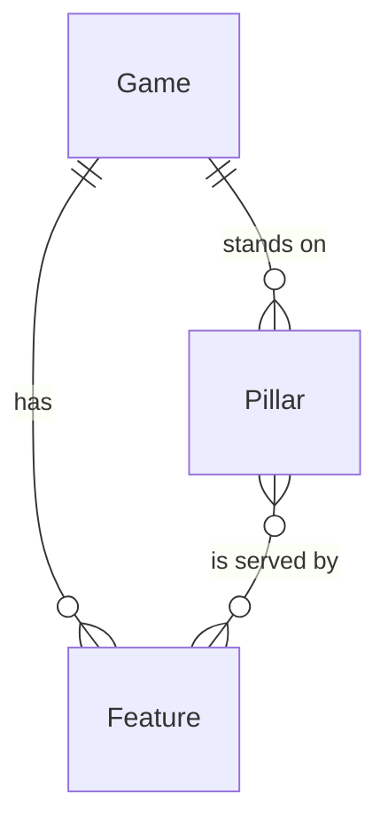

# Game design docs

*A recipe from the Fibery Process Cookbook: the process in plain words, and the model to build it in any tool.*

**Docs people actually read, and a concept validated by play.** For an indie team of two to six making a small game. Pillars say what the game is, one page says what each feature is, and a weekly review decides what gets built, reworked or cut.

## The idea

The classic game design document is a hundred pages nobody reads past the first. It goes stale in a month, and features creep in because nothing says no to them. This recipe replaces it with small pieces. The **Game** holds the hook, the audience and the one question the proof of concept must answer. Three to five **Pillars**, short statements of the experience the game must deliver, act as a filter for every idea. Each **Feature** gets a one pager: one screen with a sketch, the **Hypothesis** of why it will be fun, and how a prototype will test it. Once a week the team meets for a design review, where the **Game lead**, the person with the last word on the design, decides each waiting feature's fate. A feature is validated only when someone has played it.

In any work tool, this becomes three linked kinds of records: games, pillars and features. A feature's workflow runs from *Idea* through *In review*, *In prototype* and *Result in* to *Validated*, with *Cut* as the honest other ending. People live on a board of features by state and a review queue. Buttons turn each review decision into a state change and a comment that says who decided and why. It's a living design doc that keeps the game honest, not a task tracker.

## How it runs

Follow one feature, *Tide moves the map*, of a small game called *Lantern Tide*, from idea to validation.

1. **The game gets its pillars.** Before any feature, the game lead writes the game's hook and its **Concept question**, the one thing the proof of concept must show. The team agrees on three pillars: *Light is scarce*, *The tide reshapes every run* and *Quiet tension*. Each pillar says in one line what it **Rules out**, so it can say no. The game sits in *Concept*.
2. **An idea appears.** Someone adds a feature in *Idea* through the **New idea** form: "Tide moves the map". They link it to the game and to *The tide reshapes every run*. Ideas are cheap, and most stay ideas.
3. **It gets a one pager.** An author, one of the **Authors** who write the feature, moves it to *One pager*. They write the page in its description and attach a **Sketch**, the diagram that carries most of the page. They fill the hypothesis, "players plan around the tide and feel clever when it pays off", and the **Test**, what a prototype must show to confirm it. They tick **Core** when the concept can't be validated without this feature. When the page fits one screen, they move it to *In review*.
4. **The review decides.** At the weekly design review, the game lead goes through the **Review queue**, every feature waiting for a decision. A feature linked to no active pillar is red, and the first question is which pillar it serves. The team talks and the game lead writes a **Review note**, why this decision. Then the game lead presses one of three buttons. **Prototype it** sends *Tide moves the map* to *In prototype*, and with its first feature in prototype the game lead moves the game to *Prototyping*. **Rework** sends a page back to *One pager*. **Cut it** ends a feature for good. Each leaves a comment with the note and the game lead's name.
5. **It gets prototyped.** The authors set **Prototype by**, a date a week or two away, and build the smallest thing that tests the hypothesis. One question per prototype, ugly on purpose, played by someone who didn't build it. Past that date the card turns red, and the **Prototype reminder** nudges the authors every Monday.
6. **The result comes back.** After playing it, the authors write the **Result**, what players actually did and felt. They move the feature to *Result in*, where it waits for the next review. Here the tide worked, but only once it was telegraphed one turn ahead; the page now says so.
7. **It's validated, or not.** At the next review the game lead presses **Mark validated**, and *Tide moves the map* is *Validated*. A prototype that missed gets Prototype it again for another round, Rework when the page itself was wrong, or Cut it, with what was learned. A cut feature stays, so nobody pitches it again without reading why it died.
8. **The concept is validated.** The **Proof of concept** view shows how many core features are validated. When every core feature is *Validated*, the game lead moves the game to *Concept validated*. If the concept question gets a clear no, the game is *Shelved*, and its pillars, pages and results stay as the record of why.

## What people look at

- **Every morning** — **Design board**, every live feature by state: what's being written, what waits for review, what's in prototype. Red cards are off pillar, overdue or validated with no result. **My features** for your own pages and prototypes.
- **At the weekly review** — **Review queue**: what waits for a decision, new pages *In review* and played prototypes with a *Result in*, with pillars, hypothesis and result side by side.
- **Any time** — **Pillars**, for which features serve each pillar and which pillar has none. **Proof of concept**, for how close the game is to answering its question. **Cut features**, for what was dropped and why. **New idea**, a form, for capturing an idea in ten seconds.
- **How to run game design docs** — this process on one screen, kept where the team works.

## The rules

These are all the automations; everything else in the story is done by people.

- **Prototype it** (a button on a feature): moves the feature to *In prototype* and adds a comment that quotes its Review note; the comment carries the name of whoever pressed it.
- **Rework** (a button on a feature): moves the feature to *One pager* and adds a comment that quotes its Review note.
- **Cut it** (a button on a feature): moves the feature to *Cut* and adds a comment that quotes its Review note. A cut is a decision with a reason, not a deletion.
- **Mark validated** (a button on a feature): moves the feature to *Validated* and adds a comment that quotes its Review note. It checks nothing: a feature validated with no result is red on the Design board.
- **Prototype reminder**: every Monday at 09:00, the authors of every feature that is *In prototype* with a Prototype by date before today are notified.

No automations in your tool? Then a person does each of these at the same moment, and the promises they keep below become practices.

## What must stay true

Whatever anyone edits, adapts or corrects, these hold; each says what keeps it so.

- ★ Every feature serves at least one active pillar. Shown on the Design board and the Review queue, where **Off pillar** turns the card red; the review asks which pillar before anything else.
- ★ A feature is validated only by play: a *Validated* feature has a Result from a prototype. Shown on the Design board, where **No result** turns it red; the result is written by the people who played it.
- ★ A one pager fits one screen. A practice; the review sends a longer page back with Rework.
- Every review decision leaves a trace: who decided, what and why. Kept by **Prototype it**, **Rework**, **Cut it** and **Mark validated**, which write the comment, so a feature's comments are its review history while Review note holds only the latest reason; a card dragged across the board skips it, so the review uses the buttons.
- *Cut* is a real ending. A dropped feature is cut with its note, never deleted and never left in *Idea*. A practice; **Cut features** keeps the reasons where the next person with the same idea will find them.
- Pillars change rarely and in the open. A pillar the team outgrows is moved to *Retired*, not rewritten, and every feature that served only that pillar turns red through Off pillar until someone links it to an active one or cuts it. Shown on the Design board; retiring rather than rewriting is a practice.
- The concept's progress follows its core features now. Kept by the **Core features**, **Core validated** and **Concept progress** formulas; a core feature that is cut stops counting, which is a decision the review makes on purpose.

## Making it yours

Decide these before you set it up; each has a default if you shrug.

| Question | Default | If not the default |
|---|---|---|
| Are you choosing between several concepts at once? | No, one game | Yes: every concept gets its own game, pillars and features, and a Concepts board of Game by state shows which one earns the next prototype |
| Who decides at the review? | The game lead | The whole team, by agreement: anyone presses the buttons, and the comment still says who did; the Game lead field can go |
| Do you already track tasks or builds in another tool? | Yes | Features link to the work: add a Build link field on Feature for the prototype's build or task list, or a relation to your existing task database |
| Do you playtest with people outside the team? | Not yet | Yes: add a Playtest database, one session with its date and notes, linked to the features it tested, and write each feature's Result from those sessions |

- **Solo developers**: drop Authors, My features and the Game lead field; the review is your own Friday hour with the Review queue, and the buttons still leave the trace you'll want in three months.
- **Other words**: "mechanics" or "systems" for features, "design goals" or "experience goals" for pillars. Rename freely.
- **Visual pages**: many teams make the sketch the page and keep the text to a few lines under it. The Sketch field is there for that; a page that is all text is often a sign the idea isn't clear yet.
- **One document to hand out**: when a publisher or a new teammate wants a single GDD, a document that lists the game, its pillars and every validated feature's page does the job; generate it, don't maintain it.
- **After the proof of concept**: production needs more. Teams add a *Spec* state after *Validated* for full feature specs, a Content database for levels, items or characters, and their task tracker for the work. This recipe stops at the proof on purpose.
- **Pushed too far**: past about forty live features the board stops being a design doc and becomes a backlog. Cut or merge before you add more.

## Details for building

What follows is what the process is built from, in words any tool can follow; the story above is enough to run it.

Each kind of record (Game, Pillar, Feature) is a database or a table, depending on the tool, or a tab in a spreadsheet. A relation links two kinds; its inverse is the name it has on the other side. A state is a step in a workflow, and a finished state ends it. A rule is an automation, a button is an automation someone presses, and a formula is a field the tool computes. A nested view shows each record's children beneath it; where a tool can't nest, group the children by their parent instead.

A game has its pillars and its features. A feature serves one or several pillars, and a pillar is served by any number of features.

### Feature

One feature of the game, with its one page doc. The description holds the page under three headings: What the player does, Why it serves its pillars, Open questions. Comments on.

| Field | Type | Why |
|---|---|---|
| Game | relation, many-to-one → Game; inverse **Features** | The game it belongs to; rows of the Design board |
| Pillars | relation, many-to-many → Pillar; inverse **Features** | Which pillars it serves; read by Off pillar |
| Authors | people; inverse **Authored features** | Who writes the page and builds the prototype; My features and the Prototype reminder go to them |
| Sketch | files | The diagram that carries the page |
| Hypothesis | text | Why it will be fun, as a guess a prototype can test |
| Test | text | What a prototype must show to confirm the hypothesis |
| Core | checkbox | The concept can't be validated without it; counted by Core features |
| Prototype by | date | When the prototype should be played; read by Overdue and the Prototype reminder |
| Result | text | What players did and felt in the prototype; read by No result |
| Review note | text | Why the last review decided what it did; quoted by the four buttons, and the reason a cut feature died |

States: Idea → One pager → In review → In prototype → Result in → Validated (finished) · Cut (finished). Default: Idea. A validated feature that the team reopens goes back to *In review* by hand, with a new Result.

Formulas:
- **Off pillar** — yes when the feature is not *Cut* and is linked to no pillar in the *Active* state, no otherwise; colors cards red on the Design board and the Review queue.
- **No result** — yes when the feature is *Validated* and Result is empty, no otherwise; colors cards red on the Design board.
- **Overdue** — yes when the feature is *In prototype* and Prototype by is before today, no otherwise and no with no date; colors cards red on the Design board.

### Game

One game, or one concept being tested. The description holds the pitch under three headings: Hook, Audience, Like and unlike. Comments on.

| Field | Type | Why |
|---|---|---|
| Concept question | text | The one thing the proof of concept must answer; on Proof of concept |
| Target date | date | When the team wants the answer; on Proof of concept |
| Game lead | person; inverse **Led games** | Who has the last word at the review and moves the game along |

States: Concept → Prototyping → Concept validated (finished) · Shelved (finished). Default: Concept.

Formulas:
- **Core features** — how many of the game's features have Core ticked and are not *Cut*, a whole number, 0 with none; on Proof of concept.
- **Core validated** — how many of the game's features have Core ticked and are *Validated*, a whole number, 0 with none; on Proof of concept.
- **Concept progress** — Core validated out of Core features, a whole number from 0 to 100, 0 when Core features is 0; on Proof of concept.

### Pillar

One short statement of the experience the game must deliver. The name is the pillar; the description says what it means in play, with an example or two. Comments on.

| Field | Type | Why |
|---|---|---|
| Game | relation, many-to-one → Game; inverse **Pillars** | The game it holds up |
| Rules out | text | What this pillar says no to; what makes it a filter rather than a slogan |

States: Active → Retired (finished). Default: Active.

Formulas:
- **Features served** — how many of the pillar's features are not *Cut*, a whole number, 0 with none; on Pillars, where 0 shows a pillar nothing serves.

### Views

| View | Type | Of | Grouping | Shows | Filter | Sort |
|---|---|---|---|---|---|---|
| Design board | board | Feature | columns State, rows Game | Authors, Pillars, Prototype by; cards red when Off pillar, No result or Overdue | State is not Cut | |
| My features | list | Feature | | State, Game, Prototype by | Authors is me; State is not Validated or Cut | Prototype by asc |
| Review queue | grid | Feature | | State, Pillars, Hypothesis, Test, Result, Review note; rows red when Off pillar | State is In review or Result in | State asc |
| Pillars | grid | Pillar | Features nested: State, Core | Game, Rules out, Features served | State is Active | |
| Proof of concept | grid | Game | Features nested: State, Core, Result | State, Concept question, Target date, Core features, Core validated, Concept progress | | |
| Cut features | grid | Feature | | Game, Pillars, Review note | State is Cut | |
| New idea | form | Feature | | Name (required), Game (required), Pillars, Hypothesis, Description | | |
| How to run game design docs | document | | | the process on one screen, linking to this recipe | | |

### App

None needed. The central moment is the weekly review, and the Review queue shows everything it decides on in one grid. A pillar by feature matrix would be nice to look at, but the Pillars grid answers the same question.

### Reports

None needed. The questions this process asks are answered by counts on the Proof of concept view, not by charts over time.

### Sample story

Lantern Tide is in *Prototyping*, two thirds of the way to its target date, with three active pillars and a fourth, *Cozy crafting*, retired last week. Tide moves the map is in prototype, due in three days. Lantern fuel is validated, and Fog of sound came back from its prototype and waits with its result in. Two one pagers are being written; one, a fishing minigame, served only the retired pillar and is red. A crafting bench was cut at the last review with its reason. Shadow creatures is a day past its prototype date. Five ideas sit untouched.

## Sources

- ['The goal of design is to efficiently communicate ideas'](https://www.gamedeveloper.com/design/-the-goal-of-design-is-to-efficiently-communicate-ideas-), Danielle Riendeau, Game Developer, 2026, on Stone Librande's GDC 2010 talk *One-Page Designs*: one page per idea instead of a design bible, a diagram at its heart, and why a page that must fit forces the designer to understand the idea.
- [Design Pillars – The Core of Your Game](https://www.gamedeveloper.com/design/design-pillars-the-core-of-your-game), Max Pears, Game Developer, 2017: three to five pillars, and asking of every idea whether it serves them.
- [Why Prototype?](https://learn.unity.com/tutorial/why-prototype), Unity Technologies, Unity Learn: one question per prototype, built in hours, played by others, and a write-up of about a page on what was asked and what was learned.

## Build it

In Fibery, open Claude with the Fibery plugin, attach this recipe and say "set up game design docs". Claude asks a few questions, then sets it up in about ten minutes.

Anywhere else, give this recipe to your AI assistant and name your tool, or build it by hand from Details for building.

---

*The one page design is Stone Librande's idea, from his GDC 2010 talk* One-Page Designs*, free on the GDC Vault (gdcvault.com/play/1012356). This recipe describes it in its own words and isn't affiliated with him. From the Fibery Process Cookbook (https://github.com/Fibery-inc/process-cookbook), licensed CC BY 4.0 (https://creativecommons.org/licenses/by/4.0/): copy, adapt and build it anywhere, crediting the cookbook.*
