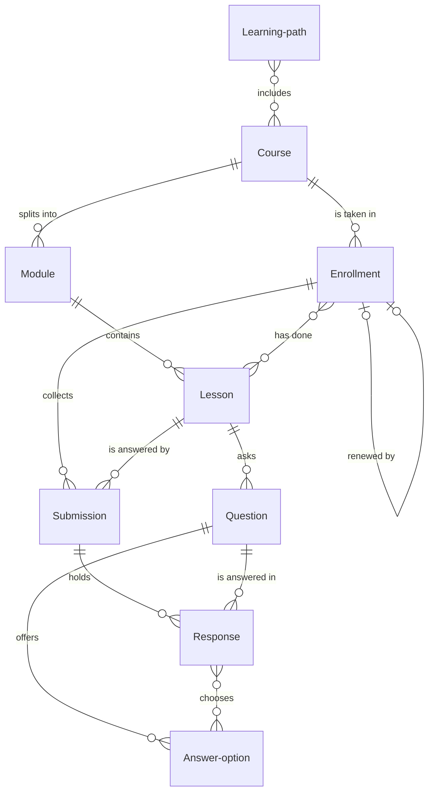

# Learning management

*A recipe from the Fibery Process Cookbook: the process in plain words, and the model to build it in any tool.*

**Everyone knows what to learn and by when; nobody chases certificates.** For a company or department of ten to five hundred people. Courses, reviewed work and recurring required training in one place, with the people who learn, teach and answer for it.

## The idea

Most companies run training from a slide folder, a spreadsheet of who did what, and a reminder someone forgets to send. So nobody can say who has done this year's security training, a new hire's onboarding stalls without anyone noticing, and an assignment waits weeks for feedback. The fix is to treat learning as work with owners and dates. A **Course** is built from **Modules**, sections in order, and each module from **Lessons**: a reading, an assignment or a quiz. One person taking one course is an **Enrollment**, with a due date when the course is required and a progress figure everyone can see. A quiz is a set of **Questions**, each with its **Answer options**, taken inside the course and scored the moment the learner finishes, with no outside quiz tool. Assignments and quiz attempts come in as **Submissions**; an **Instructor** reviews the assignments. Courses group into **Learning paths**, such as onboarding for every new hire. A **Learning manager** assigns training and answers for who is trained, and everyone in the company is a **Learner**.

In any work tool, this becomes courses with their modules and lessons, enrollments whose workflow runs from *Assigned* to *Completed*, and submissions that move from *Submitted* to *Accepted*. Learners live in one app and nothing else: their courses, each lesson on screen in order, quizzes and hand-ins, with no records, lists or forms to find. The learning manager lives in a board of people against required courses. Formulas score every quiz from the learner's answers. Rules turn a missed date into an overdue enrollment, close an enrollment once everything is done, and open a renewal before a certification runs out. It's a record of who learned what and when, not a place to host video.

## How it runs

Follow one enrollment: a new hire taking *Security basics*, a required course that must be retaken every year.

1. **A course is written.** An instructor builds a course from modules and lessons, then publishes it. *Security basics* starts in *Draft*, the course's first state. Its **Instructors**, the people who own it, add three modules in order. Each lesson has a **Kind**: *Reading* for content to go through, *Assignment* for work an instructor reviews, *Quiz* for a knowledge check with a **Pass mark**, the score from 0 to 100 needed to pass. The lesson's content lives in its description, with any video linked. A colleague reads it in *In review*, and the instructor moves it to *Published*. The course gets **Valid for months**, here 12, because the company asks everyone to retake it yearly. Then the learning manager adds the course to a learning path, so everyone knows what a role must take: here *Onboarding*, the path every new hire takes, beside two other courses.
2. **The instructor writes the quizzes.** Before the course is published, each quiz lesson gets its questions and answer options, with the right ones marked. *Security basics* has a short quiz after each module and a *Final test*, a quiz lesson in its own last module that checks the whole course. Each question has a **Question kind**, *Single choice* or *Multiple choice*, its answer options with **Correct** ticked on the right ones, and an **Explanation** the learner sees after answering. The instructor builds them in the **Quiz builder**, where a broken question is red: fewer than two options, no correct option, or a single choice question with more than one. A quiz is **Quiz ready** when it has a pass mark, at least one question and no broken ones, and the course shows **Quizzes not ready**, how many of its quizzes aren't. The instructor publishes only at 0.
3. **Someone is assigned.** The learning manager creates an enrollment for the new hire through the **New enrollment** form. It names the **Learner**, the course, **Required** because it is mandatory, a **Due date** three weeks out, and **Assigned by**, the learning manager. It starts in *Assigned* and appears in the learner's **My learning**. For the rest of the path, the manager adds one enrollment per course.
4. **The learner works through the lessons.** The learner opens **My learning**, the one app learners use, and reads the course lesson by lesson. They see their open courses with progress and due date, press Continue, and read each lesson on screen. Next marks a reading done. Each reading done is added to **Lessons done**. The enrollment's **Progress** is the share of the course's lessons done, from 0 to 100: a reading counts when it is ticked, an assignment or a quiz only once it has an accepted submission, so a failed quiz never moves it. The first reading done moves the enrollment to *In progress* through the **Started** rule.
5. **The learner takes a quiz.** The learner answers a quiz in My learning, and it is scored the moment they finish. Each attempt is one submission, in *Answering* while the learner is still on it. Each answer is a **Response**, the options the learner chose for one question, and a response is **Right** when the chosen options are exactly the correct ones. The attempt's **Score** is the share of the quiz's questions answered right, from 0 to 100; a question skipped or answered twice counts as wrong. While the attempt is *Answering*, the score is only a running count and decides nothing. The attempt ends when the learner presses Finish: My learning stamps the score as **Final score** and the attempt ends *Accepted* when it is **Passed**, its final score reaching the pass mark, or *Not passed*, and then the learner tries again with a new attempt. If a response is changed afterwards, the score no longer matches the final score, and the attempt shows **Changed after finish** in the instructor's review queue.
6. **An assignment is handed in and reviewed.** The learner hands in assignment work in My learning, and an instructor reviews it. They attach files or a link right on the lesson's screen, and the submission starts in *Submitted*; the instructor's feedback shows on the same screen. The instructor opens the **Review queue**, takes the oldest submission and moves it to *In review*. They write feedback as a comment and move it to *Accepted* or back to *Needs changes*, and the learner resubmits on the same submission. The **Review done** rule tells the learner the result, for a quiz attempt as for an assignment.
7. **The course is completed.** Once every reading is ticked and every assignment and quiz accepted, Progress reaches 100 and the enrollment closes by itself. The **On completion** rule moves the enrollment to *Completed* and stamps **Completed on**. **Valid until** follows from it: twelve months later for *Security basics*. The learner leaves a **Rating** from 1 to 5 and a line of **Feedback**, which instructors read when they revise the course.
8. **Or it runs late, or is dropped.** A required enrollment past its due date turns *Overdue*, and both the learner and the person who assigned it hear about it. The **Due date passed** rule does this every morning. The enrollment still completes as above once the work is done. When a learner leaves the company or the training no longer applies, the learning manager moves it to *Dropped*.
9. **The learning manager reviews compliance.** Every Monday the learning manager opens **Compliance**: every person against every required course. Overdue cards are red, certifications about to expire are amber, and the manager follows up with the people and their leads.
10. **A year later, it renews.** Thirty days before Valid until, a fresh enrollment opens for the same learner and course. The **Renewal due** rule creates it, links it to the old one as **Renewed by** and sets its due date to the day the certification expires. The old enrollment stays *Completed*, so last year's training is still on file.

## What people look at

- **Every day, learners** — **My learning**, a custom view and the only thing a learner ever opens: their courses, then one course lesson by lesson, quizzes and hand-ins in place. If your tool can't draw it, learners use a plain list of their enrollments, the **Submit work** form and the **Answer** form instead.
- **Every morning, instructors** — the **Review queue**: which submissions wait, oldest first.
- **Every Monday** — the learning manager opens **Compliance**: who has done which required course, who is late, whose certification runs out soon.
- **Any time** — **Course outline**, every course with its modules, lessons and learning paths, its completion rate and rating, for instructors who maintain courses; the **Quiz builder**, every quiz with its questions and answer options, where instructors write and fix quizzes; **New enrollment**, a form; and the **Completions by month** report for how much training actually got done.
- **How to run the learning program** — this process on one screen, kept where the company works.

## The rules

These are all the automations; everything else in the story is done by people.

- **Started**: when Lessons done changes on an enrollment that is *Assigned*, the enrollment moves to *In progress*.
- **On completion**: when Progress turns to 100 on an enrollment that is *Assigned*, *In progress* or *Overdue*, the enrollment moves to *Completed* and Completed on is set to today.
- **Due date passed**: every day at 07:00, every enrollment that is *Assigned* or *In progress* with a due date before today moves to *Overdue*, and its learner and its Assigned by are notified.
- **Renewal due**: every day at 07:00, for every enrollment where Expiring soon is yes and Renewed by is empty, a new enrollment is created and linked as its Renewed by, with the same learner, course, Required and Assigned by, a due date equal to its Valid until, in *Assigned*; the learner is notified.
- **Review done**: when a submission moves to *Needs changes*, *Accepted* or *Not passed*, its learner is notified.

No automations in your tool? Then a person does each of these at the same moment, and the promises they keep below become practices.

## What must stay true

Whatever anyone edits, adapts or corrects, these hold; each says what keeps it so.

- ★ An enrollment is *Completed* only when every lesson is done and every assignment and quiz has an accepted submission. Kept by the **Progress** formula, which counts a quiz or assignment only through an accepted submission, and by **On completion**, which runs on it; shown on **Compliance**, where an enrollment dragged to *Completed* with Progress under 100 is red.
- ★ Required training has a due date, and a missed one is seen. Kept by **Due date passed**, which turns the enrollment *Overdue* and tells the learner and whoever assigned it; shown on **Compliance**, where a required enrollment with no due date is red too.
- ★ A certification expires on its own schedule, never on someone's memory. Kept by the **Valid until** formula, computed from Completed on and the course's Valid for months, and by **Renewal due**, which opens the next enrollment thirty days ahead.
- ★ Past training is history. A renewal is a new enrollment, and the old one stays *Completed* with its date, so the company can always show who was trained when. Kept by **Renewal due**, which creates a new record instead of reopening the old one; reopening a completed enrollment by hand is a practice not to follow.
- A quiz result comes from the learner's answers, never typed, and is fixed at Finish. Every attempt keeps its own responses, and a failed attempt ends *Not passed* while the next one is a new submission. Kept by the **Right** and **Score** formulas and My learning, which stamps Final score and creates a new attempt each time; shown on the **Review queue**, where an attempt whose responses changed after Finish appears with Changed after finish.
- ★ A learner never has to find their way: everything they do, from reading to quizzes and hand-ins, happens in My learning, and nothing in it is for instructors or managers. Kept by **My learning**, which shows only the learner's own enrollments and opens no record pages; every view for instructors and managers is placed where learners don't start.
- A course is published only with working quizzes, and changes carefully once it is. Shown on **Course outline**, where a course with Quizzes not ready above 0 is red, and on the **Quiz builder**, where the broken question is red; publishing at 0 is a practice. A new lesson lowers the Progress of everyone mid-course, and changing which answer option is correct re-scores every past attempt. So small fixes are edits to wording; a changed quiz is a new quiz lesson, and a rewrite is a new course, with the old one moved to *Archived*. A practice.

## Making it yours

Decide these before you set it up; each has a default if you shrug.

| Question | Default | If not the default |
|---|---|---|
| Do you already track teams, departments or roles in your tool? | No | The learning manager sees compliance by team: link each learner's team, group Compliance rows by Team instead of Learner, and give Learning path an Audience field pointing at the teams or roles it's for |
| Who reviews assignments? | The course's instructors | A learner's own lead or a peer reviews: add a Reviewer person field on Submission, filled when it's submitted, and filter the Review queue to Reviewer is me |
| Does any training expire? | Yes, per course | Nothing needs retaking: drop Valid for months, Valid until, Expiring soon, Renewed by and the Renewal due rule |
| May everyone see everyone's progress and scores? | Yes | Scores stay private: keep Enrollment and Submission apart, open only to the learner, the instructors and the learning manager |

- **Other words:** "Trainings", "Programs" or "Modules" for courses; "Tracks" or "Curricula" for learning paths; "Assignments" for enrollments. Rename freely.
- **Assigning a whole path at once:** this recipe adds one enrollment per course, which is quick through the form for a handful of courses. A tool that can run a script can add an Assign path button on Learning path that creates them all.
- **External learners** (customers, partners, students) who never open the tool: a Learner database of records instead of a person field, with enrollments and submissions coming in through forms. The course player and My learning go away; learners get their lessons by link.
- **Live sessions** (workshops, webinars): a Session database linked to Lesson, with date, place and an Attended field per learner, once the course needs more than a reading list.
- **Open questions**, where the learner writes an answer: make it an assignment lesson an instructor reviews. Choice questions are what the tool can score on its own.
- **A question bank**, where the final test draws questions from every lesson's quiz: a Question can link to several quiz lessons instead of one. Random picks per attempt and a limit on attempts belong to My learning.
- **Locked answers:** where your tool can limit who edits a record, let learners create responses but not change them; Changed after finish then only catches mistakes, not second tries.
- **Prerequisites:** a Requires relation from Course to Course, shown on Course outline. Enforcing the order is a practice; nothing stops an enrollment.
- **Hardest questions**, the share of responses that are right per question, or **average quiz score per course**, a second report, or an Expired flag for certifications nobody renewed: what teams add once the program runs.
- **Pushed too far:** when every course is required and every lesson is a quiz, people click through without learning. Keep required training to what the company must prove.

## Details for building

What follows is what the process is built from, in words any tool can follow; the story above is enough to run it.

Each kind of record (Course, Module, Lesson, Question, Answer option, Learning path, Enrollment, Submission, Response) is a database or a table, depending on the tool, or a tab in a spreadsheet. A relation links two kinds; its inverse is the name it has on the other side. A state is a step in a workflow, and a finished state ends it. A rule is an automation, a button is an automation someone presses, and a formula is a field the tool computes. A nested view shows each record's children beneath it; where a tool can't nest, group the children by their parent instead.

Nine databases, past the usual seven, because a quiz scored inside the tool needs its questions, options and answers as records. The core is Course, Lesson, Enrollment and Submission; Module and Learning path organize courses, and Question, Answer option and Response make the quiz.

A course splits into modules, and a module into lessons. A quiz lesson holds questions, and each question its answer options. Learning paths and courses link many to many. An enrollment is one learner in one course; it collects the lessons done and the submissions made, and may be renewed by a later enrollment. A submission belongs to one enrollment and answers one lesson; a quiz attempt's submission holds one response per question, each pointing at the options chosen.

### Course

One course people take, from first lesson to completion. The description holds what the course is for and who should take it. Comments on.

| Field | Type | Why |
|---|---|---|
| Instructors | people; inverse **Courses taught** | Who owns the course and reviews its submissions |
| Learning paths | relation, many-to-many → Learning path; inverse **Courses** | The paths it belongs to |
| Valid for months | integer, 0 or more; 0 means it never expires | Read by Valid until on every enrollment |
| Hours | decimal, one decimal place | Rough time to complete; on Course outline and Learning paths, so managers plan time for it |

States: Draft → In review → Published → Archived (finished). Default: Draft. Only *Published* courses are offered on the New enrollment form.

Formulas:
- **Completion rate** — the share of its enrollments that are *Completed*, out of those not *Dropped*, a whole number from 0 to 100, 0 with none left; on Course outline.
- **Average rating** — the average Rating of its *Completed* enrollments that have one, a decimal with one decimal place, 0 with none; on Course outline.
- **Quizzes not ready** — how many of its *Quiz* lessons, across all its modules, have Quiz ready no, a whole number, 0 with none; on Course outline, red above 0.

### Module

One section of a course, in order. No description.

| Field | Type | Why |
|---|---|---|
| Course | relation, many-to-one → Course; inverse **Modules** | The course it belongs to |
| Order | integer | Its place in the course; My learning and Course outline sort by it |

### Lesson

One step of a module: a reading, assignment or quiz. The description holds the lesson's content; for an assignment, what to hand in and how it's judged. Comments on.

| Field | Type | Why |
|---|---|---|
| Module | relation, many-to-one → Module; inverse **Lessons** | The module it belongs to |
| Order | integer | Its place in the module; My learning and Course outline sort by it |
| Kind | single select: Reading, Assignment, Quiz; default Reading | Assignments and quizzes count toward Progress only through an accepted submission; My learning ticks readings only |
| Pass mark | integer, 0 to 100; default 80 | The score a quiz needs; read by Passed on Submission; empty for readings and assignments |
| Minutes | integer | Rough time for the lesson; on My learning |
| Link | url | The video or the material the lesson points to |
| Files | files | Slides, handouts and templates |

Formulas:
- **Quiz ready** — yes when the lesson is a *Quiz* with a Pass mark, at least one question and no question with Question problem; no otherwise, and yes for readings and assignments; on the Quiz builder, read by Quizzes not ready and My learning.

### Question

One question of a quiz lesson. The description holds the question itself, with any picture. No comments.

| Field | Type | Why |
|---|---|---|
| Lesson | relation, many-to-one → Lesson; inverse **Questions** | The quiz it belongs to; read by Score |
| Order | integer | Its place in the quiz; My learning and Quiz builder sort by it |
| Question kind | single select: Single choice, Multiple choice; default Single choice | Whether My learning offers one pick or several |
| Explanation | rich text | Why the right answer is right; My learning shows it after the attempt |

Formulas:
- **Question problem** — yes when the question has fewer than two answer options, none marked Correct, or is *Single choice* with more than one marked Correct; no otherwise; red on the Quiz builder, read by Quiz ready.

### Answer option

One possible answer to a question. No description.

| Field | Type | Why |
|---|---|---|
| Question | relation, many-to-one → Question; inverse **Answer options** | The question it answers |
| Order | integer | Its place among the options; My learning shows them in this order |
| Correct | checkbox | Marks a right answer; read by Right on Response |

### Learning path

A set of courses taken together, such as onboarding. The description holds who the path is for and in which order to take its courses.

No fields beyond the Courses inverse from Course.

### Enrollment

One person taking one course. Named "<learner> — <course>". Comments on.

| Field | Type | Why |
|---|---|---|
| Learner | person; inverse **Enrollments** | Who takes the course; My learning, Due date passed and Review done go to them |
| Course | relation, many-to-one → Course; inverse **Enrollments** | The course taken |
| Required | checkbox | Mandatory training; Compliance shows only these |
| Due date | date | When it must be done; read by Due date passed |
| Assigned by | person; inverse **Enrollments assigned** | Who assigned it; told when it's overdue, and copied to a renewal |
| Lessons done | relation, many-to-many → Lesson; inverse **Done in** | Readings ticked by the learner in My learning; read by Progress, which ignores any assignment or quiz added here, and by Started |
| Completed on | date | Stamped by On completion; read by Valid until and the Completions by month report |
| Rating | integer, 1 to 5 | The learner's verdict on the course; read by Average rating |
| Feedback | text | One line for the instructors, read on the course's enrollments when they revise it |
| Renewed by | relation, one-to-one → Enrollment; inverse **Renews** | The enrollment that renews this one; set by Renewal due |

States: Assigned → In progress → Completed (finished) · Overdue · Dropped (finished). Default: Assigned. *Overdue* is not an ending: an overdue enrollment still moves to *Completed*. Source of truth: **Progress**; On completion sets the state from it, and a card dragged to *Completed* early is red on Compliance.

Formulas:
- **Progress** — the share of the course's lessons, across all its modules, that are done: a *Reading* when it is in Lessons done, an *Assignment* or *Quiz* when this enrollment has an *Accepted* submission for it; a whole number from 0 to 100, 0 when the course has no lessons; on My learning and Compliance, read by On completion.
- **Valid until** — Completed on plus the course's Valid for months, a date; far in the future when Valid for months is 0 or there is no Completed on; on Compliance, read by Expiring soon.
- **Expiring soon** — yes when the enrollment is *Completed*, Valid until is within the next 30 days or already past, and Renewed by is empty; no otherwise; read by Renewal due, colors Compliance cards amber.

### Submission

One hand-in of an assignment, or one quiz attempt. Named "<learner> — <lesson>". The description holds the learner's note on an assignment. Comments on, where the instructor writes feedback.

| Field | Type | Why |
|---|---|---|
| Enrollment | relation, many-to-one → Enrollment; inverse **Submissions** | Whose course this work counts for; read by Progress |
| Lesson | relation, many-to-one → Lesson; inverse **Submissions** | The assignment or quiz it answers |
| Learner | person; inverse **My submissions** | Who handed it in; Review done notifies them |
| Submitted on | date; default today | Sorts the Review queue, oldest first |
| Final score | integer, 0 to 100 | Score at the moment of Finish, stamped by My learning and never edited by people; read by Passed and Changed after finish |
| Files | files | The work itself |
| Link | url | The work, when it lives elsewhere |

States: Answering → Submitted → In review → Needs changes → Accepted (finished) · Not passed (finished). Default: Submitted. *Answering* is a quiz attempt still open in My learning; when the learner finishes, My learning moves it to *Accepted* when Passed is yes and to *Not passed* otherwise, so a quiz attempt never waits for review. An assignment in *Needs changes* moves back to *Submitted* when the learner resubmits. Source of truth for a quiz: Final score, stamped from Score at Finish; Score keeps following the responses, and Changed after finish shows when the two part.

Formulas:
- **Score** — the share of its lesson's questions that have exactly one response in this submission and that response is Right, a whole number from 0 to 100, 0 when the lesson has no questions; responses to questions of another lesson don't count. On My learning, stamped into Final score at Finish.
- **Passed** — yes when its lesson is a *Quiz* and Final score is at least the lesson's Pass mark, no otherwise, and no with no final score or no pass mark; read by My learning at Finish.
- **Changed after finish** — yes when the submission has a Final score and Score is no longer equal to it, no otherwise; on the Review queue.

### Response

One learner's answer to one question in one quiz attempt. Named by its question. No description.

| Field | Type | Why |
|---|---|---|
| Submission | relation, many-to-one → Submission; inverse **Responses** | The attempt it belongs to; read by Score |
| Question | relation, many-to-one → Question; inverse **Responses** | The question answered |
| Chosen options | relation, many-to-many → Answer option; inverse **Chosen in** | What the learner picked; one for a single choice question |

Formulas:
- **Right** — yes when the chosen options are exactly the question's options marked Correct, none missing and none extra, so an option from another question can never be right; no otherwise, and no with nothing chosen; read by Score.

Twelve formulas, past the usual eight, because quizzes are scored and checked by formulas rather than by code.

### Views

| View | Type | Of | Grouping | Shows | Filter | Sort |
|---|---|---|---|---|---|---|
| My learning | app | | | see App | | |
| Review queue | list | Submission | | Lesson, Learner, Submitted on, State, Final score, Changed after finish; red when Changed after finish | State is Submitted or In review, or Changed after finish is yes | Submitted on asc |
| Compliance | board | Enrollment | columns Course, rows Learner | State, Progress, Due date, Valid until; red when Overdue, or Completed with Progress under 100, or with no due date; amber when Expiring soon | Required is checked; State is not Dropped; Renewed by is empty | |
| Course outline | grid | Course | Modules nested: Order; Lessons nested: Order, Kind, Minutes, Pass mark | State, Instructors, Learning paths, Hours, Valid for months, Quizzes not ready, Completion rate, Average rating; red when Quizzes not ready is above 0 | State is not Archived | |
| Quiz builder | grid | Lesson | Questions nested: Order, Question kind, Explanation, Question problem, red when Question problem; Answer options nested: Order, Correct | Module, Pass mark, Quiz ready; red when Quiz ready is no | Kind is Quiz | |
| New enrollment | form | Enrollment | | Learner (required), Course (required, Published only), Required, Due date, Assigned by (default: me) | | |
| Submit work (fallback) | form | Submission | | Enrollment (required), Lesson (required), Learner (default: me), Files, Link, Description | | |
| Answer (fallback) | form | Response | | Submission (required), Question (required), Chosen options (required) | | |
| How to run the learning program | document | | | the process on one screen, linking to this recipe | | |

### App

**My learning**, a page of its own and the first thing a learner sees; never a tab on a record. It is the learner's whole experience, three screens with no other buttons. **Home**: the learner's own open enrollments as cards, each with course, Progress, Due date and a Continue button; finished ones fold below. **Course**: the lessons in Order, grouped by module, the current one open on screen with its content, Link and Files; Next marks a reading done and moves on, and the learner never opens a record page. An assignment lesson has the hand-in on the same screen (files or a link, then Hand in), with its state and the instructor's comments shown under it. **Quiz**: Start creates a submission in *Answering*, questions come one at a time, one pick or several by their kind, each answer a response; Finish warns about skipped questions, stamps Score into Final score, moves the attempt to *Accepted* or *Not passed* by Passed, and shows which were right with explanations; Try again starts a new attempt, and only a Quiz ready quiz can be started. It **reads** the learner's Enrollments, Course, Modules, Lessons (Order, Kind, Minutes, Link, Files, Pass mark, description), Questions, Answer options (Correct only after Finish), Lessons done, Submissions (Lesson, State, Score, Passed, comments) and Progress, and **writes** Lessons done (readings only), Submission (Enrollment, Lesson, Learner, Submitted on, Files, Link, Final score, State) and Response (Submission, Question, Chosen options). Fallback: a list of the learner's open enrollments, readings ticked in Lessons done, Submit work for hand-ins and the Answer form for quizzes, which an instructor then closes by Passed. It earns its place because a learner needs one calm place to learn, and lists, record pages and forms are built for the people who run the program; the scoring itself stays in formulas, so the app only shows and collects.

### Reports

**Completions by month** — source Enrollment, current, only enrollments with Completed on: a stacked bar counting enrollments by month of Completed on, colored by Required.

### Sample story

Onboarding has three courses, all published. Security basics, the hero, is required, valid for 12 months: one new hire is halfway through with an assignment in review and a due date in nine days; another passed the Final test on the second attempt, 70 then 90, and completed last week, rating it 4. One learner completed it eleven months ago, so their renewal has just opened. One required enrollment is a week overdue, and one was dropped when its learner left. Presenting with confidence, an optional course, is still in review with two modules. An assignment has waited six days for feedback, one quiz attempt sits at Not passed, and one learner left a quiz half answered.

## Sources

- [Completion tracking](https://docs.moodle.org/39/en/Completion_tracking), MoodleDocs, Moodle: a lesson counts as done when it is viewed, scored or ticked by the learner, and a course completes when its lessons do.
- [Certifications](https://docs.moodle.org/503/en/Certifications), MoodleDocs, Moodle: recurring compliance training with an expiry, a recertification due on the expiry date, and earlier completions kept on record.

## Build it

In Fibery, open Claude with the Fibery plugin, attach this recipe and say "set up learning management". Claude asks a few questions, then sets it up in about ten minutes.

Anywhere else, give this recipe to your AI assistant and name your tool, or build it by hand from Details for building.

---

*From the Fibery Process Cookbook (https://github.com/Fibery-inc/process-cookbook), licensed CC BY 4.0 (https://creativecommons.org/licenses/by/4.0/): copy, adapt and build it anywhere, crediting the cookbook.*
