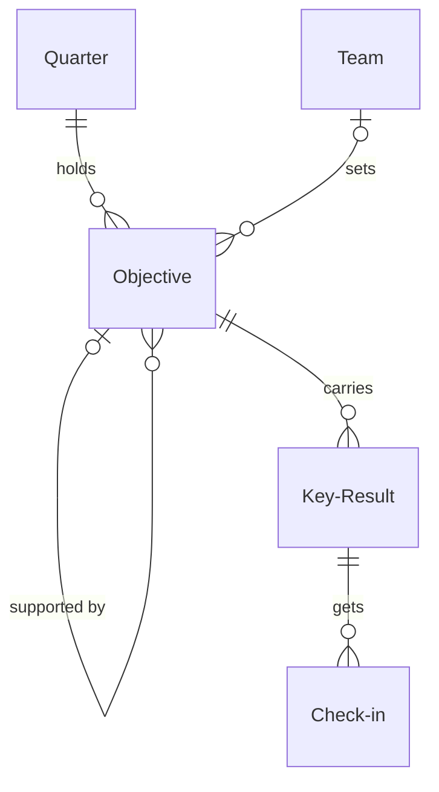

# OKRs

*A recipe from the Fibery Process Cookbook: the process in plain words, and the model to build it in any tool.*

**Everyone knows the few things that matter this quarter, and whether they're moving.** For a company of twenty to two hundred people in several teams. John Doerr's Objectives and Key Results, set up so every team objective shows under the company objective it serves and the weekly check in is a record, not a memory.

## The idea

A company of sixty has more good ideas than quarters; without a system each team chases its own, and "how are we doing" is answered from memory. OKRs answer it with numbers. A **Quarter** is the clock: thirteen weeks with a hard end. Inside it, an **Objective** says what the company, or one **Team**, wants to be true by the end, in one qualitative line, with an **Owner** who answers for it. Each objective carries two to five **Key Results**, the numbers that prove it: each moves from a starting number to a target, so progress is computed, never claimed. An objective is the company's or a team's, and every team objective supports one company objective, so the company's few goals and the teams' work hang on one tree: three to five objectives at the top, one to three per team.

The habit that keeps it alive is the weekly **Check in**: every key result owner records the new number, a health and a line of context, and the team looks at the whole picture together. At the end of the quarter every key result gets a score from 0 to 100, and each objective's owner writes down what they learned.

In any work tool, this becomes a few kinds of linked records: objectives whose workflow runs from *Draft* to *Scored*, linked to themselves so team objectives nest under the company objectives they support; key results whose progress is a formula from the start, the current and the target number; and check ins, with a rule that copies each new one onto its key result. People live in a list the Monday meeting runs on, and a scorecard shows every unscored key result in red before the quarter is closed. It's a way of deciding and tracking, not a task tracker: the work that moves the numbers stays where the team plans it.

## How it runs

Follow one team objective, *Stop churn before it starts*, through a quarter.

1. **Leadership drafts the company objectives.** Four to six weeks before the quarter, the leaders open the next quarter, in *Planning*, and write three company objectives in *Draft*, their **Level**, company or team, set to *Company*. One is *Grow by keeping customers*, owned by the CEO. Its **Kind** is *Aspirational*: a score of 70 of 100 at the end is a good quarter; a must-do is *Committed*, and under 100 needs an explanation. Its key result is *Net revenue retention from 98% to 110%*.
2. **Teams draft theirs.** Two weeks before the quarter the company objectives are shared. The Customer Success lead adds *Stop churn before it starts*: Level *Team*, Team Customer Success, herself as Owner, why it matters in the Description, and **Supports**, the company objective hers rolls up to, set to *Grow by keeping customers*. That link is the roll up: on **Company OKRs**, the list of the whole tree, her objective sits under the company one. She adds three key results, *Monthly churn from 3.0% to 1.5%* among them, each with a **Start value**, where the number stands now, a **Target value**, where it should stand at the end, and an Owner. The CEO sends one draft back, "Ship the health score": a task isn't a key result; the number it would move is.
3. **The quarter starts.** The CEO moves the quarter to *Active*, and the **Quarter starts** rule moves every *Draft* objective in it to *Active*; they appear on **This week**, the list the Monday meeting runs on. An objective added after this is moved to *Active* by its owner.
4. **Monday, every week.** At 09:00 the **Check in reminder** asks every key result owner for this week's number. Each owner opens the **Check in sheet**, an app with one row per key result they own, and records a check in for each: this week's number as the **New value**, a **Health**, *On track*, *At risk* or *Off track*, and a note on what moved and what's in the way.
5. **The team meets.** The **Record check in** rule copies the new number and the health onto the key result, so a key result always shows its latest check in. Then the team meets with This week open: every key result with its **Progress**, how far the number has come from start to target, 0 to 100, computed, never claimed. A key result with no check in for 7 days shows **Stale**, in red; the meeting asks why.
6. **Week six: a number stalls.** Churn is 2.8%. The owner marks it *At risk*; the note says the health score has to land first. That's the conversation, written down where the next one can find it. An objective that stops making sense is moved to *Dropped* by its owner, with a comment saying why.
7. **The company reads the tree.** On Company OKRs the CEO sees *Grow by keeping customers* at **Average progress** 30, the average of its own key results on a scale of 0 to 100, while its **Supporting progress**, the average of the active team objectives under it, is 60: the teams deliver, retention hasn't followed. That gap is the leadership meeting's question.
8. **The last week: scoring.** The CEO moves the quarter to *Scoring*. Each key result owner sets its **Score**, 0 to 100, from Progress plus judgement: churn reached 1.9%, Progress 73, scored 70. Each objective owner writes the reflection in the Description. Each objective's **Average score**, the average of its key results' scores, appears on the **Scorecard**, the grid of the quarter's objectives, highest first.
9. **The quarter closes.** The CEO opens the Scorecard: a key result still without a Score is red there, and the quarter isn't closed until none is. Then they press **Close the quarter**, a button on the quarter: every active objective becomes *Scored* and the quarter *Closed*. *Stop churn before it starts* ends at 63, a good aspirational quarter. The next one is already in *Planning*.

## What people look at

- **Every Monday** — **This week**: every key result of every active objective, grouped by objective, with progress, health and last check in; stale ones red. What moved, what didn't, who hasn't said.
- **Every Monday, before the meeting** — the **Check in sheet**, a custom view: each owner records this week's value, health and note for all their key results in one go. If your tool can't draw it, **Weekly check in**, a form, does the job one key result at a time.
- **Any time** — **Company OKRs**, the tree: each company objective, the team objectives under it, their key results, average and supporting progress side by side. **By team**: each team's objectives and what they support. **My key results**: your own numbers.
- **While planning** — **Next quarter**: the coming quarter's objectives and their key results, blank Supports and blank targets visible, so alignment is checked before it starts.
- **At the end of the quarter** — the **Scorecard**: every objective with its score and kind, highest first.
- **At the leadership meeting** — the **Progress over time** report: do the numbers climb, or jump in the last week? **Scores by quarter**: do aspirational objectives land near 70 and committed ones at 100?
- **How to run OKRs** — this process on one screen, kept where the team works.

## The rules

These are all the automations; everything else in the story is done by people.

- **Record check in**: when a check in is created, the key result's Current value becomes the check in's New value, its Health the check in's Health, and its Last check in the check in's Date. Every new check in counts, so check ins are entered in date order.
- **Check in reminder**: every Monday at 09:00, the owner of every key result in an *Active* objective is notified, one message per key result, asking for this week's check in.
- **Quarter starts**: when a quarter moves to *Active*, every objective in it that is *Draft* moves to *Active*.
- **Close the quarter** (a button on a quarter): every *Active* objective in the quarter moves to *Scored* and the quarter to *Closed*. It checks nothing: the Scorecard shows which key results are still unscored, in red.

No automations in your tool? Then a person does each of these at the same moment, and the promises they keep below become practices.

## What must stay true

Whatever anyone edits, adapts or corrects, these hold; each says what keeps it so.

- ★ Progress is computed, never claimed: a key result moves from a Start value to a Target value, and its Progress is how far the Current value has come. Kept by **Progress**, a formula; a key result with no Start value or Target value shows 0, and the Next quarter grid shows the blanks while the quarter is in *Planning*.
- The latest check in is the truth about a key result: Current value, Health and Last check in come from it. Kept by **Record check in**, which copies every new check in onto its key result; so a check in entered late for an earlier week is entered before this week's, a practice, and a corrected number is a new check in dated today, not an edit of the old one. A value entered on the key result by hand holds until the next check in.
- ★ Every team objective supports one company objective. Shown on **Next quarter**, which shows a team objective with an empty Supports while the quarter is in *Planning*; Quarter starts activates it anyway, so the planning meeting fixes the blank, not a rule.
- ★ Every key result in an active objective gets a check in every week. Shown by **Stale**, which turns a key result red on This week and My key results after 7 days without one; the **Check in reminder** asks every Monday, and the meeting asks why.
- ★ A quarter closes only when every key result of every active objective in it has a Score. Shown on the **Scorecard**, where a key result without a Score is red; **Close the quarter** checks nothing, so pressing it only when nothing is red is a practice, like the reflection in each objective's Description. Once closed, a score corrected later changes Average score on the Scorecard and nothing else; the quarter stays *Closed* and its objectives *Scored*.
- Progress follows the links: a key result moved to another objective, or a team objective moved under another company objective, takes its numbers with it, and both sides recompute. Kept by **Average progress** and **Supporting progress**, which read the links, not a copy.
- A dropped objective asks for nothing more, and counts for nothing: its key results leave This week, get no reminder, never show Stale and are not scored, and it drops out of its company objective's Supporting progress. Kept by the **Check in reminder**, **Stale**, **Close the quarter** and **Supporting progress**, which look only at *Active* objectives. Dropping is the owner's call, with a comment saying why; a practice.

## Making it yours

Decide these before you set it up; each has a default if you shrug.

| Question | Default | If not the default |
|---|---|---|
| Company and team objectives only, or individual ones too? | Company and Team | People get objectives of their own under their team's; add *Individual* to Level, and an individual objective supports a team objective. Most companies of this size skip them |
| Does a team objective support a company objective or a company key result? | An objective | Teams align on the number, not the sentence; point Supports at Key Result, Company OKRs nests team objectives under key results, and Supporting progress moves to Key Result |
| Do you already track teams, projects or initiatives in your tool? | — | Objectives show the teams you already have, and each key result shows the work behind it; link Objective to the existing teams database instead of adding Team, and add an Initiatives field on Key Result that links to the project database |

- **Small company (under twenty):** one level, everyone in one meeting. Drop Team, Supports and Level; Company OKRs becomes a flat list, and By team goes.
- **Confidence instead of health:** some teams rate each key result 1 to 10 for confidence, starting at 5. Replace Health with a Confidence number on Key Result and Check in; Record check in copies it the same way.
- **Fortnightly check ins:** the meeting every other Monday. Stale at 14 days, the Check in reminder every other Monday. The source doesn't fix a cadence; weekly is the common choice, and monthly is where the habit dies.
- **Other words:** "Goals", "Rocks", "Measures": rename freely. OKRs are the mechanics, not the vocabulary.

## Details for building

What follows is what the process is built from, in words any tool can follow; the story above is enough to run it.

Each kind of record (Objective, Key Result, Check in) is a database or a table, depending on the tool, or a tab in a spreadsheet. A relation links two kinds; its inverse is the name it has on the other side. A state is a step in a workflow, and a finished state ends it. A rule is an automation, a button is an automation someone presses, and a formula is a field the tool computes. A nested view shows each record's children beneath it; where a tool can't nest, group the children by their parent instead.

Each objective is set for one quarter and belongs to one team unless it's the company's; a team objective supports one company objective, so Objective links to itself. A key result proves one objective, and a check in records one week of one key result. Team exists only when the company doesn't track its teams already.

### Objective

One record per objective, company or team. The Description holds why it matters, written when drafted, and the reflection, written when scored. Comments on.

| Field | Type | Why |
|---|---|---|
| Level | single select: Company, Team; default Team | A company objective has no Team and no Supports |
| Team | relation, many-to-one → Team; inverse **Objectives** | Whose it is; empty on company objectives |
| Quarter | relation, many-to-one → Quarter; inverse **Objectives** | The quarter it's set for |
| Owner | person; inverse **Owned objectives** | One person answers for it |
| Supports | relation, many-to-one → Objective; inverse **Supported by** | The company objective a team objective rolls up to; Company OKRs nests through it |
| Kind | single select: Aspirational, Committed; default Aspirational | What a good score is: about 70 for aspirational, 100 for committed |

States: Draft → Active → Scored (finished) · Dropped (finished). Default: Draft. Quarter starts and Close the quarter move objectives along with their quarter; an objective added after the quarter started is moved to *Active* by its owner, and *Dropped* is always a person's move. Source of truth: the objective's own State; the quarter's state is only what moves it at those two moments.

Formulas:
- **Average progress** — the average Progress of its key results, rounded to a whole number from 0 to 100; 0 with no key results; on Company OKRs, By team and the Scorecard.
- **Supporting progress** — the average Average progress of the *Active* objectives that support it, rounded to a whole number from 0 to 100; 0 when none does; a *Dropped* or *Scored* objective doesn't count; on Company OKRs.
- **Average score** — the average Score of its key results that have one, rounded to a whole number from 0 to 100; 0 until a key result is scored; on the Scorecard and Scores by quarter.

### Key Result

One measurable result of one objective: a number that should move from Start value to Target value by the end of the quarter. The Description holds how it's measured. Comments on.

| Field | Type | Why |
|---|---|---|
| Objective | relation, many-to-one → Objective; inverse **Key Results** | Every key result proves one objective |
| Owner | person; inverse **Owned key results** | Who checks in; My key results and the Check in reminder go to them |
| Start value | decimal | Where the number stood when the quarter began |
| Target value | decimal | Where it should stand at the end; below the start when the number should fall |
| Current value | decimal | The latest number; set by Record check in |
| Health | single select: On track, At risk, Off track; default On track | The owner's weekly read; set by Record check in |
| Last check in | date | Set by Record check in; Stale reads it |
| Score | integer, 0 to 100 | The owner's grade at quarter end, Progress plus judgement |

No states; a key result lives and ends with its objective. Initiatives, many-to-many to the project database the company already has, with inverse **Key Results**, only when asked for. Source of truth for Current value, Health and Last check in: the latest Check in entered, through Record check in; a value entered by hand holds until the next check in.

Formulas:
- **Progress** — how far Current value has moved from Start value toward Target value, a whole number from 0 to 100, held at 0 below the start and at 100 past the target; 0 when a value is missing or the target equals the start; on every view with key results and the Progress over time report.
- **Stale** — yes when the objective is *Active* and Last check in is empty or more than 7 days ago, no otherwise; colors This week and My key results.

### Check in

One record per key result per week, named by its date. Description off. Fields: Key Result (relation, many-to-one → Key Result; inverse **Check ins**); Date (date, today by default; becomes Last check in); New value (decimal; becomes Current value); Health (single select: On track, At risk, Off track; default On track; becomes the key result's Health); Note (text: what moved, what's next, what's in the way; the latest one shows on the Check in sheet). No states.

### Quarter

Thirteen weeks with a hard end. The Description holds the quarter's theme and, once closed, the company's reflection. Comments on. Fields: Dates (date range; the thirteen weeks, set by the leaders when they open the quarter). States: Planning → Active → Scoring → Closed (finished). Default: Planning.

### Team

Only when the company doesn't track its teams already: Name, Description off. Its objectives come through the inverse **Objectives**.

### Views

| View | Type | Of | Grouping | Shows | Filter | Sort |
|---|---|---|---|---|---|---|
| This week | list | Objective | Key Results nested: Owner, Progress, Health, Last check in; red when Stale | Team, Average progress | State is Active | key results by Health, Off track first |
| Weekly check in | form | Check in | | Key Result (required), Date (required, default: today), New value (required), Health (required), Note | | |
| Company OKRs | list | Objective | recursive through Supported by; Key Results nested: Owner, Progress, Health | Owner, Team, Kind, Average progress, Supporting progress | Quarter is Active; State is not Dropped | |
| By team | board | Objective | columns Team | Supports, Owner, Kind, Average progress | Level is Team; Quarter is Active; State is not Dropped | |
| My key results | list | Key Result | | Objective, Progress, Health, Last check in; red when Stale | Owner is me; Objective is Active | Last check in asc |
| Next quarter | grid | Objective | Key Results nested: Owner, Start value, Target value | Level, Team, Supports, Owner, Kind | Quarter is Planning | Level, Company first |
| Scorecard | grid | Objective | Key Results nested: Progress, Score; red when Score is empty | Quarter, Level, Team, Owner, Kind, Average score | Quarter is Scoring or Closed; State is not Dropped | Quarter desc, then Average score desc |
| How to run OKRs | document | | | the process on one screen, linking to this recipe | | |

### App

**Check in sheet**, a page of its own. Shows every key result in an *Active* objective that the viewer owns, grouped by objective, one row each: name, Start value to Target value, Current value with Progress as a bar, the latest Note. On each row the viewer enters this week's value, picks a Health and writes a Note, then presses Submit once; the app creates one Check in per changed row, dated today, and Record check in does the rest. A toggle shows every owner's key results, for whoever runs the meeting. Reads: Key Result Name, Owner, Start value, Target value, Current value, Health, Progress, Objective; Objective Name, State; Check in Note, Date. Writes: new Check in records with Key Result, Date, New value, Health, Note. Fallback: the Weekly check in form.

### Reports

**Progress over time** — source Key Result, historical, only key results whose objective is *Active*: a line of average Progress by week, one line per Objective. Do the numbers climb, or jump in the last week.

**Scores by quarter** — source Objective, current, only *Scored* objectives: a bar of average Average score by Quarter, colored by Kind. Do aspirational objectives land near 70 and committed ones at 100.

### Sample story

Q4 is six weeks in, seven to go. Product, Engineering, Sales and Customer Success each have an active objective under one of its two company objectives. Customer Success's, Stop churn before it starts, supports Grow by keeping customers and says why it matters in its description; its Monthly churn from 3.0% to 1.5% has five weekly check ins with notes, the latest at 2.8%, at risk. Some key results aim to fall, every health is in use, and two, never checked in, show stale. Another team objective was dropped, with a comment saying why. Q3 closed six weeks ago, its company and team objectives scored and reflected on, one committed. Q1, in planning, holds a draft company objective.

## Sources

- [Measure What Matters](https://www.whatmatters.com/the-book), John Doerr, 2018: objectives proven by measurable key results.
- [A Typical OKR Cycle](https://www.whatmatters.com/resources/a-typical-okr-cycle), What Matters: the quarter's rhythm, from drafting the company's objectives to scoring them.
- [Google's OKR Playbook](https://www.whatmatters.com/resources/google-okr-playbook), Google, on What Matters: committed and aspirational key results, and how each is scored.

## Build it

In Fibery, open Claude with the Fibery plugin, attach this recipe and say "set up OKRs". You'll see a one-screen design first; nothing is created until you say yes, and the build takes about ten minutes.

Anywhere else, give this recipe to your AI assistant and name your tool, or build it by hand from Details for building.

---

*OKRs come from Andy Grove at Intel; John Doerr's book* Measure What Matters *(2018) and whatmatters.com describe them. This recipe describes them in its own words and isn't affiliated with Intel, John Doerr or What Matters. From the Fibery Process Cookbook (https://github.com/Fibery-inc/process-cookbook), licensed CC BY 4.0 (https://creativecommons.org/licenses/by/4.0/): copy, adapt and build it anywhere, crediting the cookbook.*
