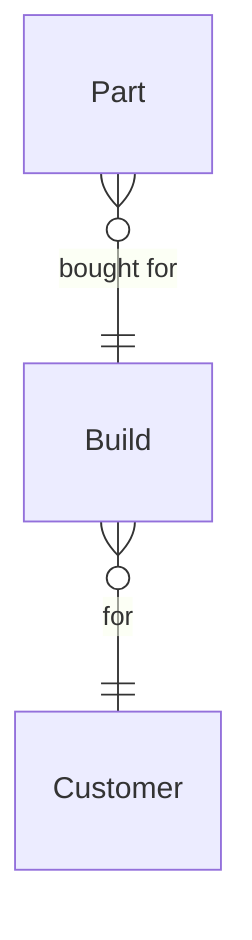

# Custom guitar shop

*A recipe from the Fibery Process Cookbook: the process in plain words, and the model to build it in any tool.*

**Every guitar has a locked spec, a promised month, and a customer who hears from you at every stage.** For a custom shop of one to five builders. How a guitar goes from the first email to the shipped case.

## The idea

Small shops don't lose customers on the bench. They lose them in the gaps: a spec that keeps changing after the wood is cut, a promised date nobody wrote down, pickups that arrive three weeks after the body was ready for them, a customer who hasn't heard anything since the deposit. The cure is short: lock the spec before anything is cut, give every guitar a place in the queue with a promised month, count the missing parts before assembly, and send a photo at every stage.

Every guitar is a **Build**, one record from inquiry to shipment, named by model and serial and owned by one **Builder**. Its spec sheet lives in its description and is frozen by a button once the customer agrees it and the deposit lands. Each pickup set, bridge, tuner set, case or wood set bought for a guitar is a **Part**, so the shop knows what's on order and what gates assembly. The **Customer** is who it's for; most shops already keep customers somewhere, and the build can link there.

In any work tool, this becomes a few kinds of linked records: builds whose workflow runs from *Inquiry* to *Shipped*, parts under each build with a short workflow of their own, a board of the bench by stage that the builder opens every morning, and a button that locks the spec and puts the guitar in the queue. It's the shop's order book and floor board in one, not an accounting system: the money is two dates, deposit and balance, and the invoices live elsewhere.

## How it runs

Follow one guitar, *Heron 0142*, from the first email to the courier.

1. **An inquiry arrives.** Ana writes asking for a Heron in cherry sunburst. The builder adds her as a customer, with her email and country, and opens a build in *Inquiry*, named by model and serial, with its **Model**, *Heron*, its customer, and the wishes so far in its description under the spec sheet's headings: Body and neck, Fretboard and frets, Finish, Electronics, Hardware, Case. Email settles the pickups and the neck profile; each answer goes into the sheet.
2. **The spec is locked.** When Ana agrees the sheet and the deposit lands, the builder enters **Deposit received on** and **Promised on**, the month the guitar is promised for, and presses **Lock the spec**, a button on the build: the build moves to *Queued* and a comment records the lock date and the promise. From here a change to the sheet is a new agreement with a new promise, written in a comment, never a silent edit.
3. **It waits its turn.** The **Order book**, a grid of every inquiry and every queued build by promised month, shows **Days to promised** for each. The shop builds two or three guitars at a time, so the builder sees when Heron 0142 starts and whether a promise is in trouble. Meanwhile the builder orders the long-lead parts, the pickups and the case that take weeks to arrive: each is a part, *Needed* until it's ordered, then *Ordered* with its supplier and the order date.
4. **Woodwork.** The builder moves the build to *Woodwork*; the **Stage dates** rule stamps the date of the move, so the **Shop floor**, the board of every guitar on the bench by stage, shows **Days in stage**, how long each guitar has sat where it is. Body blank, neck carve, fretboard, frets. At the end the builder sends Ana photos, the first of the updates she gets at every move.
5. **Finish.** The builder moves the build to *Finish*, the long stage: sealer, color, clear coats, then weeks of curing, and the Shop floor shows the wait honestly. Parts keep arriving, and the builder moves each to *Received*. When the last one lands, the **All parts in** rule comments on the build that assembly is clear and tells the builder.
6. **Assembly and setup.** The builder moves the build to *Assembly* when **Parts missing**, the count of parts not yet received, is zero; moved early, it shows red on the Shop floor. Electronics, hardware, strings. Then the builder moves it to *Setup*: action and intonation, how the strings sit and how true they play up the neck, a playing test, the final photos and the balance invoice. The builder enters **Balance paid on** when the money arrives.
7. **It ships.** The builder moves the build to *Shipped* with the carrier and the tracking link; the **On shipping** rule stamps the shipping date and leaves a comment with the tracking line, ready for the email to Ana. The guitar leaves the Shop floor and joins **Shipped guitars**, the grid of every guitar the shop has made.
8. **Or it stops.** The builder moves an inquiry that goes quiet, or a build whose customer backs out after the lock, to *Cancelled*, with the deposit decision in a comment. A build whose promised month has passed unshipped is **Late**; the Shop floor and the Order book show it red, and the builder writes to the customer before the customer writes to them.

## What people look at

- **Every morning** — **Shop floor**: every guitar on the bench by stage, with its days in stage and missing parts; late ones red. Where is everything, today.
- **Every Monday** — **Order book**: inquiries and queued builds by promised month. Who's next, and which promise is in trouble. **Parts to chase**: the builds waiting on parts, soonest promise first, with each part's state. What to call the supplier about.
- **Any time** — **My builds**, a builder's own guitars; **Ready to ship**, the guitars in setup waiting on a balance or a box; **Shipped guitars**, every guitar made, with its tracking; **Customers**, each with their builds; **New inquiry**, a form for the first email; and the **Shipping pace** report, how many left the shop each month.
- **How to run the custom guitar shop** — this story, kept where the team works.

## The rules

These are all the automations; everything else in the story is done by people.

- **Lock the spec** (a button on a build): moves the build to *Queued* and adds a comment with the lock date and the promise. It checks nothing: a queued build with no deposit date or promised month shows a blank on the Order book. The lock comment is the baseline for any later change.
- **Stage dates**: when a build moves to another state, Stage changed on is set to today.
- **On shipping**: when a build moves to *Shipped*, Shipped on is set to today and a comment holds the carrier and the tracking link, ready for the customer email.
- **All parts in**: when a part moves to *Received* and every part of its build is now received, the build gets a comment saying assembly is clear and its builder is notified.

No automations in your tool? Then a person does each of these at the same moment, and the promises they keep below become practices.

## What must stay true

Whatever anyone edits, adapts or corrects, these hold; each says what keeps it so.

- ★ Nothing is cut before the spec is locked: a build is *Queued* only with a deposit date and a promised month, and *Woodwork* comes after *Queued*. Shown on the **Order book**, where a *Queued* build missing either date has a blank beside its name. A build moved along by hand gets no lock comment, so locking means pressing **Lock the spec**; that part is a practice.
- ★ After the lock, a change to the sheet or the promised month is a new agreement: the builder edits the sheet or Promised on and writes the change and the new promise in a comment, never a silent edit. A practice; the lock comment is the baseline, and nothing enforces it.
- ★ Assembly starts only when every part is in. Shown by **Parts missing**, red on the Shop floor for a build in *Assembly* with a part still *Needed* or *Ordered*; the **All parts in** comment says when the way is clear, and a part moved to another build changes the count without a comment.
- A promise in trouble is seen before the customer asks. Shown by **Late**, which turns a build red on the Shop floor and the Order book once its promised month has passed unshipped.
- Days in stage counts from the last real move. Kept by **Stage dates**; a move entered late is corrected by editing Stage changed on, and Days in stage follows it.
- ★ The customer hears from the builder at every stage move. A practice; Days in stage on the Shop floor shows how long since the last move, and nothing enforces the sending.
- A *Shipped* build is never reopened: a guitar that comes back for work is a repair, not the same build, and Shipped on is the day it first left. Kept by **On shipping** for the date; the rest is a practice.

## Making it yours

Decide these before you set it up; each has a default if you shrug.

| Question | Default | If not the default |
|---|---|---|
| Do you already keep customers in your tool? | — | Your builds point at the customers you already have: Build links to that database, and no Customer database is created |
| One builder per guitar, or hand-offs between people? | One builder | Each station gets its owner and its time: add a Step database under Build, one record per stage with who did it and when it started and finished |
| Do you also build stock guitars, for dealers or the website? | No | Stock guitars sit on the Shop floor without a customer: add a Stock field on Build, ticked for them, with Customer empty until the guitar sells |
| Is finishing done in-house? | Yes | The guitar leaves the shop for a while: add Sent to finish and Back from finish on Build, and *Finish* becomes a waiting stage |

- **A one-person shop:** keep the Builder field pointed at you; My builds is every build, and All parts in tells you. Nothing else changes.
- **Repairs and setups alongside builds:** a Job database with its own short workflow, not Build states; the Shop floor stays for guitars being made.
- **A waiting list before the deposit:** an *Interested* state before *Inquiry* when demand outruns slots, with the Order book sorted by the date added.
- **Money:** the two dates are enough for the Shop floor; prices and payments stay in the accounting tool, with the invoice number in the description if needed.
- **Pushed too far:** a state per bench step, fret level, nut, wiring, makes the board a checklist nobody moves. Six stages is about right; the sub-steps are headings in the description.

## For AI agents

- Every Monday, list the builds promised within four weeks that haven't reached *Finish*, and the parts still *Needed* or *Ordered* for builds in *Finish*.
- Draft the stage update to the customer from the build's latest comment when asked; never send it.
- Flag a build in *Assembly* with parts missing, and a build in *Setup* for more than 14 days with no Balance paid on.
- Never lock a spec, move a build between stages or cancel one; those are the builder's calls.
- Try asking: "Which builds are promised within four weeks and not yet in Finish?", "What is Heron 0142 still waiting on?", "Draft the update to Ana from the latest comment on Heron 0142".

## Details for building

What follows is what the process is built from, in words any tool can follow; the story above is enough to run it.

Each kind of record (Build, Part, Customer) is a database or a table, depending on the tool, or a tab in a spreadsheet. A relation links two kinds; its inverse is the name it has on the other side. A state is a step in a workflow, and a finished state ends it. A rule is an automation, a button is an automation someone presses, and a formula is a field the tool computes. A nested view shows each record's children beneath it; where a tool can't nest, group the children by their parent instead.

Each build is for one customer, and a customer may come back for several builds. Each part is bought for one build, and a build has any number of parts.

### Build

One guitar from inquiry to shipment, named by model and serial ("Heron 0142"); the serial is the shop's order number, given at the inquiry. The description holds the spec sheet under six headings: Body and neck, Fretboard and frets, Finish, Electronics, Hardware, Case. Comments on; Lock the spec, On shipping and All parts in write there.

| Field | Type | Why |
|---|---|---|
| Model | single select: the shop's models, Heron, Wren and Custom in the sample story; no default | On every card; Shipping pace colors by it |
| Customer | relation, many-to-one → Customer; inverse **Builds** | Who it's for; the Customers grid nests builds through it |
| Builder | person; inverse **Building** | Owns the guitar start to finish; My builds filters on it, and All parts in notifies them |
| Promised on | date | The promised month, entered as its last day; the Order book sorts by it, Days to promised and Late read it |
| Deposit received on | date | Entered by the builder when the deposit lands; on the Order book, where a queued build without it shows a blank |
| Balance paid on | date | Entered at setup; Ready to ship shows who still owes |
| Stage changed on | date | Set by Stage dates at every move; Days in stage counts from it; edited by hand when a move is entered late |
| Shipped on | date | Set by On shipping; Shipped guitars sorts by it and Shipping pace counts by its month |
| Carrier | single select: UPS, FedEx, DHL, Pickup; no default | On shipping puts it in the comment; Ready to ship and Shipped guitars show it |
| Tracking | url | The link for the customer email; On shipping puts it in the comment |

States: Inquiry → Queued → Woodwork → Finish → Assembly → Setup → Shipped (finished) · Cancelled (finished). Default: Inquiry. Source of truth: the state, which the builder moves; Stage dates stamps Stage changed on at every move, and a move entered late is fixed by editing Stage changed on, which Days in stage follows. Promised on holds the current promise; the comments hold its history.

Formulas:
- **Days in stage** — days since Stage changed on, a whole number, 0 with no date; on Shop floor cards and My builds.
- **Days to promised** — days from today to Promised on, a whole number, negative once past, 0 with no date; on the Order book.
- **Parts missing** — how many of the build's parts are not *Received*, a whole number, 0 when the build has no parts; on Shop floor cards, red in *Assembly*, and on Parts to chase; All parts in reads it.
- **Late** — yes when Promised on has passed and the build is neither *Shipped* nor *Cancelled*, no with no date; colors the Shop floor and the Order book.

### Part

One pickup set, bridge, tuner set, case or wood set bought for one build. No description, no comments. Fields: Build (relation, many-to-one → Build; inverse **Parts**); Supplier (text); Ordered on (date). States: Needed → Ordered → Received (finished). Default: Needed.

### Customer

Who the guitar is for. The description holds notes from the conversation. Comments on. Fields: Email (email); Country (text; shipping and customs). No states. Their guitars come through the inverse Builds.

### Views

| View | Type | Of | Grouping | Shows | Filter | Sort |
|---|---|---|---|---|---|---|
| Shop floor | board | Build | columns State | Model, Customer, Promised on, Days in stage, Parts missing; red when Late, or when Parts missing is above 0 in Assembly | State is Woodwork, Finish, Assembly or Setup | |
| Order book | grid | Build | | Customer, Model, Promised on, Days to promised, Deposit received on, Builder; red when Late | State is Inquiry or Queued | Promised on asc |
| Parts to chase | grid | Build | Parts nested: State, Supplier, Ordered on | Promised on, Parts missing | Parts missing above 0; State is not Shipped or Cancelled | Promised on asc |
| My builds | list | Build | | Model, Customer, State, Promised on, Days in stage | Builder is me; State is not Shipped or Cancelled | Promised on asc |
| Ready to ship | list | Build | | Customer, Promised on, Balance paid on, Carrier, Tracking | State is Setup | Promised on asc |
| Shipped guitars | grid | Build | | Customer, Model, Shipped on, Promised on, Carrier, Tracking | State is Shipped | Shipped on desc |
| Customers | grid | Customer | Builds nested: Model, State, Promised on | Email, Country | | Name |
| New inquiry | form | Build | | Name, Customer, Model, Description | | |
| How to run the custom guitar shop | document | | | the story, through What must stay true | | |

### App

None needed. The central moments are the morning look at the bench and the Monday look at the queue, and the Shop floor board with Days in stage and the Order book grid show them. A floor wall with a timer per stage was considered; Days in stage on the board covers it.

### Reports

**Shipping pace** — source Build, current, only *Shipped*: a bar of builds per month of Shipped on, colored by Model.

### Sample story

Heron 0142 is in finish with a full spec sheet, its lock comment and its customer's notes, beside another guitar three weeks into curing. A Wren is in woodwork, a Custom in assembly shows red with its pickups still ordered, and a Heron in setup waits on its balance. Three builds are queued, one already late and two promised within half a year. Two inquiries are open, one with a half-written spec sheet. A guitar shipped last month with its tracking, and one build was cancelled after the lock, the deposit decision in a comment. Most parts are in, a few on order, two still needed. Customers live in three countries; one has two builds.

## Build it

In Fibery, open Claude with the Fibery plugin, attach this recipe and say "set up the custom guitar shop". You'll see a one-screen design first; nothing is created until you say yes, and the build takes about ten minutes.

Anywhere else, give this recipe to your AI assistant and name your tool, or build it by hand from Details for building.

---

*From the Fibery Process Cookbook (https://github.com/Fibery-inc/process-cookbook), licensed CC BY 4.0 (https://creativecommons.org/licenses/by/4.0/): copy, adapt and build it anywhere, crediting the cookbook.*
