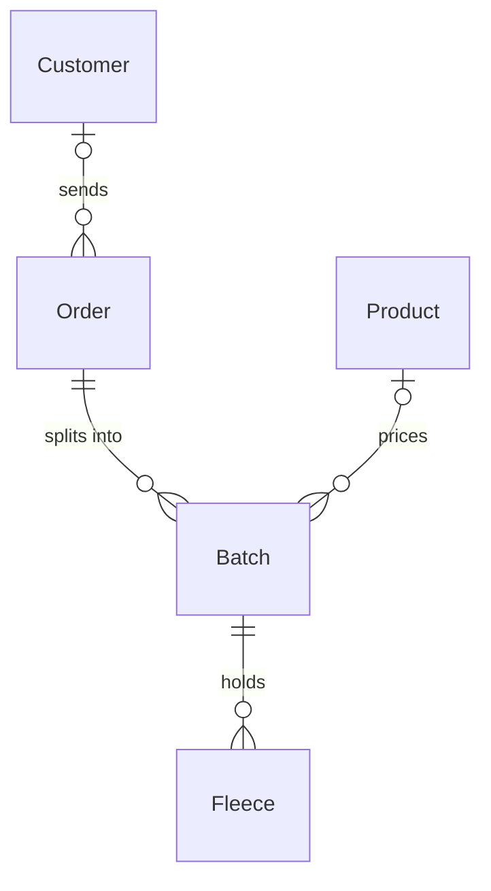

# Custom fiber mill

*A recipe from the Fibery Process Cookbook: the process in plain words, and the model to build it in any tool.*

**Every farm gets its own fiber back, and knows when its turn comes.** For a small custom mill of two to six people that turns farms' wool and alpaca into roving, batts and yarn. From the bag on the doorstep to the box going home, with an honest answer to "when will mine start?".

## The idea

Small custom mills are in demand, and the wait shows it: farms queue for months, sometimes more than a year, to have their fleeces washed, carded and spun. The work still runs on a paper form tucked into each bag, a notebook of who's next and a phone that rings with "when will mine start?". A bag whose label falls off is a fleece nobody can name, and a line nobody can see invites quiet favors.

The method is simple. Every shipment from a farm is one **Order**, and orders wait their turn in one line, first come, first served, measured in pounds. Every bag is a **Fleece** with a number from the moment it's weighed. An order splits into **Batches**, one per product, and a batch never holds two customers' fiber. The **Mill manager** keeps the line moving and says honestly when each order should start; **Operators** run the batches through the machines, stage by stage.

In any work tool, this becomes five kinds of linked records: farms and their orders, whose workflow runs from *Expected* to *Returned*; batches that move machine by machine from *Waiting* to *Done*; the fleeces inside them; and the mill's price list. People live on a board of batches by machine and a line of orders by arrival; a custom view adds up the pounds ahead of every order and turns them into a start month, and a rule marks an order ready when its last batch is done. It's the mill's order book and production line in one, not its accounting.

## How it runs

Follow one order, *Hillside spring clip*, from the form to the box going home.

1. **The farm books in.** After shearing, a farm fills the **Order form**: the farm and its clip, its **Contact**, how many **Bags** it's sending, its **Return**, *Ship* or *Pick up*, and what it wants, fleece by fleece, in its own words. Hillside wants its two white fleeces blended into worsted yarn and its grey one made into roving. The form arrives as an order in *Expected*: the fiber is on its way. **Intake**, the person who receives bags and talks to farms, links the order to the farm's **Customer** record, with its email, phone and return address, or adds the farm the first time.
2. **The bags arrive.** Three bags come in the mail, a form inside each. Intake weighs each bag and logs it as a fleece named after the animal it came from. Each fleece gets its **Tag number** the moment it's logged, and intake writes the number on the bag before the bag leaves the scale. The fleece also records its **Fiber**, its **Color** and its **Raw weight** in pounds: Daisy is tag 1046 at 7.2 pounds, Clover 1047 at 6.8, Pepper 1048 at 8.1. Then intake splits the order into batches, one per product: *Hillside worsted* holds Daisy and Clover, and *Hillside roving* holds Pepper. Each batch gets a **Product** from the mill's price list, which sets its **Rate per pound** and its **Minimum weight**. Intake takes the deposit, ticks **Deposit paid** and moves the order to *In line*. The **Received** rule sets its **Received on** date, and from that day the order counts its **Days waiting**.
3. **Intake checks the fiber.** Every fleece gets a **Condition**: *Good*, or a reason to call the farm, such as *Needs skirting*, with the dirty edges still on, *Heavy vegetable matter*, *Tender*, where the fiber snaps when tugged, or *Too short*. Clover is full of hay. Intake moves the order to *On hold* and asks the farm whether to skirt it for a fee or send it back. A held order keeps its place in line, because Received dates an order only the first time. Hillside says skirt it; intake notes the answer in the order's comments and moves it back to *In line*. A batch lighter than its product's minimum shows red as **Under minimum**, and intake asks the farm to add a fleece or pick another product. A fleece the mill can't use at all is marked *Rejected*: it stays with its batch, so it goes home in the same box, and it's left out of every weight.
4. **Every Monday, the line moves.** The mill manager opens **Queue forecast**, a custom view of every waiting order in the order it arrived, with the pounds ahead of it and the month its turn should come at the mill's pace. The mill manager moves the orders at the front to *In production*; the **Started** rule sets their **Started on**, which stops their days waiting. The forecast saves each waiting order's **Estimated start**, and intake tells the farms that ask. Hillside is ninth in line, 410 pounds back, and should start in July: a month, never a day.
5. **The batches run.** Operators take each batch through the machines, one state per stage: *Waiting*, *Washing*, *Picking*, where the fiber is opened up, *Carding*, where it's combed into a web, *Spinning* and *Finishing*. Each batch has one **Operator**, and **Production** shows every batch at its machine. Right after washing, the operator weighs the batch's **Washed weight**, which its price runs on. Hillside roving skips *Spinning*.
6. **A batch is finished.** At *Finishing*, the operator skeins the yarn, sets its twist, counts the **Skeins**, weighs the **Finished weight** and moves the batch to *Done*. The **Batch done** rule sets its **Done on**. The batch now shows its **Yield**, the share of its raw weight that came back as fiber, from 0 to 100; washing alone takes a good part of it, so farms like to see the number. When a batch can't be made, say the fiber is too short to spin, the operator moves it to *Cancelled* with a comment. Intake calls the farm, and usually a new batch with another product takes its place.
7. **The order is ready.** When Hillside's last batch is done, the **Order ready** rule moves the order to *Ready*. Its **Price** is the sum of its batches' prices, each batch's washed weight at its product's rate. Intake bills it from the mill's accounting, ticks **Paid** when the money is in, and ships the box or waits for the farm to pick it up. Intake pastes the **Tracking number** and moves the order to *Returned*.
8. **Or it stops early.** A farm that changes its mind before its turn has its order moved to *Cancelled* by intake, and its fiber goes back unwashed. Next spring Hillside books again, and its customer record shows every order with its weights and yields, so the farm can see how this clip compares.

## What people look at

- **Every morning** — **Production**: every unfinished batch at its machine, a column per stage, red when a batch is under its product's minimum and grey when its order is on hold. What's running, and what comes next. Each operator also opens **My batches**.
- **Every Monday** — **Queue forecast**, a custom view: the line in arrival order, the pounds ahead of each order and the month it should start. The mill manager pulls the next orders from the front. If your tool can't draw it, **Queue** does the job as a plain grid, with Estimated start typed by the mill manager.
- **When bags arrive** — **Order board**: every open order in its state, *Expected* for what's in the mail and *Ready* for what can go home, red when ready but unpaid. **Fleece log**: every bag by tag number, for "whose is bag 1047?".
- **Any time** — **Customers** for every farm with its orders and their yields; the **Order form** for farms; the **Wait time** report for how long orders waited before starting, month by month; and the **Pounds out** report for what the mill produced, by product.
- **How to run the custom fiber mill** — this process on one screen, kept where the team works.

## The rules

These are all the automations; everything else in the story is done by people.

- **Received**: when an order moves to *In line* and has no Received on yet, its Received on is set to today. An order back from *On hold* keeps its date, so it keeps its place.
- **Started**: when an order moves to *In production* and has no Started on yet, its Started on is set to today.
- **Batch done**: when a batch moves to *Done*, its Done on is set to today.
- **Order ready**: when a batch moves to *Done* and every batch of its order is *Done* or *Cancelled*, the order moves to *Ready*.

No automations in your tool? Then a person does each of these at the same moment, and the promises they keep below become practices.

## What must stay true

Whatever anyone edits, adapts or corrects, these hold; each says what keeps it so.

- ★ A batch holds one customer's fiber. Every fleece belongs to one batch and every batch to one order, so two customers' fiber never share a run. Kept by the **Batch** relation on Fleece and the **Order** relation on Batch; cleaning the machines between batches is a practice.
- ★ Every bag is known from the moment it's weighed. Its fleece gets a tag number as soon as it's logged, and the number goes on the bag before the bag leaves the scale. Kept by the **Tag number**; writing it on the bag is a practice.
- ★ The line is first come, first served, and a hold doesn't cost a farm its place. Kept by **Received**, which dates an order only the first time it joins the line; shown on **Queue forecast** and **Queue**, both in Received on order. Starting an order out of turn is the mill manager's call, explained in the order's comments; a practice.
- Nothing runs on held fiber: an order *On hold* waits for the farm's answer, and its batches stay *Waiting*. Shown on **Production**, where a held order's batches are grey; keeping them off the machines is a practice.
- An order is *Ready* only when every batch of it is done or cancelled. Kept by **Order ready**; an order whose last batch is cancelled rather than done is moved by the mill manager.
- Price follows weight: a batch costs its washed weight at its product's rate, and an order costs the sum of its batches, cancelled ones aside. Kept by the **Price** formulas; the price list changes between seasons, never under an order already billed, which is a practice.
- Fiber goes home only once it's paid for. Shown on **Order board**, where a *Ready* order not yet paid is red; a practice.

## Making it yours

Decide these before you set it up; each has a default if you shrug.

| Question | Default | If not the default |
|---|---|---|
| Which stages does your fiber go through? | Washing, picking, carding, spinning, finishing | Batches follow your own machines: add *Dehairing* after *Picking* for alpaca and cashmere, *Drafting* after *Carding* for pin drafted roving, or *Felting* for felt, and drop the stages you don't run |
| Do farms reserve a place before they ship? | No: the line forms as fiber arrives | Farms book ahead, often with a deposit: add a *Reserved* state before *Expected*, and let Received date an order when it's reserved, so the line forms by reservation instead |
| Do you also make your own yarn to sell? | No | Your own runs wait in the same line: add the mill as a customer and run them as its orders; stock and sales stay in your shop |
| Do you already keep customers in your tool or your accounting? | — | Orders link to the customers you already keep: point the Customer relation on Order at them instead of creating Customer |

- **One or two people:** drop Operator and My batches; Production is enough when everyone runs every machine.
- **Other words:** "Clip" or "Job" for order, "Lot" for batch, "Bag" for fleece: rename freely. Kilograms work as well as pounds; pick one unit and keep it everywhere, the price list included.
- **Pooled lots:** when several small farms want their fiber run together, the pool is a customer of its own with its own order, and the farms agree beforehand how the yarn is shared. The batch still holds one customer's fiber.
- **Dyeing:** once dyeing is a regular service, add a *Dyeing* stage after *Finishing* and a Dye color field on Batch for the color the farm chose.
- **A page for farms:** farms that could see their own orders, states and estimated starts would call less. It needs a way to show each farm only its own orders, which most tools set up apart from the rest.
- **What teams add once it runs:** a reminder for orders on hold more than a week, a skein label template, a report of yield by fiber, and a stage clock that shows where batches wait. Each is small, and left out so the first season stays simple.
- **Pushed too far:** a start month promised as a date becomes a broken promise every time a machine stops. Say a month, and let the line, not the calendar, decide who's next.

## For AI agents

- Every Monday, list the orders *On hold* for more than seven days, with the question each is waiting on, so intake can call the farm.
- When an order moves to *In line*, draft the note intake sends the farm: its fleeces with their tag numbers and raw weights, its batches and products, and its Estimated start as a month. Never promise a day.
- Flag finished batches whose Yield is far below what the same product usually gets, so the mill manager checks the weights before the bill goes out.
- Never change Received on or Estimated start, and never move an order ahead in line; the line is the mill manager's.
- Try asking: "Which orders should start in the next month, and how many pounds is that?", "Where are Hillside's fleeces now?", "Draft an arrival note for Hillside spring clip".

## Details for building

What follows is what the process is built from, in words any tool can follow; the story above is enough to run it.

Each kind of record (Order, Batch, Fleece) is a database or a table, depending on the tool, or a tab in a spreadsheet. A relation links two kinds; its inverse is the name it has on the other side. A state is a step in a workflow, and a finished state ends it. A rule is an automation, a button is an automation someone presses, and a formula is a field the tool computes. A nested view shows each record's children beneath it; where a tool can't nest, group the children by their parent instead.

A customer sends orders, and an order splits into batches, one per product. A batch holds the fleeces that go into it and takes one product from the price list. A fleece belongs to one batch and a batch to one order: that is what keeps two customers' fiber apart.

### Order

One record per shipment from a farm, from the form to the box going home. Its name is the farm and the clip ("Hillside spring clip"). The description holds what the farm asked for, fleece by fleece, as written on the form. Comments on: holds and their answers go there.

| Field | Type | Why |
|---|---|---|
| Customer | relation, many-to-one → Customer; inverse **Orders** | The farm; linked by intake when the order arrives |
| Contact | text | How to reach the farm, as written on the Order form; intake copies it onto the customer the first time |
| Bags | integer | How many bags the farm is sending; intake checks the count on arrival |
| Return | single select: Ship, Pick up; default Ship | How the finished fiber goes home; on Order board |
| Received on | date | Set by Received the first time the order joins the line; the line's order and Days waiting run on it |
| Started on | date | Set by Started; ends Days waiting, and the Wait time report counts by it |
| Estimated start | date | The first day of the month the order should start; written by Queue forecast or typed by the mill manager; what intake tells the farm |
| Deposit paid | checkbox | Ticked by intake when the farm pays its deposit; on Queue |
| Paid | checkbox | Ticked by intake when the bill is paid; fiber goes home only once it is |
| Tracking number | text | Pasted by intake when the box ships, for "where is my box?" |

States: Expected → In line → On hold → In production → Ready → Returned (finished) · Cancelled (finished). Default: Expected. *On hold* can come from *In line* or *In production*, and the order goes back to where it was. Source of truth: **Received on**, set once by Received; the line sorts by it, so a date typed by hand moves the order in line.

Formulas:
- **Raw weight** — the sum of the Raw weight of its batches that aren't *Cancelled*, a decimal with one decimal place, 0 with no batches; on Queue and Order board, and read by Queue forecast.
- **Days waiting** — days from Received on to Started on, or to today when the order hasn't started, a whole number, 0 with no Received on; on Queue, and averaged by the Wait time report.
- **All batches done** — yes when the order has at least one batch and every batch is *Done* or *Cancelled*, no otherwise; Order ready fires on it.
- **Price** — the sum of the Price of its batches that aren't *Cancelled*, money, 0 with no batches; on Order board and Customers, and what intake bills.

### Batch

One product made from one order's fiber. Its name is the farm and the product ("Hillside worsted"). The description holds the farm's spec: the blend, the yarn weight and ply, anything to add. Comments on.

| Field | Type | Why |
|---|---|---|
| Order | relation, many-to-one → Order; inverse **Batches** | Every batch belongs to one order, so to one customer |
| Product | relation, many-to-one → Product; inverse **Batches** | What it becomes, from the price list; its rate and minimum come from there |
| Operator | person; inverse **Operated batches** | Who runs it through the machines; My batches |
| Washed weight | decimal, pounds, one decimal place | Weighed by the operator right after washing; Price runs on it |
| Finished weight | decimal, pounds, one decimal place | Weighed at finishing; Yield and the Pounds out report run on it |
| Skeins | integer | How many skeins, bags or bumps came out; counted by the operator at finishing, for packing |
| Done on | date | Set by Batch done; the Pounds out report counts by it |

States: Waiting → Washing → Picking → Carding → Spinning → Finishing → Done (finished) · Cancelled (finished). Default: Waiting. Roving and batts skip *Spinning*.

Formulas:
- **Raw weight** — the sum of the Raw weight of its fleeces whose Condition isn't *Rejected*, a decimal with one decimal place, 0 with none; on Production, and read by the order's Raw weight, Under minimum and Yield.
- **Price** — Washed weight times its product's Rate per pound, money, 0 when either is missing; summed by the order's Price.
- **Yield** — Finished weight as a share of Raw weight, a whole number from 0 to 100, 0 when either is missing; on Customers, under each order.
- **Under minimum** — yes when Raw weight is above 0 and below its product's Minimum weight, no otherwise and no with no product; red on Production.

### Fleece

One bag as it arrives, usually one animal's fleece. Its name is the animal, as the farm wrote it ("Daisy"). No description. Comments on, for anything intake notices.

| Field | Type | Why |
|---|---|---|
| Tag number | integer, numbered automatically in the order fleeces are logged | Written on the bag at the scale; how anyone finds a bag on Fleece log |
| Batch | relation, many-to-one → Batch; inverse **Fleeces** | Which batch it goes into, and through it which order |
| Fiber | single select: Wool, Alpaca, Llama, Mohair, Other; default Wool | What it's washed and carded as; on Fleece log |
| Color | single select: White, Grey, Brown, Black, Mixed; no default | Its natural color, set by intake; a common choice is running light fiber before dark on a shared machine |
| Raw weight | decimal, pounds, one decimal place | Weighed by intake on arrival; the line, the minimum and the yield run on it |
| Condition | single select: Good, Needs skirting, Heavy vegetable matter, Tender, Too short, Rejected; default Good | Intake's check on arrival; anything but Good is a reason to call the farm, and Rejected fiber is left out of every weight |

No states: a fleece moves with its batch.

### Product

One line of the mill's price list: what a batch can become ("2 ply worsted yarn", "Roving", "Batts"). The description holds the spec: yarn weight, ply, skein size. Fields: Rate per pound (money; the price per pound of washed fiber, which Price on Batch uses; pricing on washed weight is a common choice, since what washes out varies from fleece to fleece); Minimum weight (decimal, raw pounds; below it a batch shows Under minimum). No states.

### Customer

One record per farm or fiber artist that sends fiber. The description holds notes: breeds, preferences, what they asked for last time. Comments on. Fields: Email (email); Phone (phone); Address (text; where boxes go home). No states.

### Views

| View | Type | Of | Grouping | Shows | Filter | Sort |
|---|---|---|---|---|---|---|
| Production | board | Batch | columns State | Order, Product, Operator, Raw weight, Washed weight; red when Under minimum, grey when its order is On hold | State is not Done or Cancelled | |
| My batches | list | Batch | | Order, Product, State, Washed weight | Operator is me; State is not Done or Cancelled | State |
| Queue | grid | Order | | Customer, Received on, Raw weight, Days waiting, Estimated start, Deposit paid, State; grey when On hold | State is In line or On hold | Received on asc |
| Order board | board | Order | columns State | Customer, Raw weight, Estimated start, Price, Paid, Return; red when Ready and not Paid | State is not Returned or Cancelled | |
| Fleece log | grid | Fleece | | Tag number, Batch, Fiber, Color, Raw weight, Condition | | Tag number desc |
| Customers | grid | Customer | Orders nested: State, Received on, Raw weight, Price; under each order, Batches nested: Product, Finished weight, Yield | Email, Phone | | Name asc |
| Order form | form | Order | | Name (required), Contact (required), Bags (required), Return (default: Ship), Description | | |
| How to run the custom fiber mill | document | | | the process on one screen, linking to this recipe | | |

### App

**Queue forecast**, a page of its own. It lists every order *In line* or *On hold* by Received on, with its raw weight, as a bar on a month axis that starts the week its turn should come. The mill manager sets the pace, pounds per week, at the top, and the app keeps it. An order's turn comes once the mill has run, at that pace, the unfinished batches of every order *In production* and every order ahead of it in the line. Held orders keep their row, in grey. A save button writes each order's Estimated start as the first day of its month; clicking a row opens the order. With nothing waiting it shows "The line is empty." Reads: Order Name, Customer, Received on, Raw weight, Days waiting, State; Batch Raw weight, State, Order. Writes: Order Estimated start. Fallback: the Queue grid.

### Reports

**Wait time** — source Order, current, only orders with a Started on: a bar of the average Days waiting by month of Started on.

**Pounds out** — source Batch, current, only *Done* batches: a stacked bar of the sum of Finished weight by month of Done on, colored by Product.

### Sample story

Hillside spring clip arrived six weeks ago and is ninth in line, its two batches waiting; the forecast says July. Three orders are in production: one batch is spinning, one carding, and two washed this week, one of them red, under its minimum. An order went on hold four days ago over a fleece full of hay. Three orders are expected in the mail, one not yet linked to its farm. Last month eleven batches finished, one with a poor yield, and one order sits ready but unpaid. Hillside's order from last spring went home in October, and one order was cancelled before its turn.

## Build it

In Fibery, open Claude with the Fibery plugin, attach this recipe and say "set up the custom fiber mill". You'll see a one-screen design first; nothing is created until you say yes, and the build takes about ten minutes.

Anywhere else, give this recipe to your AI assistant and name your tool, or build it by hand from Details for building.

---

*From the Fibery Process Cookbook (https://github.com/Fibery-inc/process-cookbook), licensed CC BY 4.0 (https://creativecommons.org/licenses/by/4.0/): copy, adapt and build it anywhere, crediting the cookbook.*
