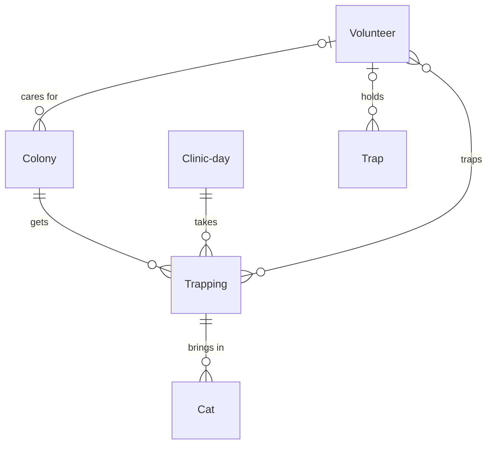

# TNR program

*A recipe from the Fibery Process Cookbook: the process in plain words, and the model to build it in any tool.*

**Every community cat fixed, returned home, and counted once.** For a volunteer group of a few coordinators and the trappers and caretakers they call on. Trap, neuter, return, from a neighbor's report to a colony where every cat wears an eartip.

## The idea

Most TNR groups keep their colonies in a spreadsheet, their trappers in a phone and their clinic slots in an email thread. So a clinic day goes half empty or gets booked twice, a trap lent in spring is still missing in autumn, and the yearly count for funders takes a weekend and still counts some cats twice.

TNR itself is simple. Community cats, the unowned cats that live outdoors, are humanely trapped, spayed or neutered, vaccinated and eartipped: the tip of one ear is clipped flat, so anyone can see from afar that the cat is fixed. Then they go back to the place they live, where someone feeds them. No more kittens are born, and the colony settles and shrinks. Every place where cats live and are fed is a **Colony**. A colony gets its turn at a clinic as a **Trapping**, booked onto a **Clinic day** with a set number of surgery slots, and every cat a trapping brings in is a **Cat** that ends with an outcome. A few **Coordinators** plan and keep the records; the colony's **Caretaker**, the trappers and the clinic do the rest without opening the tool.

In any work tool, this becomes six kinds of linked records: colonies on a map; trappings booked onto clinic days; the cats each trapping brings in, whose workflow runs from *Trapped* to *Returned*; and the volunteers and numbered traps the group calls on and lends. Coordinators plan on a custom view of the coming clinic days and their open slots, a button brings a trapping's cats back from the clinic, and each colony's share of fixed cats follows by itself. It's the group's memory of every colony and every cat, not a medical record.

## How it runs

Follow one colony, *Laundromat lot*, from a neighbor's report to the last eartip.

1. **A neighbor reports cats.** Anyone can fill the **Colony report** form: where the cats are, about how many, who's reporting and how to reach them. It arrives as a colony in *Reported*: about eight cats behind a laundromat, fed every evening by a neighbor.
2. **A coordinator assesses it.** A coordinator takes it on as its **Coordinator**, calls the reporter and visits at feeding time. They count the **Estimated cats**, eight, and the **Eartipped at start**, one cat fixed years ago. They link the neighbor who feeds the cats as the colony's caretaker. Every helper the group works with is a **Volunteer** record, with a phone and **Roles**: *Trapper*, *Caretaker* or *Driver*; new helpers sign up through the **Volunteer signup** form. The coordinator notes the **Feeding time**, six in the evening, and moves the colony to *Assessed*. A report that isn't a colony, such as a lost pet or a single tame cat, is moved to *Closed* with a **Closed reason**, and so is a second report of a colony the group already knows.
3. **A clinic offers a day.** The coordinator who works with the clinics adds each clinic day in *Planned* as a partner clinic offers it: its **Date**, the **Clinic**, and its **Slots**, how many community cats the clinic will fix that day. The Elm Street clinic offers Tuesday the 21st with twelve slots. A clinic day the clinic calls off is moved to *Cancelled*; its trappings move to another day, or to *Cancelled* when they won't happen.
4. **The coordinators plan.** Every week they open **Clinic planner**, a custom view of the coming clinic days, each a bar of slots that fills as trappings are booked, beside the colonies waiting their turn, those with the most cats **Left to fix** first. The coordinator drags Laundromat lot onto the 21st. That creates a trapping in *Planned*, the colony's turn at that clinic day, with its **Planned cats**: four of the seven left to fix. The trapping gets the colony's coordinator as its Coordinator too. The day now has four more of its twelve slots **Booked**, and its **Open slots** drop to match. The coordinator adds two **Trappers** and the **Trap night**, Monday the 20th, and moves the colony to *Being trapped*. A day with more cats planned than slots turns red.
5. **Traps go out.** The group's traps are records too: every **Trap** is numbered, with the number painted on its side. The coordinator lends four of them, moving each to *Lent* with a trapper as its **Holder**. The **Trap lent** rule sets its **Out since** to today and its **Due back** to a week later.
6. **The day before trap night**, the **Food reminder** rule tells the trapping's coordinator to call the caretaker: no food from the next morning, water as usual, so the cats walk into the traps hungry.
7. **Trap night.** At feeding time the trappers catch five cats. The coordinator logs each one as a cat of the trapping, named by its coat ("orange tabby, white chest"), with its **Age**, *Adult* or *Kitten*, in *Trapped*. One of them wears an eartip already: the trappers release it on the spot, and the coordinator closes it as *Already fixed*, so it's never counted twice. The other four go to the clinic in their covered traps.
8. **Clinic day.** The clinic spays or neuters, vaccinates and eartips each cat. When the trappers collect them, the coordinator copies each cat's **Sex** from the clinic's sheet and presses **Back from clinic** on the trapping. Its trapped cats move to *Recovering* with **Fixed on** set to today, and the trapping moves to *Done*. A kitten young enough to be tamed goes to a partner rescue as *To rescue*, and a cat the vet found too sick to save ends as *Died*. The coordinator sets outcomes like these before pressing the button, so it leaves them alone. At the end of the day the coordinator moves the clinic day to *Done*.
9. **Recovery and return.** The cats rest in their covered traps somewhere quiet and warm. Each one shows its **Return on**, the day it can go home; a common choice is the day after surgery for males and two days after for females. On that day a trapper releases the cat where it was caught, at feeding time, and the coordinator moves it to *Returned*. The traps come back too: the coordinator moves each to *Available*, and the **Trap back** rule clears its holder and dates. A trap past its due date shows red as **Overdue**; one that never comes back is *Lost*, and one too damaged to use is *Retired*.
10. **The colony settles.** Laundromat lot now has four **Cats fixed**, and its **Fixed share**, the share of its cats that wear an eartip, is 63 out of 100. A second trapping two weeks later brings in the last three. With every cat eartipped, the coordinator moves the colony to *Managed*. The caretaker keeps feeding, and a newcomer, reported on the form or by phone, sends the colony back to *Being trapped*. When the cats are gone or the caretaker moves away, the coordinator moves the colony to *Closed*.

## What people look at

- **Every morning in trapping weeks** — **In care**: every cat trapped or recovering, with its trapping and the day it goes home, red once that day has passed. Who is in the holding space, and who goes back today.
- **Every week** — **Clinic planner**, a custom view: the coming clinic days with their open slots, and the colonies with cats left to fix. If your tool can't draw it, **Clinic days** does the job as a grid with each day's trappings beneath it. **Colony board**: every colony in its state, with new reports to assess in *Reported*.
- **Any time** — **Colonies**, a map of every colony colored by state, with its fixed share; **Traps** for who holds which trap and which are overdue; **Volunteers** for finding a trapper or calling a caretaker; the **Colony report** and **Volunteer signup** forms for the public and for new helpers; and the **Fixed by month** report, females and males, the number funders ask for.
- **How to run the TNR program** — this process on one screen, kept where the group works.

## The rules

These are all the automations; everything else in the story is done by people.

- **Back from clinic** (a button on a trapping): moves the trapping to *Done*, and every cat of it that is *Trapped* to *Recovering*, with its Fixed on set to today. It checks nothing: a cat that went to a rescue or died is set by hand first, so the button leaves it alone.
- **Trap lent**: when a trap moves to *Lent*, its Out since is set to today and its Due back to seven days from today.
- **Trap back**: when a trap moves to *Available*, its holder is unlinked and its Out since and Due back are cleared.
- **Food reminder**: every day at 09:00, for every trapping that is *Planned* with a trap night tomorrow, its Coordinator is notified to call the colony's caretaker about holding back food.

No automations in your tool? Then a person does each of these at the same moment, and the promises they keep below become practices.

## What must stay true

Whatever anyone edits, adapts or corrects, these hold; each says what keeps it so.

- ★ Every cat goes home to the colony it came from. A cat belongs to one trapping and a trapping to one colony, so where to release it is never a guess. Kept by the **Trapping** relation on Cat and the **Colony** relation on Trapping; releasing it at that spot, at feeding time, is a practice.
- ★ Every cat is counted once. A cat trapped with an eartip is closed as *Already fixed*, and only cats *Recovering* or *Returned* count as fixed. Kept by the **Cats fixed** formulas.
- ★ Every cat ends with an outcome: *Returned*, *To rescue*, *Died* or *Already fixed*. Shown on **In care**, which lists every cat without one and turns red once a cat's Return on has passed; a cat still *Trapped* after its clinic day stays on In care until a coordinator gives it its outcome.
- ★ No cat is trapped for a clinic day that's full: a day's trappings plan no more cats than it has slots, because a trapped cat with nowhere to go suffers for it. Shown on **Clinic planner** and **Clinic days**, where Open slots below 0 is red; moving a trapping to another day is the coordinators' call.
- Food is held back before every trap night. A practice; the **Food reminder** asks the trapping's coordinator the day before, and nothing enforces it.
- Every lent trap has a holder and a day it's due back. Kept by **Trap lent** and **Trap back**; shown on **Traps**, where an overdue trap is red.
- A colony's numbers follow its cats: Cats fixed adds up its trappings' fixed cats, and Fixed share adds those eartipped at the start, against the latest Estimated cats. Kept by the **Cats fixed** and **Fixed share** formulas; correcting the estimate when cats arrive, leave or die is the coordinator's practice.

## Making it yours

Decide these before you set it up; each has a default if you shrug.

| Question | Default | If not the default |
|---|---|---|
| Do you foster and adopt too? | No: friendly cats and young kittens go to a partner rescue as *To rescue* | You keep them: *To rescue* becomes *To foster*, and fostering and adoption stay a process of their own, linked from Cat |
| Do you run a trap bank? | Yes | Trappers use their own traps: drop Trap, the Traps view, Trap lent and Trap back |
| Do trappers use the tool themselves? | No: they're volunteer records, and coordinators log their cats | Trappers log their own cats: Trappers on Trapping becomes a people field with a My trappings list, and Volunteer keeps the caretakers and drivers |
| Do you already keep volunteers or donors somewhere? | — | Point Caretaker, Trappers and Holder at the people you already keep instead of creating Volunteer |

- **One coordinator:** drop both Coordinator fields; the Food reminder comes to you.
- **Other words:** "ferals" for community cats, "feeder" for caretaker, "job" for trapping, "spay day" for clinic day: rename freely.
- **Vouchers instead of clinic days:** treat each batch of vouchers from a clinic as a clinic day whose Slots is how many vouchers it holds and whose Date is when they expire. The planner then fills vouchers instead of surgery slots.
- **Microchips and tests:** a Microchip field on Cat when the clinic chips cats; vaccines and test results stay in the clinic's records.
- **Where colonies are:** where a colony's address could bring it harm, keep Colony and Volunteer for the coordinators only, apart from anyone else who opens the setup.
- **Finish one colony before the next:** four cats from each of ten colonies leaves every colony breeding. Booking a colony's whole count over the next clinic days is a common choice, and the planner shows what each colony has left.
- **What teams add once it runs:** a check on managed colonies every three months, a waiting list for traps, a report of outcomes by month, and a kitten count by colony in spring. Each is small, and left out so the first season stays simple.

## Details for building

What follows is what the process is built from, in words any tool can follow; the story above is enough to run it.

Each kind of record (Colony, Trapping, Cat) is a database or a table, depending on the tool, or a tab in a spreadsheet. A relation links two kinds; its inverse is the name it has on the other side. A state is a step in a workflow, and a finished state ends it. A rule is an automation, a button is an automation someone presses, and a formula is a field the tool computes. A nested view shows each record's children beneath it; where a tool can't nest, group the children by their parent instead.

A colony is fed by one caretaker and gets trappings, each booked onto one clinic day. The cats a trapping brings in belong to it, and through it to their colony. Trappers are volunteers linked to the trappings they work, and a trap is held by one volunteer at a time.

### Colony

One record per place where community cats live and are fed. Its name is the place ("Laundromat lot"). The description holds the access notes: where to park, where the cats hide, who to ask, and the reporter's message. Comments on.

| Field | Type | Why |
|---|---|---|
| Location | location | Where the colony is; Colonies puts it on the map |
| Coordinator | person; inverse **Coordinated colonies** | The coordinator who knows it; Clinic planner makes them the Coordinator of the colony's trappings |
| Caretaker | relation, many-to-one → Volunteer; inverse **Colonies cared for** | Who feeds it; who the coordinator calls before trap night |
| Feeding time | text | When the caretaker feeds ("about 6 pm"); trap night follows it |
| Estimated cats | integer | The coordinator's latest count; Fixed share and Left to fix run on it |
| Eartipped at start | integer | Cats already eartipped at the first count; counted as fixed by Fixed share |
| Reported by | text | Name and phone of whoever reported it, from the Colony report form |
| Closed reason | single select: Not a colony, Duplicate, Gone, Caretaker moved; no default | Why a colony was closed; set by the coordinator with *Closed* |

States: Reported → Assessed → Being trapped → Managed · Closed (finished). Default: Reported. *Managed* isn't an ending: a newcomer sends the colony back to *Being trapped*. Source of truth: **Estimated cats**, set by the coordinator; Fixed share and Left to fix follow it.

Formulas:
- **Cats fixed** — the sum of Cats fixed of its trappings, a whole number, 0 with none; on Colony board, and read by Fixed share and Left to fix.
- **Fixed share** — Cats fixed plus Eartipped at start, as a share of Estimated cats, a whole number from 0 to 100, never above 100, 0 with no estimate; on Colony board and Colonies.
- **Left to fix** — Estimated cats minus Cats fixed minus Eartipped at start, a whole number, never below 0, 0 with no estimate; on Colony board, and how Clinic planner orders the colonies.

### Trapping

One colony's turn at one clinic day: how many cats it aims for, who traps, and on which night. Its name is the colony and the clinic day ("Laundromat lot, Oct 21"). The description holds the plan: where the traps go, the holding space, who drives. Comments on.

| Field | Type | Why |
|---|---|---|
| Colony | relation, many-to-one → Colony; inverse **Trappings** | Whose turn it is, and where its cats go home |
| Clinic day | relation, many-to-one → Clinic day; inverse **Trappings** | Which clinic day takes its cats |
| Coordinator | person; inverse **Coordinated trappings** | Who runs the trapping: the colony's coordinator, set by Clinic planner when it books the trapping, or picked on Clinic days; the Food reminder goes to them |
| Planned cats | integer | How many cats it aims to bring in; Booked adds them up against the day's slots |
| Trappers | relation, many-to-many → Volunteer; inverse **Trappings worked** | The volunteers who set the traps |
| Trap night | date | When the traps go out, usually the evening before the clinic day; the Food reminder runs on it |

States: Planned → Done (finished) · Cancelled (finished). Default: Planned.

Formulas:
- **Cats fixed** — how many of its cats are *Recovering* or *Returned*, a whole number, 0 with none; summed by the colony's Cats fixed.

### Cat

One cat a trapping brought in, from the trap to its outcome. Its name is its coat ("Orange tabby, white chest"). No description. Comments on, for the clinic's remarks.

Fields: Trapping (relation, many-to-one → Trapping; inverse **Cats**; where it came from and which clinic day took it); Age (single select: Adult, Kitten; default Adult; kittens young enough to tame often go to a rescue); Sex (single select: Female, Male, Unknown; default Unknown; copied from the clinic's sheet; Return on and the Fixed by month report run on it); Fixed on (date; set by Back from clinic; Return on and the Fixed by month report run on it).

States: Trapped → Recovering → Returned (finished) · To rescue (finished) · Died (finished) · Already fixed (finished). Default: Trapped.

Formulas:
- **Return on** — Fixed on plus one day for a male, or two days for a female or a cat of unknown sex, a date; with no Fixed on, a date far in the future so nothing looks due; on In care, red once passed while the cat is *Recovering*.

### Clinic day

One day a partner clinic fixes community cats for the group. Its name is the clinic and the date ("Elm Street clinic, Oct 21"). The description holds the drop-off and pickup times and the clinic's rules. Comments on.

Fields: Date (date; Clinic planner and Clinic days run on it); Clinic (single select: the group's partner clinics; no default); Slots (integer; how many community cats the clinic takes that day).

States: Planned → Done (finished) · Cancelled (finished). Default: Planned.

Formulas:
- **Booked** — the sum of Planned cats of its trappings that aren't *Cancelled*, a whole number, 0 with none; on Clinic days and Clinic planner.
- **Open slots** — Slots minus Booked, a whole number, below 0 when overbooked; on Clinic days and Clinic planner, red below 0.

### Volunteer

One record per helper who doesn't open the setup: trappers, caretakers, drivers. Its name is the person's name. The description holds availability and experience. Comments on.

Fields: Phone (phone); Email (email); Roles (multi select: Trapper, Caretaker, Driver; what they do, on Volunteers); Area (single select: the group's neighborhoods; no default; to find a trapper near a colony). No states.

### Trap

One numbered trap in the group's trap bank. Its name is the number painted on it ("Trap 12"). No description. Comments on.

Fields: Kind (single select: Box trap, Drop trap, Transfer cage; default Box trap; a drop trap is for cats that won't walk into a box); Holder (relation, many-to-one → Volunteer; inverse **Traps held**; who has it now, unlinked by Trap back); Out since (date; set by Trap lent); Due back (date; set by Trap lent, a week after; Overdue runs on it).

States: Available → Lent, and back to Available when it returns · Lost (finished) · Retired (finished). Default: Available.

Formulas:
- **Overdue** — yes when the trap is *Lent* and Due back has passed, no otherwise; red on Traps.

### Views

| View | Type | Of | Grouping | Shows | Filter | Sort |
|---|---|---|---|---|---|---|
| In care | list | Cat | | Trapping, Age, Sex, Fixed on, Return on, State; red when Recovering and Return on has passed | State is Trapped or Recovering | Return on asc |
| Clinic days | grid | Clinic day | Trappings nested: Colony, Coordinator, Planned cats, Trappers, Trap night, State | Date, Clinic, Slots, Booked, Open slots; red when Open slots is below 0 | State is Planned | Date asc |
| Colony board | board | Colony | columns State | Coordinator, Caretaker, Estimated cats, Fixed share, Left to fix | State is not Closed | |
| Colonies | map | Colony | | name, Fixed share; color by State | State is not Closed | |
| Traps | grid | Trap | | Kind, Holder, Out since, Due back, State; red when Overdue | State is Available or Lent | Due back asc |
| Volunteers | grid | Volunteer | | Roles, Area, Phone, Email, Colonies cared for, Traps held | | Name asc |
| Colony report | form | Colony | | Name (required), Location (required), Estimated cats, Reported by (required), Description | | |
| Volunteer signup | form | Volunteer | | Name (required), Phone (required), Email, Roles (required), Area | | |
| How to run the TNR program | document | | | the process on one screen, linking to this recipe | | |

### App

**Clinic planner**, a page of its own. It shows the coming *Planned* clinic days as columns, each headed by its date, clinic and a bar of Slots filling with Booked, red past full, with its trappings beneath as cards: colony, Planned cats and trappers. Down the left side are the colonies *Assessed* or *Being trapped*, most Left to fix first. Dragging a colony onto a day creates its trapping for that day, with Planned cats the smaller of its Left to fix and the day's Open slots, and the colony's coordinator as Coordinator. Planned cats can be edited on the card; clicking a card opens the trapping. With no clinic day planned it shows "No clinic days yet. Add the next one a clinic offers." Reads: Clinic day Date, Clinic, Slots, Booked, Open slots, State; Trapping Colony, Clinic day, Planned cats, Trappers, State; Colony Name, State, Left to fix, Coordinator. Writes: new Trapping records with Colony, Clinic day, Planned cats and Coordinator; Trapping Planned cats. Fallback: the Clinic days grid.

### Reports

**Fixed by month** — source Cat, current, only cats with a Fixed on: a stacked bar of cats by month of Fixed on, colored by Sex.

### Sample story

Laundromat lot's clinic day was yesterday: four cats fixed and recovering, the two males going home today and the two females tomorrow, and one cat already eartipped released at the trap. Its second trapping is booked for the clinic day in nine days, with three cats left to fix; that day has twelve slots and thirteen planned, so it shows red. Two other colonies are being trapped, a managed colony just reported a newcomer, and three new reports wait, one of them a duplicate. A kitten went to a rescue last month. Traps 7 and 12 are out, and 12 is three days overdue. Last month's clinic days fixed 31 cats, more females than males.

## Sources

- [Guide to Trap-Neuter-Return (TNR) and Colony Care](https://aspcapro.org/sites/default/files/TNR_workshop_handbook.3.pdf), Alley Cat Allies, ASPCA and the Mayor's Alliance for NYC's Animals, 2016: the whole practice, from holding back food to the clinic's daily limit, recovery times and release where each cat was trapped.
- [How You Can Help Community Cats: A Step-by-Step Guide to Trap-Neuter Return](https://www.alleycat.org/resources/how-to-help-community-cats-a-step-by-step-guide-to-trap-neuter-return/), Alley Cat Allies: trapping step by step, the eartip and keeping track of a colony.
- [Trap, Neuter, Return (TNR) Program for Feral Cats](https://www.toronto.ca/community-people/animals-pets/spay-neuter-services/trap-neuter-return-program-for-feral-cats/), City of Toronto, 2026: clinic appointments booked before trapping, and the minimum recovery before release.

## Build it

In Fibery, open Claude with the Fibery plugin, attach this recipe and say "set up the TNR program". You'll see a one-screen design first; nothing is created until you say yes, and the build takes about ten minutes.

Anywhere else, give this recipe to your AI assistant and name your tool, or build it by hand from Details for building.

---

*From the Fibery Process Cookbook (https://github.com/Fibery-inc/process-cookbook), licensed CC BY 4.0 (https://creativecommons.org/licenses/by/4.0/): copy, adapt and build it anywhere, crediting the cookbook.*
