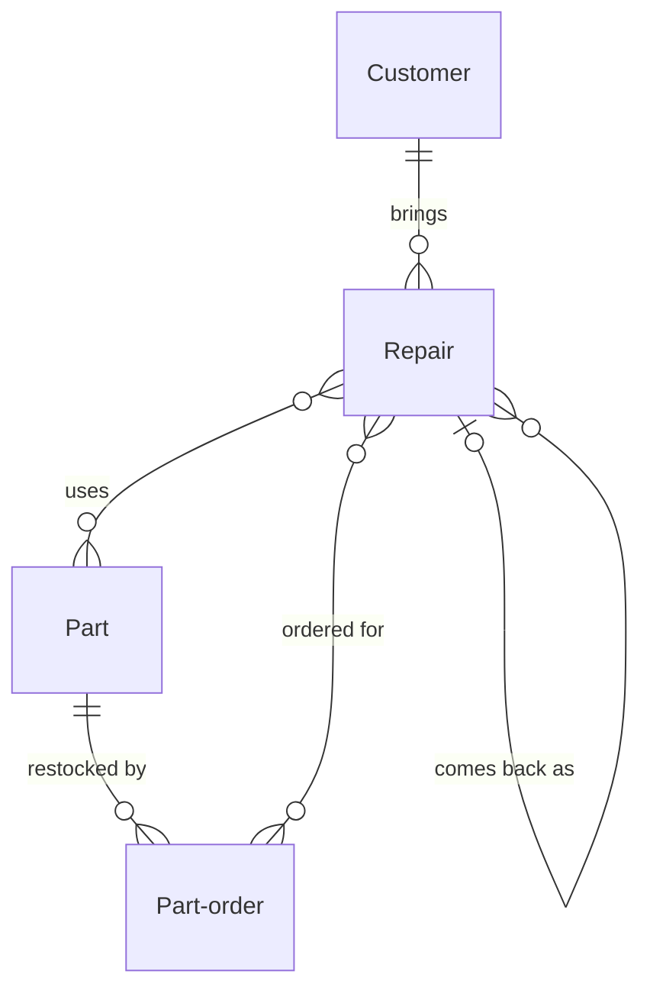

# Phone repair shop

*A recipe from the Fibery Process Cookbook: the process in plain words, and the model to build it in any tool.*

**Know where every phone is, what it costs and when it's ready.** For a walk-in phone repair shop of three to six people. Every phone from the counter to the bench and back, the parts it needs, and the warranty that follows it out of the door.

## The idea

In most small repair shops the system is a pad of paper slips, a notebook of phone numbers and one person's memory of the shelf. Phones wait with nobody sure who has them. Customers hear about a higher price at the till. The last screen for a popular model goes on the day three of them come in. And when a phone comes back a month later, nobody can say who fixed it or whether it's covered.

The method is one record per phone and two people on every one. Every phone that crosses the counter becomes a **Repair**, with its tag number, its condition and a price the customer agreed, and it moves across one board from the shelf to the bench and back to the counter. The **Counter person** takes it in, talks to the customer and hands it back; the **Technician** diagnoses and fixes it. The **Owner**, one of the team, orders parts and decides what happens to a phone nobody collects. Every **Part** on the shelf is counted from what arrives and what is fitted, and a phone that needs a part the shop doesn't have waits on a **Part order** that sends it back to the queue the day the part arrives. A phone that comes back under warranty is a new repair, linked to the first, free, and back with whoever fixed it.

In any work tool, this becomes four kinds of linked records: repairs whose workflow runs from *Queued* through the bench to *Collected*, with *Unclaimed* as the other ending; customers; parts whose stock count the tool works out; and part orders, which bring waiting phones back to the queue. People live on a board of every phone in the shop by state, a row per technician, red past its promise, and the counter has its own screen that finds a customer by phone number, takes the phone in and prints the claim slip. A rule wipes the passcode when the phone leaves, and another hands a warranty comeback, free, to whoever did the work. It's the shop's memory of every phone that comes in, not a till.

## How it runs

Follow one repair, *1042 iPhone 13*, from the counter to the bench and back, and then back again.

1. **A phone comes in.** Maya puts an iPhone 13 with a cracked screen on the counter. The counter person, whoever is at the counter, opens **Check in**, the counter's screen, and types her number. She's new, so they add her as a **Customer**, with her **Phone** and **Contact by**, how she wants to hear from the shop: *Text message*. They write the fault in her words, check the phone with her, note a scratch and a dented corner with two photos, and write down what she leaves: the SIM stays in, the case goes home with her. A cracked screen is a fixed-price job, so they set the **Repair type**, *Screen*, and the **Price**, 120 in the shop's currency, take a **Deposit** of 20 and give a **Promised by**, tomorrow at 17:00. She gives them her **Passcode** so the phone can be tested; it stays on the repair only while the phone is in the shop. They tie tag 1042 to the phone and hand her the claim slip. The repair, named *1042 iPhone 13* by its tag and device, waits *Queued* on the shelf.
2. **The morning look.** Every morning the technicians open the **Bench**, every phone in the shop by state with a row per technician, and split what's *Queued*. A phone past its Promised by is **Late** and red there, so the promises at risk are the first thing anyone sees. The technician who takes 1042 puts their name on it and moves it to *In repair*; from then on it's on **My repairs**, their own list.
3. **The price changes.** Under the screen the technician finds a swollen battery that has to go too. They raise the Price to 175, write why in a comment and move the repair to *Awaiting approval*. It appears on **My calls**, the counter person's list of customers to call.
4. **The customer says yes.** The counter person texts Maya, she agrees, and they write her yes in a comment. A screen is on the shelf, but **Stock**, the list of every part the shop keeps, shows the iPhone 13 battery at 0 **In stock**. Nobody types that number: it's the part's **Base count**, how many were on the shelf when it was first counted, plus every piece that has arrived since, less every piece fitted. So the technician adds a part order for one battery, *To order*, linked to 1042, and moves the repair to *Waiting for parts*. The counter person moves Promised by to three days out and texts Maya the new time.
5. **The owner orders.** The owner opens **Parts on order**, every part order by state with a row per **Supplier**, places the battery order and moves it to *Ordered*, typing its **Expected on**, the day the supplier promises: two days out. An order past that day turns red there, **Overdue**, and the owner chases it; one the supplier can't fill is *Cancelled* and ordered elsewhere. It's Monday, so the owner also goes down Stock: a part whose In stock has fallen to its **Reorder at**, the count at which to buy more, is **Low stock** and red, and **On order** says how many are already coming. The iPhone 13 screens are down to two, so a second part order goes to the same supplier, its **Quantity** five.
6. **The part arrives.** Two days later the counter person unpacks the delivery and moves both part orders to *Received*. In stock goes up by what arrived, and the **Part arrived** rule moves 1042 back to *Queued*, where its technician finds it on My repairs.
7. **The repair is done.** The technician fits the screen and the battery and adds both to the repair's **Parts used**, which takes them off In stock. They test the phone against the checklist in its description: touch, display, cameras, speakers, charging, buttons and unlock. Then they move it to *Ready*. The **On ready** rule sets **Ready on** to today, clears **Customer told**, the tick that says the customer knows, and asks the counter person to call.
8. **The customer collects.** The counter person texts Maya and ticks Customer told. When she comes in, **Ready to collect**, the phones waiting for their customers, shows 1042 and its **To pay**, 155: the price less the deposit. She pays at the till and gets her phone back, and the counter person moves the repair to *Collected*. The **On collection** rule sets **Collected on** to today, and **Forget the passcode** empties the passcode. The phone is **Under warranty** for 90 days from that day.
9. **It comes back.** Five weeks later the new screen stops answering along one edge. On Check in the counter person finds Maya by her number and sees 1042 among her repairs, still Under warranty. They take the phone in as a new repair, *1107 iPhone 13*, linked to the first through **Warranty for**, and the **Warranty return** rule sets its Price to 0 and gives it to the technician who did 1042. The first repair stays *Collected*: a comeback is never a reopened repair, and **Comebacks**, a report of warranty returns month by month, shows from whose bench they come.
10. **Or it never goes home.** Not every phone gets fixed. When a customer says no to a new price, or a phone can't be saved, the technician ticks **Not repaired** and moves it to *Ready* as it came, and the counter person sets the Price to the diagnostic fee, 20. *1060 Galaxy S21*, water-damaged beyond saving, is still on the shelf 30 days later: its **Days waiting** turns it red on Ready to collect, and the counter person calls once more. At 90 days, as the claim slip says, the owner moves it to *Unclaimed*, and Forget the passcode empties its passcode too.

## What people look at

- **Every morning** — **Bench**: every phone in the shop by state, a row per technician, red when Late. What's on the shelf, who has what, which promises are at risk. Then each technician's **My repairs**: what's theirs to fix, soonest promise first.
- **When a customer walks in** — **Check in**, a custom view drawn as the counter's screen: find the customer by phone number, see their repairs and warranty, take the phone in, print the claim slip. If your tool can't draw it, the **New repair** form does the job, with the **Customers** grid, every customer with their repairs, for the lookup. For a customer collecting, **Ready to collect**: which phone, what to pay, red after 30 days.
- **Through the day** — **My calls**, for each counter person: whose yes is needed, and who to tell their phone is ready.
- **Every Monday** — **Stock**, for the owner: what's on the shelf and what to reorder, red when low. **Parts on order**: what's coming, from whom, for which repairs, red when overdue.
- **Every month** — the **Takings** report, what the shop earned month by month, by repair type; and **Comebacks**, warranty returns month by month, by technician.
- **How to run the phone repair shop** — this process on one screen, kept where the team works.

## The rules

These are all the automations; everything else in the story is done by people.

- **Part arrived**: when a part order moves to *Received*, every repair it was ordered for that is *Waiting for parts* moves to *Queued*.
- **On ready**: when a repair moves to *Ready*, its Ready on is set to today, its Customer told is cleared, and its counter person is notified to tell the customer. A phone that goes back to the bench and comes out again gets a second call.
- **On collection**: when a repair moves to *Collected*, its Collected on is set to today, the day its warranty starts.
- **Forget the passcode**: when a repair moves to *Collected* or *Unclaimed*, its Passcode is emptied.
- **Warranty return**: when a repair is linked through Warranty for to an earlier repair that is Under warranty, at check-in or later, its Price is set to 0 and its technician becomes the earlier repair's technician.

No automations in your tool? Then a person does each of these at the same moment, and the promises they keep below become practices.

## What must stay true

Whatever anyone edits, adapts or corrects, these hold; each says what keeps it so.

- ★ No phone is worked on before it's checked in: a tag, the fault in the customer's words, its condition with photos, what was left with it, a price and a promise. Kept by **Check in**, which asks for each before it prints the claim slip; for a repair added through New repair, it's a practice.
- ★ The customer agrees every price before the work it pays for: a price raised on the bench waits in *Awaiting approval* until the counter person has the customer's yes, written in a comment. Shown on **My calls**, where every repair awaiting approval stays until someone calls; writing the yes down is a practice.
- ★ A passcode lives only as long as the repair: on the repair while the phone is in the shop, gone the moment it leaves. Kept by **Forget the passcode**; never writing it on the tag or in a comment is a practice.
- ★ A comeback under warranty is a new repair, linked to the first, free and back with the technician who did the work; the first repair is never reopened. Kept by **Warranty return** for the price and the technician, and shown by **Under warranty** on Check in and the Customers grid; linking instead of reopening is a practice, and Comebacks counts only what was linked.
- A promise in trouble is seen before the customer asks: a phone past its Promised by and not yet *Ready* is red on the Bench and My repairs. Shown by **Late**; calling with a new time before the old one passes is the counter person's practice.
- In stock is what's on the shelf: arrivals add, fitted parts subtract, and nobody types the count. Kept by the **In stock** formula. A piece broken in fitting, a second piece of one part in one repair, or a difference found at the monthly count is corrected by changing Base count, with a comment saying why: a practice.
- A phone nobody collects is chased, then let go by the shop's terms: red on Ready to collect from 30 days, and *Unclaimed* only by the owner's hand, from 90 days. Shown by **Days waiting**; the calls and the decision are practices.

## Making it yours

Decide these before you set it up; each has a default if you shrug.

| Question | Default | If not the default |
|---|---|---|
| Do you also take bookings or mail-in repairs? | Walk-ins only | Phones arrive by appointment or by post. For bookings: a *Booked* state before *Queued*, a Booked for field with the slot's time, and a Bookings calendar. For mail-in: an *In the post* state and Tracking in and Tracking out links on Repair |
| Do you buy and resell used phones? | No | Used phones get their own life beside the repairs: a Used phone database from *Bought* through *Refurbishing* and *For sale* to *Sold*, linked to the parts it uses, so In stock counts both |
| Do you want the margin on each repair? | No | Every repair shows what it earned: a Cost field on Part, a Parts cost formula on Repair, the cost of its parts used, a Margin formula, Price less Parts cost, and a Margin report by repair type |
| Do you already keep customers in your tool? | — | Repairs point at the customers you already have: Repair links to that database, Check in searches it by phone, and no Customer database is created |

- **A shop of two or three:** one person is often both the counter person and the technician of a repair. Keep both fields anyway: On ready, Warranty return and Comebacks each read one of them, and My calls and My repairs become your two lists.
- **Your own terms:** a 90-day warranty, a second call at 30 days and *Unclaimed* at 90 are common choices, and local consumer law may set its own. Whatever yours are, change them together: on the claim slip, in Under warranty and on Ready to collect.
- **Free diagnosis:** a phone that isn't repaired goes back with a Price of 0; nothing else changes.
- **Tablets, watches, laptops, consoles:** the same flow, since each repair is named by its device; add the faults they bring, a hinge or a keyboard, to the Repair type options.
- **More suppliers:** two or three fit the Supplier options. With more, or when you need their contacts and account numbers, a Supplier database linked from Part order.
- **Other words:** "ticket", "job" or "work order" for repair; "front desk" for counter person: rename freely.
- **Pushed too far:** a second shop needs a Shop field on Repair and on Part and a Stock list per shop, because one count can't be true for two shelves. Past ten technicians, every repair needs its steps with their own owners and times, and that's a workshop recipe, not this one.

## Details for building

What follows is what the process is built from, in words any tool can follow; the story above is enough to run it.

Each kind of record (Repair, Customer, Part, Part order) is a database or a table, depending on the tool, or a tab in a spreadsheet. A relation links two kinds; its inverse is the name it has on the other side. A state is a step in a workflow, and a finished state ends it. A rule is an automation, a button is an automation someone presses, and a formula is a field the tool computes. A nested view shows each record's children beneath it; where a tool can't nest, group the children by their parent instead.

Each repair belongs to one customer, uses any number of parts and can wait on several part orders; a warranty return points at the one earlier repair it comes back from. Each part order is for one part and lists the repairs waiting for it. The owner holds no field: one person orders for the whole shop, from Stock and Parts on order.

### Repair

One phone brought in for one job, from the counter back to the customer, named by its tag number and the device: "1042 iPhone 13". The description holds five headings: Fault, in the customer's words; Device, the IMEI or serial number and the color; Condition, the marks found at check-in, each with a picture in Photos; Left with us, the SIM, case, charger or memory card; Test, the checklist the technician goes through before *Ready*. Comments on; every new price and the customer's answer go there. Its fifteen fields are one more than a main database usually needs: the check-in photos get a field of their own, so a form can ask for them.

| Field | Type | Why |
|---|---|---|
| Customer | relation, many-to-one → Customer; inverse **Repairs** | Whose phone it is; Check in and Customers show the repairs through it |
| Photos | files | The marks found at check-in, photographed with the customer; Check in asks for them before it prints the claim slip |
| Repair type | single select: Screen, Battery, Charging port, Back glass, Camera, Water damage, Software, Other; no default | Set at check-in; on Bench cards, and what Takings colors by |
| Price | money | The agreed price: set at check-in, changed only with the customer's yes, the diagnostic fee for a phone not repaired, 0 for a warranty return; To pay and Takings read it |
| Deposit | money | Taken at check-in, empty when none; To pay subtracts it |
| Promised by | date-time | When the counter person promised the phone; Late reads it, and Bench and My repairs sort by it |
| Passcode | text | So the phone can be tested; emptied by Forget the passcode |
| Counter person | person; inverse **Counter repairs** | Talks to the customer about this repair; set by Check in to whoever takes the phone in; My calls and On ready go to them |
| Technician | person; inverse **Bench repairs** | Diagnoses and fixes it; set by whoever takes it from the shelf, or by Warranty return; the Bench rows, My repairs and Comebacks run on it |
| Not repaired | checkbox | Ticked when the customer said no or the phone can't be saved; Under warranty reads it |
| Customer told | checkbox | Ticked by the counter person once the customer knows the phone is ready; cleared by On ready; My calls reads it |
| Ready on | date | Set by On ready; Days waiting counts from it |
| Collected on | date | Set by On collection; Under warranty counts from it, and Takings counts by its month |
| Warranty for | relation, many-to-one → Repair; inverse **Came back as** | The earlier repair this one is a free comeback of; Warranty return and Comebacks run on it |
| Parts used | relation, many-to-many → Part; inverse **Used in** | Every piece taken from the shelf for it, one link per part; In stock subtracts them |

States: Queued → In repair → Awaiting approval → Waiting for parts → Ready → Collected (finished) · Unclaimed (finished). Default: Queued. A repair goes back and forth among the first four as the work needs, and Part arrived brings it back to *Queued*. Source of truth: **Price** holds the agreed price, except while *Awaiting approval*, when it holds the one being asked; the comments keep every change and the customer's answer. Ready on and Collected on are set by the rules; a move entered late gets its date corrected by hand.

Formulas:
- **Late** — yes when Promised by has passed and the repair is *Queued*, *In repair*, *Awaiting approval* or *Waiting for parts*; no otherwise, and no with no promise; red on the Bench and My repairs.
- **To pay** — Price less Deposit, an amount of money with two decimal places, an empty Price or Deposit counting as 0; negative when the deposit is more than the price, which means money back; on Ready to collect.
- **Days waiting** — days from Ready on to today, a whole number, 0 with no date; on Ready to collect, red from 30.
- **Under warranty** — yes when Collected on is less than 90 days ago and Not repaired is unticked; no otherwise, and no with no Collected on; on Check in and the Customers grid, and read by Warranty return.

### Customer

A person who brings phones in, named by first and last name. The description holds what the counter should know, such as a business that pays by invoice. Comments off.

| Field | Type | Why |
|---|---|---|
| Phone | phone | How Check in finds them, and how the counter person calls or texts |
| Email | email | For a customer who'd rather hear by email; on the Customers grid |
| Contact by | single select: Call, Text message, Email; default Text message | How they want to hear that their phone is ready; on My calls |

No states. Their repairs come through the inverse Repairs.

### Part

One part the shop keeps on the shelf, named by the model it fits and what it is: "iPhone 13 battery". The description holds the quality grade and the supplier's part number. Comments on; every change to Base count gets one.

| Field | Type | Why |
|---|---|---|
| Kind | single select: Screen, Battery, Charging port, Back glass, Camera, Other; no default | Stock sorts by it |
| Base count | integer | How many were on the shelf when the part was first counted, corrected at each monthly count and for every piece broken, lost or used twice in one repair; In stock starts from it |
| Reorder at | integer | The In stock at which to buy more; 0 for a part bought only when a repair needs it; Low stock reads it |

No states. Its repairs come through the inverse Used in, its orders through the inverse Part orders.

Formulas:
- **In stock** — Base count, plus the Quantity of each of its part orders that is *Received*, less the number of repairs it's linked to through Used in, whatever their state; a whole number, Base count alone when nothing has arrived or been fitted; on Stock, and read by Low stock.
- **On order** — the total Quantity of its part orders that are *To order* or *Ordered*, a whole number, 0 with none; on Stock.
- **Low stock** — yes when Reorder at is above 0 and In stock is at or below it; no otherwise; red on Stock.

### Part order

One order of one part from one supplier, named by the quantity and the part: "5 iPhone 13 screens". The description holds the supplier's order number. Comments off.

| Field | Type | Why |
|---|---|---|
| Part | relation, many-to-one → Part; inverse **Part orders** | What's ordered; In stock and On order read its Quantity through it |
| Quantity | integer | How many pieces; In stock adds it once *Received*, On order counts it while it's coming |
| Supplier | single select: the shop's suppliers, two in the sample story; no default | Where it's ordered from; the rows of Parts on order |
| Expected on | date | The day the supplier promises, typed by the owner when ordering; Overdue reads it |
| For repairs | relation, many-to-many → Repair; inverse **Part orders** | The repairs waiting for it, empty for a restock; Part arrived moves them on |

States: To order → Ordered → Received (finished) · Cancelled (finished). Default: To order. The technician adds an order for a repair, the owner adds restocks and places every order, and the counter person receives the delivery.

Formulas:
- **Overdue** — yes when Expected on has passed and the order is *Ordered*; no otherwise, and no with no date; red on Parts on order.

### Views

| View | Type | Of | Grouping | Shows | Filter | Sort |
|---|---|---|---|---|---|---|
| Bench | board | Repair | columns State, rows Technician | Customer, Repair type, Promised by, Price; red when Late | State is not Collected or Unclaimed | Promised by asc |
| My repairs | list | Repair | | State, Repair type, Promised by, Customer; red when Late | Technician is me; State is Queued, In repair, Awaiting approval or Waiting for parts | Promised by asc |
| New repair | form | Repair | | Name (required), Customer (required), Repair type (required), Price (required), Deposit, Promised by (required), Passcode, Counter person (required), Warranty for, Photos, Description | | |
| Customers | grid | Customer | Repairs nested: State, Collected on, Under warranty, Technician | Phone, Contact by, Email | | Name asc |
| Ready to collect | grid | Repair | | Customer, To pay, Not repaired, Customer told, Ready on, Days waiting; red when Days waiting is 30 or more | State is Ready | Ready on asc |
| My calls | list | Repair | | State, Customer, the customer's Phone and Contact by, Price, Promised by | Counter person is me; State is Awaiting approval, or State is Ready and Customer told is unticked | Promised by asc |
| Stock | grid | Part | | Kind, In stock, Reorder at, On order; red when Low stock | | Kind, then Name |
| Parts on order | board | Part order | columns State, rows Supplier | Part, Quantity, Expected on, For repairs; red when Overdue | State is To order or Ordered | Expected on asc |
| How to run the phone repair shop | document | | | the process on one screen, linking to this recipe | | |

### App

**Check in**, a page of its own, for the counter. Most tools can't draw it out of the box: build it as a custom app or view where the tool allows one, or use its fallback. The counter person types a phone number and sees whose it is, or adds a new customer with Name, Phone and Contact by. Below, that customer's repairs with State, Collected on and Under warranty; picking one as the reason for this visit fills Warranty for. Then the new repair: its name from the tag number and the device, Repair type, Price, Deposit, Promised by, Passcode, Photos, and the description's first four headings. It creates the repair only with a tag, a fault, a price and a promise, sets Counter person to whoever is signed in, and shows the claim slip to print: tag, customer, device, fault, price, deposit, promise and the shop's terms. Reads: Customer Name, Phone, Contact by; Repair Name, Customer, State, Collected on, Under warranty. Writes: Customer Name, Phone, Contact by; Repair Name, Customer, Repair type, Price, Deposit, Promised by, Passcode, Counter person, Warranty for, Photos, Description. Fallback: the New repair form, with the Customers grid for the lookup.

### Reports

**Takings** — source Repair, current, only *Collected* repairs: a stacked bar of the sum of Price by month of Collected on, colored by Repair type.

**Comebacks** — source Repair, current, only repairs with a Warranty for: a stacked bar of repairs by month of creation, colored by Technician. Colored by Technician because Warranty return gives a comeback to whoever did the first repair.

### Sample story

1042 iPhone 13, collected five weeks ago, is back as 1107 iPhone 13, in repair under warranty with the same technician. Other phones are queued, awaiting approval or on the bench, one a day late. Two wait for parts from two suppliers, one order overdue. A third is queued again since its Pixel 7 back glass arrived. Two phones became ready today, one customer not yet told. 1060 Galaxy S21, not repaired, has been ready for 35 days, and another phone went unclaimed. Collected repairs span four months and several types, one an earlier comeback. The iPhone 13 battery is out, none on order; iPhone 12 screens are low, three on order; a charging port order was cancelled.

## Sources

- [Write it Right!](https://bhgs.dca.ca.gov/forms_pubs/write_it_right_flyer.pdf), Bureau of Household Goods and Services, California Department of Consumer Affairs, 2019: a claim slip at drop-off, a written price, and the customer's yes before anything costs more.
- [How to Find a Good Local Repair Shop](https://www.ifixit.com/News/117445/does-ifixit-have-stores), Elizabeth Chamberlain, iFixit, 2026: an organized intake and pickup, approval before going over the estimate, and a clear warranty.
- [Uncollected goods](https://www.nsw.gov.au/legal-and-justice/consumer-rights-and-protection/repairs-replacements-and-refunds/uncollected-goods), NSW Fair Trading, 2025: what a shop does with a repaired phone nobody collects.

## Build it

In Fibery, open Claude with the Fibery plugin, attach this recipe and say "set up the phone repair shop". You'll see a one-screen design first; nothing is created until you say yes, and the build takes about ten minutes.

Anywhere else, give this recipe to your AI assistant and name your tool, or build it by hand from Details for building.

---

*From the Fibery Process Cookbook (https://github.com/Fibery-inc/process-cookbook), licensed CC BY 4.0 (https://creativecommons.org/licenses/by/4.0/): copy, adapt and build it anywhere, crediting the cookbook.*
