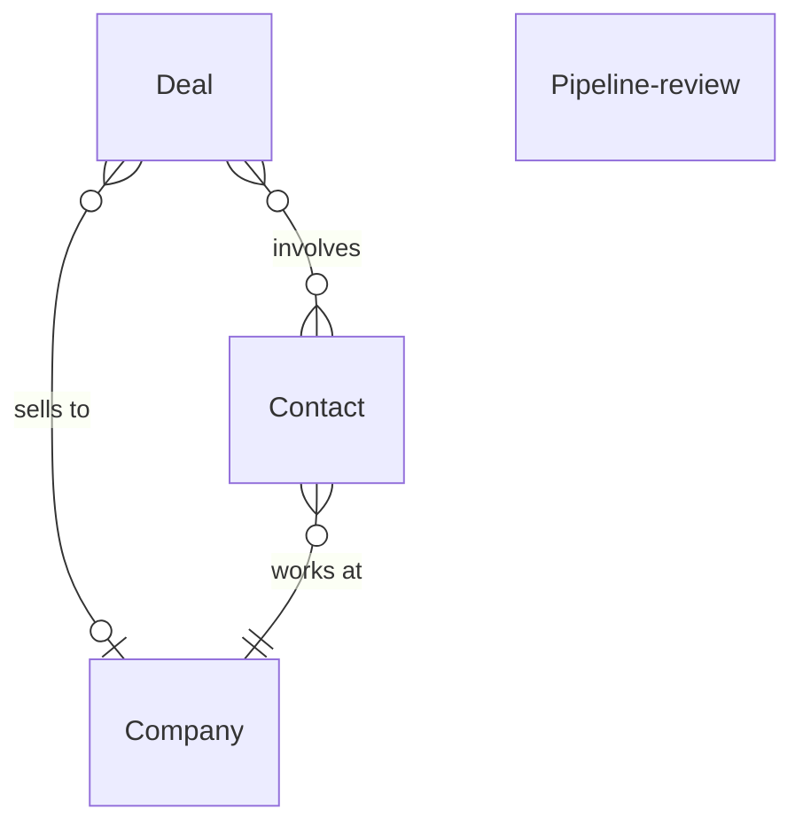

# Sales pipeline

*A recipe from the Fibery Process Cookbook: the process in plain words, and the model to build it in any tool.*

**Every open deal has a next step, a number and a date, and the team looks at all of them every Monday.** For the sales team of a small SaaS company, from a founder who sells to ten reps. A B2B pipeline from the first inbound or outbound lead to a signature or a lost reason.

## The idea

Small SaaS companies rarely lose deals on the demo. They lose them in the quiet: a lead that waited four days for a reply, a proposal nobody chased, a close date that slips every month. The cure is a few habits: one record per opportunity on one board, a next step with a date on every open deal, an honest amount and close date once fit is confirmed, a reason on every lost deal, and a weekly review of all of it.

Every opportunity is a **Deal**, one record from the first touch to the signature, worked by one **Owner**, the rep, and sold to one **Company**. The people in the conversation are each a **Contact**, with a job title and an email. The deal's **Source** says how it arrived: *Inbound*, they came to you; *Outbound*, you went to them. Every Monday the team holds a **Pipeline review**, one record per meeting, with that week's numbers and notes.

In any work tool, this becomes a few kinds of linked records: deals whose workflow runs from *Lead* to *Won* or *Lost*, a company and its contacts linked to each deal, a board of every open deal by stage that turns red when the next step is missing, and a rule that creates Monday's review before anyone arrives. It's the sales team's pipeline and forecast, not a marketing database: a deal exists once there is a conversation, and prospect lists stay in the outreach tool.

## How it runs

Follow one deal, *Kestrel Logistics*, from the first reply to the signature.

1. **A lead appears.** An inbound lead arrives through the **New inbound lead** form on the website, as a Deal in *Lead* with Source *Inbound*, and the rep who answers it becomes its Owner. An outbound lead is created by its Owner when a cold email gets a reply, with Source *Outbound*. Kestrel is outbound: Dana, their head of operations, answered Maya's second email. Maya creates the deal, links the Company, with its website and size, adds Dana as a Contact, sets herself as Owner, and replies the same day.
2. **Discovery.** Maya books a call and moves the deal to *Discovery*, with **Next step** "Discovery call" and the day it's due. The call qualifies the deal: pain, who decides, when, what they pay today; the notes go in the Description under its Discovery heading. Fit confirmed, she enters the **Amount**, the expected annual value, which each stage discounts into a **Weighted amount** for the forecast, and a **Close date**, her honest guess, and books the demo. No fit, or no answer after three tries: *Lost*, with the reason, *No fit* or *Went quiet*.
3. **Demo.** With the demo booked, Maya moves the deal to *Demo*. The **Stage dates** rule stamps **Stage changed on** at every move, and **Days in stage** counts from it. The demo is for the people who decide, so Dana brings her finance lead, whom Maya adds as a second Contact.
4. **Proposal.** Maya sends the plan, price and terms, links the proposal in the Description under its Proposal heading, moves the deal to *Proposal* and updates the Amount to the proposed figure. Next step: "Follow up with Dana", due Tuesday.
5. **No deal without a next step.** An open deal whose **Next step date**, the day its next step is due, is empty or past, or whose Close date has passed, is **Stale**. It shows red on **Pipeline**, the board of every open deal by stage, and on **My deals**, the owner's own list. The owner writes the next step, moves the close date, or admits it's lost.
6. **Monday: the pipeline review.** At 08:00 the **Review prep** rule creates this week's Pipeline review, and before the meeting the **Sales lead**, who runs it, fills the review in: five numbers, how many deals are open, their value in full and weighted by stage, what was won and what was lost in the last seven days, and the stale deals listed under To challenge in its Description. At the meeting they open **Pipeline by owner**, open deals by stage with a row per owner, and each owner walks their row: what moved, what's next and when, whether amount and close date still hold. Stale deals get a next step or go to *Lost*. Kestrel, ten days unanswered: Maya will call the finance lead on Wednesday.
7. **Won.** Signed. Maya moves the deal to *Won*; the **On closing** rule sets Close date to today, so the forecast and the win rate run on real dates. The company's **Won deals**, how many of its deals were won, becomes 1: a customer now.
8. **Or lost.** The owner can move a deal to *Lost* from any stage, with its **Lost reason**: *No fit*, *Not now*, *Price*, *Missing feature*, *Chose competitor* or *Went quiet*; when it's missing, the **Lost needs a reason** rule asks the owner for it. Lost deals stay; **Won and lost**, every closed deal with its reason, and the reports learn from them.

## What people look at

- **Every morning** — **Pipeline**: every open deal by stage, red when Stale. Where is every deal. **New leads**: every deal still in *Lead*, oldest first. Who is waiting for a reply. **My deals**: your own open deals, by next step date. What do I do today.
- **Every Monday** — this week's Pipeline review, with the numbers and To challenge; **Pipeline by owner**, the board the meeting walks, open deals by stage with a row per owner; **Review history**: the numbers week by week.
- **Any time** — **Won and lost**: every closed deal with its reason; **Companies**: each with its contacts and deals, customers marked by Won deals; **New inbound lead**, the form on the website; the **Forecast** report, weighted amount by close month; **Win rate**, won against lost by month; **Wins by source**, what inbound and outbound each bring.
- **How to run the sales pipeline** — this process on one screen, kept where the team works.

## The rules

These are all the automations; everything else in the story is done by people.

- **Review prep**: every Monday at 08:00, creates the week's Pipeline review dated today, so the meeting has its record before anyone arrives.
- **Stage dates**: when a deal's state changes, Stage changed on is set to today.
- **On closing**: when a deal moves to *Won* or *Lost*, Close date is set to today.
- **Lost needs a reason**: when a deal moves to *Lost* with no Lost reason, its owner is notified to add one.

No automations in your tool? Then a person does each of these at the same moment, and the promises they keep below become practices.

## What must stay true

Whatever anyone edits, adapts or corrects, these hold; each says what keeps it so.

- One opportunity is one deal, from the first conversation to *Won* or *Lost*, and every open deal is on the Pipeline board. A practice; the board hides nothing but *Won* and *Lost*, so every deal that exists is walked on Monday.
- ★ Every open deal has a next step with a date, and neither that date nor its close date has passed. Shown by **Stale**, the formula that turns the deal red on Pipeline, My deals and Pipeline by owner; the Sales lead lists every Stale deal under To challenge before Monday's meeting. A deal reopened from *Won* or *Lost* is Stale at once, because On closing left its Close date in the past, until its owner sets new dates.
- Past *Discovery*, a deal carries an Amount and a Close date, the owner's honest numbers. A practice; the Monday walk asks every owner whether amount and close date still hold, and an empty Amount is plain on every Pipeline card.
- ★ Every lost deal says why. A practice; the **Lost needs a reason** rule asks the owner the moment a deal is *Lost* without a reason, and nothing refuses the move.
- A closed deal's Close date is the day it closed, not the guess. Kept by **On closing**, which sets it on *Won* or *Lost*; the guess is not kept, so how far the forecast drifted is read from Review history, week by week.
- ★ A week's numbers are a snapshot of Monday morning, and nobody edits them after. A practice; the Sales lead writes them once, before the meeting, in the review that **Review prep** creates at 08:00, and nothing stops a later edit. The live figures are on Pipeline and in the Forecast report, and the two are allowed to differ by Tuesday.

## Making it yours

Decide these before you set it up; each has a default if you shrug.

| Question | Default | If not the default |
|---|---|---|
| Do you already track companies, contacts or customers in your tool? | — | Deals link to the companies and contacts you already have; no Company or Contact database is created |
| One owner from lead to close, or do SDRs hand leads to account executives? | One owner | The SDR and the account executive each see their part of the deal; add an SDR field on Deal, for the person who qualified it, and a *Qualified* state between *Lead* and *Discovery* for the hand off |
| How is a deal priced? | One Amount, annual value, typed by hand | Amount is computed, not typed; add Seats and Price per seat on Deal, and Amount becomes a formula from them |
| Is there a negotiation or procurement step after the proposal? | No | The forecast counts a deal in legal or procurement at 80 percent; add a *Negotiation* state between *Proposal* and *Won*, weighted so in Weighted amount |

- **The founder sells alone:** keep the Pipeline review; the history is the point. Drop Pipeline by owner.
- **Other sources and words:** add *Referral*, *Partner* or *Event* to Source; call deals Opportunities and companies Accounts if the team says so.
- **Trials, sign ups, expansions, renewals:** a sign up is not a deal; a deal starts when someone qualifies one. Add a Kind field on Deal with *New*, *Expansion* and *Renewal* when one board tracks them all; most small teams keep renewals off it.
- **Pushed too far:** more than six open stages makes the board a checklist and the weights fiction. A stage is a milestone the customer passed, not a task for the rep.
- **What teams add once it runs:** quotas, and with them a forecast app that draws each month against its target line. Until the team has quotas, the Forecast report and Review history do that job.

## Details for building

What follows is what the process is built from, in words any tool can follow; the story above is enough to run it.

Each kind of record (Deal, Company, Contact) is a database or a table, depending on the tool, or a tab in a spreadsheet. A relation links two kinds; its inverse is the name it has on the other side. A state is a step in a workflow, and a finished state ends it. A rule is an automation, a button is an automation someone presses, and a formula is a field the tool computes. A nested view shows each record's children beneath it; where a tool can't nest, group the children by their parent instead.

Each deal is sold to at most one company, empty only on a lead from the form until the rep links it, and involves any number of contacts. Each contact works at one company. A Pipeline review links to nothing: it holds the week's numbers and the meeting's notes.

### Deal

One opportunity to sell to one company, named by the company, with the plan or product added when a company has several ("Kestrel Logistics", "Kestrel Logistics expansion"). The Description holds the notes under four headings: Discovery, Demo, Proposal, Decision. Comments on.

| Field | Type | Why |
|---|---|---|
| Company | relation, many-to-one → Company; inverse **Deals** | Who's buying; empty on a lead from the form until the rep links it |
| Contacts | relation, many-to-many → Contact; inverse **Deals** | The people in the conversation; the champion and the decision maker first |
| Owner | person; inverse **Owned deals** | The rep who works it; My deals and Pipeline by owner run on it |
| Source | single select: Inbound, Outbound; no default | Which engine brought it; Wins by source |
| Amount | money | Expected annual contract value; set at Discovery, updated at Proposal; Pipeline value, Weighted amount, the reports |
| Close date | date | The honest expected signing date while open; the real date once closed, set by On closing; Stale, Forecast, Win rate |
| Next step | text | The one concrete thing that moves the deal, "Call Dana about procurement" |
| Next step date | date | When the next step is due; Stale when empty or past; My deals sorts by it |
| Lost reason | single select: No fit, Not now, Price, Missing feature, Chose competitor, Went quiet; no default | Why it was lost; Lost needs a reason asks for it; Won and lost shows it |
| Stage changed on | date | Set by Stage dates; Days in stage counts from it |

States: Lead → Discovery → Demo → Proposal → Won (finished) · Lost (finished). Default: Lead. Source of truth for Close date: people set it while the deal is open; On closing overwrites it on *Won* or *Lost*, and the old guess is not kept.

Formulas:
- **Days in stage** — days since Stage changed on, a whole number; days since the deal was created when it has never moved and the date is empty; on Pipeline and Pipeline by owner cards and under To challenge.
- **Weighted amount** — Amount times the stage's chance of closing, 10 percent in *Lead*, 20 in *Discovery*, 40 in *Demo*, 60 in *Proposal*, the full amount when *Won*, 0 when *Lost*; money, 0 with no amount; summed into Weighted value by the Sales lead and charted by the Forecast report. The percentages are a common starting point; teams tune them after a quarter of history.
- **Stale** — yes when the deal is neither *Won* nor *Lost* and its Next step date is empty or past, or its Close date is past; yes or no, no once the deal is closed, and an empty Close date doesn't count; colors Pipeline, My deals and Pipeline by owner red; listed by the Sales lead under To challenge.

### Company

One company that might buy or has bought. The Description holds what they do and the account notes. Comments off. Fields: Website (url); Size (single select: Under 10, 10 to 50, 50 to 200, 200 to 1000, Over 1000; no default). No states. Its contacts and deals come through the inverses **Contacts** and **Deals**.

Formulas:
- **Won deals** — how many of the company's deals are *Won*, a whole number, 0 with none; on the Companies grid. Above 0 means a customer, so a new deal there is an expansion.

### Contact

One person at a company. Description off, comments off. Fields: Company (relation, many-to-one → Company; inverse **Contacts**); Email (email); Title (text, their job title). No states. Their deals come through the inverse **Deals**.

### Pipeline review

One record per weekly meeting, named by its week ("Week of 5 October"). The Description holds To challenge, the Stale deals the Sales lead lists before the meeting, one line each with owner, stage and days in stage, then the notes and commitments people write at the meeting. Comments off. Fields: Date (date; set by Review prep); Open deals (integer); Pipeline value (money); Weighted value (money); Won last week (money); Lost last week (money). The five numbers are written by the Sales lead before the meeting; all six show on Review history. No states. Source of truth: the numbers are a snapshot the Sales lead writes on Monday before the meeting and are not edited after; the live figures are on Pipeline and in the Forecast report.

### Views

| View | Type | Of | Grouping | Shows | Filter | Sort |
|---|---|---|---|---|---|---|
| Pipeline | board | Deal | columns State | Company, Amount, Owner, Close date, Next step, Next step date, Days in stage; red when Stale | State is not Won or Lost | Close date asc |
| New leads | list | Deal | | Source, Company, Owner, Creation date | State is Lead | Creation date asc |
| My deals | list | Deal | | State, Company, Amount, Next step, Next step date; red when Stale | Owner is me; State is not Won or Lost | Next step date asc |
| Pipeline by owner | board | Deal | columns State, rows Owner | Company, Amount, Close date, Next step, Days in stage; red when Stale | State is not Won or Lost | Close date asc |
| Review history | grid | Pipeline review | | Date, Open deals, Pipeline value, Weighted value, Won last week, Lost last week | | Date desc |
| Won and lost | grid | Deal | | Company, Owner, Source, Amount, Close date, Lost reason | State is Won or Lost | Close date desc |
| Companies | grid | Company | Deals nested: State, Amount, Owner | Website, Size, Contacts, Won deals | | Name asc |
| New inbound lead | form | Deal | | Name, Description; Source preset to Inbound | | |
| How to run the sales pipeline | document | | | the process on one screen, linking to this recipe | | |

### App

None needed. The central moment is the Monday walk through every open deal, owner by owner, and the Pipeline by owner board with Days in stage and Stale shows it. A forecast app with a target line was considered; the Forecast report and Review history cover it until the team has quotas.

### Reports

There are three, one past the usual two, because a sales team is asked three separate questions every month: what will close, how often it wins, and where its wins come from.

- **Forecast** — source Deal, current, only open deals with a Close date: a stacked bar of Weighted amount by month of Close date, colored by State.
- **Win rate** — source Deal, current, only *Won* and *Lost*: a stacked bar of deals per month of Close date, colored by State; the eye reads the ratio.
- **Wins by source** — source Deal, current, only *Won*: a bar of Amount per quarter of Close date, colored by Source.

### Sample story

Kestrel Logistics is in Proposal, notes under the four headings and the proposal linked, a call due in two days. Deals from the last three months fill the other stages, at companies of every size, with their contacts. A lead from the form arrived this morning with no owner yet, another yesterday; an outbound one has sat untouched for three days. One Discovery deal has no next step date, one Proposal deal passed its close date last week: both Stale. Two wins in the last two months made their companies customers; two losses say Not now and Chose competitor. Past Mondays' reviews hold notes and numbers growing a little each week; this week's also has To challenge.

## Sources

- [Pipeline Management](https://holloway.com/g/founding-sales/sections/pipeline-management), Pete Kazanjy, Founding Sales, Holloway, 2022: a dated next step on every deal, and a weekly look at the whole pipeline.
- [How to Run the Perfect Sales Pipeline Review Meeting](https://close.com/blog/sales-pipeline-review-meeting), Steli Efti, Close, 2016: the Monday review where each owner walks through their deals.
- [Close-Losting](https://www.holloway.com/g/founding-sales/sections/close-losting), Pete Kazanjy, Founding Sales, Holloway, 2022: closing a dead deal as lost, with its reason.

## Build it

In Fibery, open Claude with the Fibery plugin, attach this recipe and say "set up the sales pipeline". Claude asks a few questions, then sets it up in about ten minutes.

Anywhere else, give this recipe to your AI assistant and name your tool, or build it by hand from Details for building.

---

*From the Fibery Process Cookbook (https://github.com/Fibery-inc/process-cookbook), licensed CC BY 4.0 (https://creativecommons.org/licenses/by/4.0/): copy, adapt and build it anywhere, crediting the cookbook.*
