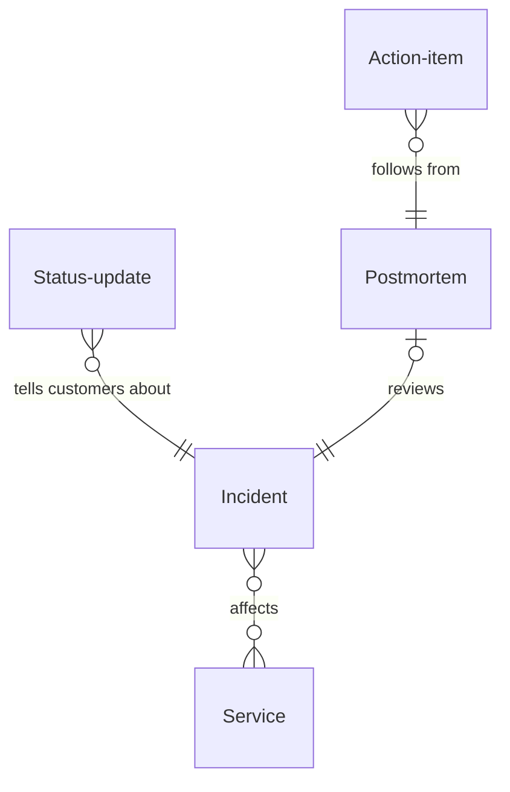

# Incident management

*A recipe from the Fibery Process Cookbook: the process in plain words, and the model to build it in any tool.*

**Declared in one step, run by one commander, told to customers on a clock, and closed only when the fixes are done.** For a SaaS engineering team with someone on call. An outage handled from the first page to the last action item, built on PagerDuty's response guide.

## The idea

Outages hurt twice: while the product is down, and again when nobody writes down what happened, so the same thing breaks next quarter, and the postmortem's action items, if any, belong to nobody.

Four habits fix that. Anything that hurts customers or threatens data is an **Incident**, declared in one step by the **On call**, the engineer on duty, with a severity that says how bad it is. Every incident has one **Commander**, who coordinates and doesn't debug. While customers can see it, they hear from the team on a clock, through **Status updates**, the messages posted to the status page, the public page that says whether the product is up. Every serious incident ends in a **Postmortem**, a written account of what happened and why, with no blame in it, whose **Action items**, the fixes it calls for, each have one owner and a date and are chased until the postmortem closes. Every week the team reads the postmortems that are ready and agrees their action items.

In any work tool, this becomes a few kinds of linked records: incidents whose workflow runs from *Investigating* to *Resolved*, status updates linked under each incident with a formula that says when the next one is due, a board of open incidents that turns red when customers have waited too long, a rule that creates the postmortem when a serious incident resolves, and a reminder that chases overdue action items every Monday. It's the team's memory of its incidents, not the pager and not the status page.

## How it runs

Follow one incident, *Logins failing in EU*, from the page to the closed postmortem.

1. **The on call declares.** At 02:10 the login error rate alarms. The on call opens the **Declare incident** form, names the incident and picks the **Severity**, how bad it is: *SEV1*, the product down or data at risk, on a scale that ends at *SEV4*, no customer impact. They tick **Customer facing**, customers can see it, link the **Services** affected, parts of the product that break on their own, here Auth and Web app, and write a one-line summary. The incident starts in *Investigating*.
2. **A commander takes charge.** The **On declaration** rule has already stamped when the incident was declared, which counts as its start until someone knows better, and made the on call the Commander. On a *SEV1* or *SEV2* a second engineer takes over as Commander, with a comment, so the on call can debug. The **Responders**, everyone working on it, are listed on the incident; the internal timeline is its comments.
3. **Customers hear from you.** Within minutes the commander posts the first status update, the message as it goes out on the status page: what customers see, not what the team suspects. The incident shows **Last customer update**, when the newest one went out, and **Next update due**, thirty minutes later on a *SEV1*, an hour on a *SEV2*. On **Active incidents**, the board of every open incident, a card past its due time turns red, and the commander posts again.
4. **The cause is found.** A config push broke token signing. The commander moves the incident to *Identified* and posts an update. The responders roll the push back, and the commander moves the incident to *Monitoring* while the team watches the error rate; another update says logins are recovering.
5. **It's resolved.** At 03:05 the commander moves the incident to *Resolved* and posts the last update. The **On resolution** rule stamps when it was resolved, and for a *SEV1* or *SEV2* the **Postmortem needed** rule creates the Postmortem in *Drafting*, with the commander as its **Owner**, who writes it. Its **Due on**, the date its review must have happened by, is three days out for a *SEV1*, seven for a *SEV2*. **Duration**, how long it lasted, shows 55 minutes. An incident that turns out to be nothing is moved to *Not an incident* by the commander; declaring it was still right.
6. **The postmortem is written, blamelessly.** The owner fills its Description under seven headings: Summary, Impact, Timeline, Contributing causes, What went well, What went wrong, Where we got lucky. No names in the causes: what let a wrong config reach production unchecked, not who pushed it. Each fix worth doing becomes an action item, one piece of follow-up work with exactly one Owner and a Due on; fewer that get done beat many that don't. The owner moves the postmortem to *In review*.
7. **The review.** Every week the team holds the **Postmortem review**, a thirty-minute meeting over **Postmortems to review**, the list of what's drafting or waiting: it reads each postmortem in review, challenges the timeline and the causes, and agrees the action items with their owners and dates. The owner then moves the postmortem to *Reviewed*.
8. **Actions get done.** An action item starts *Open*; its owner moves it to *In progress* when work starts and to *Done* when it's finished, or to *Dropped* with a comment. Owners see their work in **My action items**; the team sees all of it in **Open action items**, every unfinished action by postmortem, red when **Overdue**, past its date and not finished. Every Monday the **Action chase** reminds the owner of every overdue action item.
9. **The postmortem closes.** When the postmortem's **Open actions**, how many are still unfinished, reaches zero, the **Actions done** rule moves it to *Closed*. A postmortem nobody needed is moved to *Skipped* by its owner, with a comment. Three months later, when logins wobble again, the team opens the **Incident log**, every resolved incident with its postmortem, and finds this one.

## What people look at

- **Every morning, and during an incident** — **Active incidents**: every open incident by state, with severity, commander, services and when the next customer update is due; red when it's past. Anything burning, customers waiting?
- **During an incident** — **Customer updates**: every status update posted, newest first. What have customers been told?
- **Every week, at the Postmortem review** — **Postmortems to review**: what's drafting or in review, with due dates and open actions. What needs reading this week? **Open action items**: every unfinished action by postmortem, overdue ones red. Who owes what, and what's late?
- **Every month** — the **Incident log**, every resolved incident with its duration and postmortem: what happened, and how long did it take? The **Incidents by month** report: fewer and shorter, or not? The **Postmortem debt** report: who carries overdue action items?
- **Any time** — **My action items** for your own follow-ups; **Service history**, each service with its incidents: which parts keep breaking? **Declare incident**, the form.
- **How to run incident management** — this process on one screen, kept where the team works.

## The rules

These are all the automations; everything else in the story is done by people.

- **On declaration**: when an incident is created, Declared at is set to now and whoever created the incident becomes its Commander.
- **On resolution**: when an incident moves to *Resolved*, Resolved at is set to now.
- **Postmortem needed**: when a *SEV1* or *SEV2* incident with no postmortem yet moves to *Resolved*, a postmortem is created and linked, with the commander as its Owner, and a comment on the incident says so.
- **Action chase**: every Monday at 09:00, the owner of every action item that is past its Due on and neither *Done* nor *Dropped* is notified, one message per action item.
- **Actions done**: when an action item moves to *Done* or *Dropped* and its postmortem is *Reviewed* with no other action item left unfinished, the postmortem moves to *Closed*.

No automations in your tool? Then a person does each of these at the same moment, and the promises they keep below become practices.

## What must stay true

Whatever anyone edits, adapts or corrects, these hold; each says what keeps it so.

- ★ Every incident has a Severity and one Commander from the moment it's declared. Kept by the **Declare incident** form, which won't submit without a Severity, and by **On declaration**, which makes whoever declared the incident its Commander; Commander holds one person, so a hand-over replaces one name with another, with a comment, and an incident never has two commanders or none.
- ★ While an incident is open and customer facing, customers hear from the team every 30 minutes on a *SEV1* and every hour on a *SEV2*. Shown by **Next update due** on Active incidents: the card turns red once the time is past. Posting the update, and copying it in as it goes out, is the commander's; a status update copied in late counts from when it was entered.
- A *SEV1* or *SEV2* resolves into exactly one postmortem. Kept by **Postmortem needed**, which creates it only when the incident has none: an incident reopened and resolved again gets its Resolved at stamped again and keeps the postmortem it has. An incident downgraded after that keeps it too, moved to *Skipped* with a comment; that part is a practice.
- ★ A postmortem is *Closed* only after its review, with every action item *Done* or *Dropped*. Kept by **Actions done**, which closes it the moment the last one finishes; nobody drags it there sooner, a practice. An action item reopened after the close doesn't reopen the postmortem; it stays on My action items until it's done. A postmortem emptied by moving its last action item elsewhere isn't closed by the rule; its owner closes it.
- ★ Every action item has one owner and a due date, and is chased while it's overdue. The owner and the date are a practice, agreed at the Postmortem review; the chasing is kept by **Action chase**, which asks the owner every Monday, and by **Overdue**, which turns the action item red on Open action items and My action items.
- Every declaration stays in the log, the false alarms included. A practice: an incident that turns out to be nothing is moved to *Not an incident*, never deleted, and the **Incident log** shows it beside the real ones.

## Making it yours

Decide these before you set it up; each has a default if you shrug.

| Question | Default | If not the default |
|---|---|---|
| Which severities get a postmortem? | SEV1 and SEV2 | More or fewer postmortems to write and review; the Postmortem needed rule creates them for the severities you name |
| How often do customers hear from you? | Every 30 minutes on a SEV1, every hour on a SEV2 | The clock on Active incidents runs at your pace; change the minutes in Next update due. The source asks for an update at least every 20 minutes in the first two hours; this lighter pace is a common choice |
| Do you already track services, components or products in your tool? | — | Incidents land on the services you already have; link Incident to that database instead of creating Service |
| Do you already track engineering tasks or bugs in your tool? | — | Each action item links to its ticket, so the work is tracked where engineering works; link Action item to that database |

- **Small team (one on call, a handful of engineers):** the on call commands everything, updates included; drop the Responders field.
- **Bigger response teams:** add the source's Deputy, who backs the commander up, Scribe, who keeps the timeline, and Customer liaison, who writes the updates, as fields on Incident, one person each, when the commander can't run the call and write the updates at once.
- **Other words:** "Outage", "P1 to P4" instead of SEV, "Retrospective" or "RCA" for the postmortem: rename freely.
- **Pushed too far:** an incident for every alert makes Active incidents a noise feed; a postmortem for every *SEV3* makes the review a chore and leaves action items unowned.

## Details for building

What follows is what the process is built from, in words any tool can follow; the story above is enough to run it.

Each kind of record (Incident, Postmortem, Action item) is a database or a table, depending on the tool, or a tab in a spreadsheet. A relation links two kinds; its inverse is the name it has on the other side. A state is a step in a workflow, and a finished state ends it. A rule is an automation, a button is an automation someone presses, and a formula is a field the tool computes. A nested view shows each record's children beneath it; where a tool can't nest, group the children by their parent instead.

An incident affects any number of services, and a service gathers all its incidents. A status update belongs to one incident; a postmortem reviews exactly one incident, and an incident has at most one postmortem. An action item follows from one postmortem.

### Incident

One record per incident, named by what customers would notice ("Logins failing in EU"). The Description holds what's known and the working notes; the comments are the internal timeline. Comments on; Postmortem needed writes there. Its postmortem comes through the inverse **Postmortem**.

| Field | Type | Why |
|---|---|---|
| Severity | single select: SEV1, SEV2, SEV3, SEV4; no default | Set at declaration; drives the update clock and the postmortem. The source has a fifth, cosmetic level; that's a bug, not an incident |
| Customer facing | checkbox | Customers can see it; the update clock runs only then |
| Services | relation, many-to-many → Service; inverse **Incidents** | What's affected |
| Commander | person; inverse **Commanded incidents** | The one person running it; set by On declaration, replaced by hand at a hand-over |
| Responders | people; inverse **Responded incidents** | Who's working on it |
| Summary | text | One line for the Active incidents cards, written at declaration |
| Started at | date-time | When the impact began; entered on the Declare incident form when it's known, or by the commander once it is; Duration counts from it, and from Declared at while it's empty |
| Declared at | date-time | Set by On declaration; Incidents by month groups by it, Last customer update falls back to it, the Incident log sorts by it |
| Resolved at | date-time | Set by On resolution, again on a second resolution; Duration and the postmortem's Due on count from it |

States: Investigating → Identified → Monitoring → Resolved (finished) · Not an incident (finished). Default: Investigating. The four working states are the words status pages use, so a status update carries the same word customers see. Source of truth for when the impact began: **Started at**, which the on call or the commander sets; while it's empty, Declared at stands in. Declared at never changes.

Formulas:
- **Last customer update** — when the incident's newest status update was created, a date and time; Declared at when there are none; on Active incidents cards.
- **Next update due** — Last customer update plus 30 minutes for a *SEV1* and an hour for a *SEV2*, a date and time; the year 2100 for other severities, when the incident isn't customer facing, or once it's finished, far enough away that Active incidents never shows it red; on Active incidents, red once past.
- **Duration** — minutes from Started at, or Declared at when Started at is empty, to Resolved at, a whole number; 0 until resolved; on the Incident log.

### Status update

One message to customers, copied in as it goes out, so its creation time is when it was posted; one copied in late counts from when it was entered. The name is the first line, the Description the full text. Comments off. Fields: Incident (relation, many-to-one → Incident; inverse **Status updates**). No states.

### Postmortem

One per incident that needs one; Postmortem needed creates it for a *SEV1* or *SEV2*, a person for anything else. The Description holds the writeup under seven headings: Summary, Impact, Timeline, Contributing causes, What went well, What went wrong, Where we got lucky; the action items are linked records, not a heading. Comments on.

| Field | Type | Why |
|---|---|---|
| Incident | relation, one-to-one → Incident; inverse **Postmortem** | The incident it reviews |
| Owner | person; inverse **Owned postmortems** | Writes it and runs its review; the commander by default |

States: Drafting → In review → Reviewed → Closed (finished) · Skipped (finished). Default: Drafting. *Closed* is set by Actions done; *Skipped* by a person, with a comment.

Formulas:
- **Due on** — the date the review must have happened by: three days after its incident's Resolved at when the incident is a *SEV1*, seven days otherwise, a date; the year 2100 while the incident has no Resolved at, far enough away that Postmortems to review never shows it red; on Postmortems to review, red once past.
- **Open actions** — how many of the postmortem's action items are neither *Done* nor *Dropped*, a whole number; 0 with no action items; on Postmortems to review, and Actions done checks it before closing.

### Action item

One piece of follow-up work from a postmortem, with one owner and one date. The Description holds what to do and why; the work itself may live in the engineering tracker, linked when the team has one. Comments on.

| Field | Type | Why |
|---|---|---|
| Postmortem | relation, many-to-one → Postmortem; inverse **Action items** | Where it came from |
| Owner | person; inverse **Owned action items** | The one person who does it; My action items and Action chase go to them. The source stops at creating tickets; one owner and a date is this recipe's choice |
| Due on | date | Action chase runs on it |

States: Open → In progress → Done (finished) · Dropped (finished). Default: Open.

Formulas:
- **Overdue** — yes when Due on has passed and the action item is neither *Done* nor *Dropped*; no when Due on is empty; red on Open action items and My action items; Action chase and Postmortem debt run on it.

### Service

A part of the product that can break on its own. The Description holds what it is and who knows it best. Comments off. No fields beyond Name; its incidents come through the inverse Incidents. No states.

### Views

| View | Type | Of | Grouping | Shows | Filter | Sort |
|---|---|---|---|---|---|---|
| Active incidents | board | Incident | columns State | Severity, Summary, Commander, Services, Last customer update, Next update due; red when Next update due is past; color by Severity | State is Investigating, Identified or Monitoring | Severity |
| Customer updates | list | Incident | Status updates nested: creation time, Description | Severity, Commander | State is Investigating, Identified or Monitoring | status updates by creation time desc |
| Postmortems to review | list | Postmortem | | Incident, Owner, Due on, State, Open actions; red when Due on is past | State is Drafting or In review | Due on asc |
| Open action items | list | Postmortem | Action items nested: Owner, Due on, State; red when Overdue | Incident, Owner | State is not Closed or Skipped; action items Open or In progress | action items by Due on asc |
| Incident log | grid | Incident | | Severity, Services, Commander, Declared at, Started at, Resolved at, Duration, Postmortem | State is Resolved or Not an incident | Declared at desc |
| My action items | list | Action item | | Postmortem, Due on, State; red when Overdue | Owner is me; State is Open or In progress | Due on asc |
| Service history | grid | Service | Incidents nested: Severity, State, Declared at, Duration | | | Name |
| Declare incident | form | Incident | | Name, Severity (required), Customer facing, Services, Summary, Started at | | |
| How to run incident management | document | | | the process on one screen, linking to this recipe | | |

### App

None needed. The central moments are the live incident and the weekly review, and each is one record with what hangs off it: the incident page shows its status updates and comments, the postmortem page its action items. A status wall with a countdown was considered; Active incidents with Next update due covers it.

### Reports

**Incidents by month** — source Incident, current, only *Resolved*: a stacked bar of incidents by month of Declared at, colored by Severity.

**Postmortem debt** — source Action item, current, only *Open* and *In progress*: a stacked bar of action items by Owner, colored by Overdue.

### Sample story

Logins failing in EU resolved two days ago, with a status update at every state and a comment timeline from 02:10 to 03:05; its postmortem, written under the seven headings, is in review, due tomorrow, with three action items. Three incidents are open: a customer facing SEV2, investigating for ninety minutes without a single update, so its first is overdue; a SEV3 identified, not customer facing; and a SEV1 monitoring, updated ten minutes ago. The log goes back two months, one false alarm included. Of older postmortems, one is closed, one reviewed with action items under way, two of them overdue, one drafting past its due date, and one skipped after a downgrade. One action item was dropped.

## Sources

- [PagerDuty Incident Response Documentation](https://response.pagerduty.com), PagerDuty, 2017: severity levels, a commander who coordinates rather than fixes, the roles beside them, customer updates and blameless postmortems.
- [Example Postmortem](https://sre.google/sre-book/example-postmortem/), appendix D of Site Reliability Engineering, Google, O'Reilly Media, 2017: the postmortem's headings, what went well and where we got lucky included.

## Build it

In Fibery, open Claude with the Fibery plugin, attach this recipe and say "set up incident management". Claude asks a few questions, then sets it up in about ten minutes.

Anywhere else, give this recipe to your AI assistant and name your tool, or build it by hand from Details for building.

---

*The response practice here is PagerDuty's, from its* Incident Response *documentation (2017), free at response.pagerduty.com. This recipe describes it in its own words and isn't affiliated with PagerDuty. From the Fibery Process Cookbook (https://github.com/Fibery-inc/process-cookbook), licensed CC BY 4.0 (https://creativecommons.org/licenses/by/4.0/): copy, adapt and build it anywhere, crediting the cookbook.*
