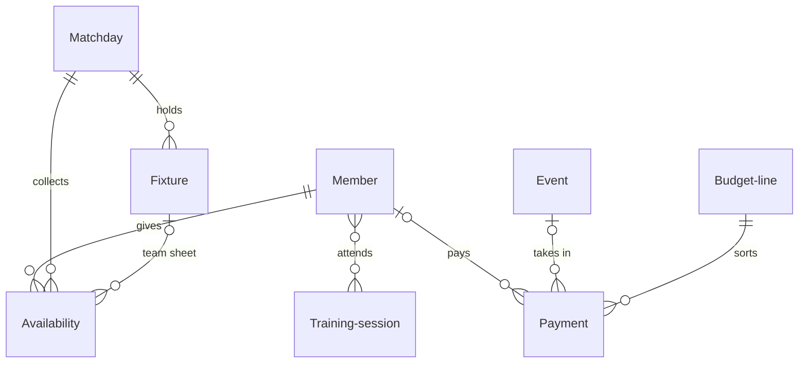

# Grassroots rugby club

*A recipe from the Fibery Process Cookbook: the process in plain words, and the model to build it in any tool.*

**Everyone answers, the fit and the free get picked, and the club knows who owes what.** For a grassroots men's club with two XVs, around fifty players and a committee of volunteers. The week from availability to match fees, with the season's training, socials and budget around it.

## The idea

A grassroots club runs on volunteers and a group chat. Availability is a poll half the squad ignores. Selection happens in the car park after Thursday training, from memory. The 2nd XV, the club's second team, finds out on Friday that it has twelve players. The treasurer matches a cash tin and a bank statement against a list of who played, and who was concussed three weeks ago lives in one person's head.

The fix is to keep three things once and read everything else from them: the people, their answers and the money. Every person on the club's books is a **Member**, playing or not. Every day the club plays, usually a Saturday, is a **Matchday**, and each match on it is a **Fixture**, one per side. Each player answers once per matchday, and that answer, his **Availability**, becomes his place in a team and then his appearance. Every sum of money in or out is a **Payment** on a **Budget line**, one of the headings the committee budgets for the season. The week has a rhythm: answers by Wednesday, selection on Thursday night, the games on Saturday, the results in that evening and the fees by the next weekend.

In any work tool, this becomes eight kinds of linked records: members, matchdays with their fixtures, one availability record per player per matchday that runs from *Available* to *Played*, training sessions with a register, events, and payments on budget lines. People live in one calendar of the club's week and, on Thursday night, in a view of two pitches with the available players beside them; a rule marks the whole team played when its captain closes the game, and formulas say who is clear to play and who owes what. It's the club's memory, not its group chat: the chat stays for the banter.

## How it runs

Follow one Saturday, *Kestrel at home*, from the fixture list to the last match fee.

1. **The fixtures go in.** In summer the league publishes the season's fixtures, and the **Fixtures secretary**, who keeps the club's diary, enters them. Every day the club plays becomes a matchday in *Open*, and every match on it a fixture in *Scheduled*. Saturday 14 November has two: the 1st XV at home to Kestrel and the 2nd XV away at Brackenford. Each fixture gets its **Team**, *1st XV* or *2nd XV*; its **Captain**, who leads the side that day and enters the result; and its **Match fee**, what each player pays to play. All of it shows on the **Club calendar**, beside training and socials.
2. **A new player joins and pays.** Dan Hughes comes to Tuesday training and joins on his phone through the **Join form**. He becomes a member in *New*, with his phone, an emergency contact and the **Positions** he plays. The **Club secretary**, who looks after members and the union's registration, sets his **Membership** to *Playing* and his **Subs rate**, what he pays for the season. Once the union has him, the club secretary ticks **Registered** and moves him to *Active*. Dan pays his subs by bank transfer that week, and the **Treasurer** enters it in the **Ledger** as a payment on this season's Subs line. The budget lines are the dozen headings the committee agreed at the AGM, the club's annual general meeting, each with its **Budget**, what the club expects to take or spend under it: Subs, Match fees, Socials, Bar, Referees, Pitch hire and so on. A payment names the member who paid it, when there is one, and Dan's **Owes**, what a member owes the club, drops to nothing. A member who stops playing for good is moved to *Left*, his history intact.
3. **The answers come in.** On Sunday evening the captains post the **Availability form** in the players' group chat. Each player answers once for Saturday 14 November, *Available* or *Unavailable*, and each answer becomes an availability record. Dan says yes. By Wednesday 29 have said yes and 6 no; the captains chase the rest in the chat, and a player who never answers isn't picked. When a player changes his mind, a captain changes his answer; he doesn't send a second one.
4. **Training keeps a register.** On Tuesday and Thursday the **Head coach**, who runs training and leads selection, puts on a **Training session** with a **Focus**. This Tuesday's is *Set piece*, and the plan goes in its description. Its **Coach**, the head coach or whoever takes it that night, takes the register: everyone there is linked as **Attended**. A session is *Planned* until the night and *Done* after it; one lost to a waterlogged pitch is *Called off*. Each member's **Trained** counts his sessions in the last 14 days, and **Training** lists the sessions with their registers.
5. **The teams are picked.** Thursday after training is **Selection night**: the head coach and both captains pick both teams in **Selection**, a view of two pitches. Shirts 1 to 15 start and 16 to 23 are replacements. Every available player sits beside the pitches as a card with his positions and how often he trained, and **Clear to play** flags anyone stood down, unregistered or owing money. They fill the 1st XV first, then the 2nd XV from who's left. Dropping a card on a shirt sets the player's **Picked for**, the fixture, and his **Shirt**; a fixture's **Team sheet** is everyone picked for it. Dan gets 13 for the 2nd XV. When both teams are full, the head coach moves the matchday to *Picked*, and the captains post the team sheets in the chat.
6. **Someone drops out.** On Friday night the 1st XV's tighthead prop pulls out: a wedding he'd forgotten. His captain moves his answer to *Dropped out* rather than deleting it, and the **Free the shirt** rule clears his fixture and shirt. The captains move the 2nd XV's tighthead prop up into shirt 3 and fill the gap he leaves from the players still unpicked.
7. **The games are played.** The 1st XV beat Kestrel 24–17 with four tries; the 2nd XV lose 12–19 at Brackenford, Dan scoring one of their two. Each captain enters **Score for**, **Score against**, every scorer's **Tries** and any **Card**, then moves his fixture to *Played*. The **Final whistle** rule marks everyone still on its team sheet *Played*: the appearance counts and the match fee is charged. **Result** says *Won* or *Lost* on **Results**, the season's fixtures with their team sheets. The 2nd XV captain is still on the coach at six, so the **Result reminder** asks him for the score. Each captain also sends the result to the league, by its deadline.
8. **A player takes a knock.** Early in the second half the 1st XV full-back is taken off with a suspected concussion and doesn't return that day. The **Welfare officer**, who looks after injured players, sets his **Stood down until**, the first day he may play again: at least 21 days on, counting the day of the injury as day 0, and only once a doctor has cleared him. The record holds that date and nothing medical. Until then, any answer he gives shows *Stood down* in red on Selection. A red card that brings a ban gets its date the same way, from the fixtures secretary.
9. **The fees come in.** Over the weekend, match fees arrive by transfer and in cash. The treasurer enters each in the Ledger on the Match fees line, against its player; sorted by Owes, **Members** shows who still needs a reminder. The curry night after the game was an **Event**, run by the **Social secretary** as its **Organiser**: *Planning*, then *On sale* at its **Ticket price**, then *Done*. The tickets and the caterer's bill go in against the event, and its **Net** shows the night made money. A social that doesn't sell is *Cancelled*.
10. **The matchday closes.** On Monday, with both results in, the fixtures secretary moves the matchday to *Done*. The **Matchday over** rule marks everyone still *Available* as *Not picked*. A fixture lost to a frozen pitch is *Called off*, so its players end *Not picked* and pay nothing. A *Postponed* one loses its team sheet to the **Clear the sheet** rule and goes back to *Scheduled* on a new matchday. Once a month the committee reads **Budget vs actual**, each line's budget against what it has taken or spent, and at the season's end **Appearances** settles who played most.

## What people look at

- **Any day** — the **Club calendar**: fixtures, training sessions and socials in one calendar. What's on, and where.
- **Sunday to Wednesday** — the **Availability form**, posted in the players' chat, and the **Selection board** as the answers arrive: who's in for Saturday, and whether the 2nd XV will be short.
- **Thursday, Selection night** — **Selection**, a custom view of the matchday's pitches with the available players beside them, red or amber when someone isn't clear to play. If your tool can't draw it, the Selection board does the job: a column per fixture, players in shirt order.
- **Saturday evening** — **Results**: every fixture of the season with its score and its team sheet.
- **Training nights** — **Training**: the sessions with their focus and their register.
- **Every week** — the treasurer's **Ledger**: every payment in and out. **Members**, the register, sorted by Owes to see who needs a reminder, and any time for a phone number, a registration or a stand-down. The **Join form** stays open for newcomers all season.
- **At the committee meeting** — the **Budget vs actual** report: each budget line against what it has taken or spent. At the season's end, the **Appearances** report: games played per member, for the awards dinner.
- **How to run the rugby club** — this process on one screen, kept where the club works.

## The rules

These are all the automations; everything else in the story is done by people.

- **Final whistle**: when a fixture moves to *Played*, every availability picked for it that is still *Available* moves to *Played*. The appearance counts and the match fee is charged.
- **Free the shirt**: when an availability moves to *Dropped out*, its Picked for and Shirt are cleared, so someone else can have the shirt.
- **Clear the sheet**: when a fixture moves to *Postponed*, every availability picked for it is unlinked from it, so the new date starts with an empty team sheet.
- **Matchday over**: when a matchday moves to *Done*, every availability on it that is still *Available* moves to *Not picked*.
- **Result reminder**: every day at 18:00, the captain of every fixture that kicked off that day and is still *Scheduled* is asked to enter the score, the tries and the cards, and to send the result to the league.

No automations in your tool? Then a person does each of these at the same moment, and the promises they keep below become practices.

## What must stay true

Whatever anyone edits, adapts or corrects, these hold; each says what keeps it so.

- ★ No answer, no shirt: a player is picked only from his own *Available* answer for that matchday, and he has one answer per matchday. Kept by **Selection** and the **Selection board**, which offer nothing else to pick from. One answer each is a practice: a captain changes a player's answer when he changes his mind, deletes a second one sent through the form, and corrects one sent for the wrong matchday or with a state other than *Available* or *Unavailable*, since the form offers every matchday and state.
- ★ Nobody plays while stood down. Shown on **Selection** and the **Selection board**, where Clear to play stays red until the day in Stood down until. Setting that day is a practice: the welfare officer gives a suspected concussion at least 21 days, the day of the injury being day 0, and waits for a doctor's clearance besides; the fixtures secretary gives a ban its date.
- ★ Every fixture is closed the day it's played: the score in and its team sheet *Played*. Kept by **Final whistle**, once the captain moves the fixture to *Played*; the **Result reminder** asks him at 18:00 if he hasn't.
- ★ What a member owes is computed, never typed. Kept by **Owes**, from his subs rate, the fixtures he played and his payments, so a corrected payment or team sheet corrects it at once.
- Every payment has a budget line. Shown on **Ledger**, where a payment without one has an empty Budget line; it is missing from Budget vs actual until it gets one.
- A drop-out is marked, never deleted, and his shirt goes to someone else. Kept by **Free the shirt** once he's *Dropped out*; marking rather than deleting is a practice, so the club sees who pulls out late.
- A matchday closes only once its fixtures are *Played*, *Postponed* or *Called off*, because Matchday over marks everyone left *Available* as *Not picked*, and nobody *Not picked* pays a fee. A practice for the fixtures secretary on Monday; a result entered after the close needs its team sheet set to *Played* by hand.

## Making it yours

Decide these before you set it up; each has a default if you shrug.

| Question | Default | If not the default |
|---|---|---|
| How many sides do you run? | Two XVs | One side: every matchday holds one fixture and Selection shows one pitch; nothing else changes. Three or more: add each side to Team, and Selection shows a pitch for every fixture of the day. |
| Do players pay a match fee? | Yes, set on each fixture | No: there's nothing to collect after the game. Drop Match fee and the Match fees line; Owes counts subs alone. |
| Do players use the tool themselves? | No: they join and answer through the forms | Yes: players answer for themselves and see what they owe. Link each member to his own person in your tool, and add a My answers list. |
| Do you already keep your members somewhere in your tool? | — | One register, not two: point Availability, Payment and Training session at the list you have instead of Member, and add Member's fields to it. |

- **A small club with one side:** the head coach and the captain pick together on the Selection board; the custom view can wait.
- **Other words:** "dues" for subs, "A side" and "B side" for the XVs, "games" for fixtures: rename freely. The week is the mechanics, not the vocabulary.
- **No subs, no play:** many clubs won't pick a player who still owes after an agreed date in the autumn. Clear to play already shows him amber; turn it red after that date. Nothing refuses him; the captains do.
- **Train to play:** clubs that pick only players who trained that week read Trained on the cards; shorten its window from 14 days to 7.
- **Old debts:** Owes starts every member's subs afresh on 1 July, while unpaid match fees never expire. To chase last season's subs, add a Membership database: one record per member per season, with its own subs and payments.
- **A season that starts in another month:** change 1 July in Owes and in the Appearances report.
- **Pushed too far, it's paperwork.** Availability is a promise to turn up, not a contract. A club that won't play a man who forgot the form loses him; a captain can always add a late answer by hand.
- **A women's side** runs the same way: add it to Team. Youth sections run under safeguarding, consent and age-grade rules this recipe doesn't cover.
- **What clubs add once it runs:** a matchday duties rota for teas, first aid, touch judges and pitch markings; a drills library linked from training sessions; sponsors with their packages and renewal dates; kit and who has which set; committee meetings and the AGM with their actions; the bar's stock, whose takings already fit a Bar line; league standings with bonus points, though the league's own are the official ones. Each is left out so the first season stays simple.

## Details for building

What follows is what the process is built from, in words any tool can follow; the story above is enough to run it.

Each kind of record (Member, Matchday, Fixture, Availability) is a database or a table, depending on the tool, or a tab in a spreadsheet. A relation links two kinds; its inverse is the name it has on the other side. A state is a step in a workflow, and a finished state ends it. A rule is an automation, a button is an automation someone presses, and a formula is a field the tool computes. A nested view shows each record's children beneath it; where a tool can't nest, group the children by their parent instead.

Each answer belongs to one member and one matchday, and is picked for at most one fixture; a fixture's team sheet is the answers picked for it, and a matchday holds its fixtures. Members attend training sessions, many to many. A payment sits on exactly one budget line and may name a member and an event. Eight databases, one past the usual seven, because a club runs four processes on one register: selection, training, socials and money. The core is Member, Matchday, Fixture, Availability, Payment and Budget line; Training session and Event can wait in a club that starts small.

### Member

One person on the club's books, playing or not. Coaches, committee members and supporters are members too. The description holds what the club secretary should remember about him. Comments on.

| Field | Type | Why |
|---|---|---|
| Membership | single select: Playing, Student, Social, Vice president, Life; default Playing | The kind of member, set by the club secretary; Members sorts by it, and the club secretary sets Subs rate from the club's rate for it |
| Positions | multi select: Prop, Hooker, Lock, Back row, Scrum half, Fly half, Centre, Back three | Where he plays; on the selection cards |
| Phone | phone | How the captains reach him |
| Email | email | For receipts and the AGM notice |
| Emergency contact | text | A name and a number, for whoever does first aid on the day |
| Subs rate | money | What he pays per season, set by the club secretary; Owes reads it |
| Registered | checkbox | Registered with the union to play this season; ticked by the club secretary, read by Clear to play |
| Stood down until | date | The first day he may play again after a stand-down or a ban; set by the welfare officer or the fixtures secretary, read by Clear to play |

States: New → Active → Left (finished). Default: New. A member who comes back moves from *Left* to *Active*.

Formulas:
- **Owes** — what he owes the club, money: his Subs rate while he's *Active*, less what he has paid on budget lines of Kind *Subs* since the season began on 1 July, never below 0; plus the Match fee of every fixture he has *Played*, less all he has ever paid on lines of Kind *Match fees*. Below 0 when he has paid fees ahead, 0 with no subs rate and no games. On Members, and read by Clear to play.
- **Trained** — how many *Done* training sessions he attended in the last 14 days, a whole number, 0 with none; on the selection cards and Members.

### Matchday

One day the club plays, usually a Saturday. It holds that day's fixtures and every answer for it. Its name is made from its date, like Sat 14 Nov. No description. Fields: Date (date; the day the answers are for, which Clear to play and Selection read). States: Open → Picked → Done (finished). Default: Open. Its fixtures and answers come through the inverses **Fixtures** and **Answers**.

### Fixture

One match of one side. Its name is made from its team, opponent and venue, like 1st XV v Kestrel (H). The description holds the coach's notes on the game. Comments on. Eleven fields, past the usual eight, because the league, the captain on the day and the treasurer all read it.

| Field | Type | Why |
|---|---|---|
| Matchday | relation, many-to-one → Matchday; inverse **Fixtures** | The day it's played on; Selection shows a matchday's fixtures side by side |
| Team | single select: 1st XV, 2nd XV | Which side plays; part of the name, and colors the Club calendar |
| Opponent | text | The other club; part of the name |
| Home or away | single select: Home, Away; default Home | Part of the name; an away game needs a Venue |
| Competition | single select: League, Cup, Friendly; default League | On Results |
| Kick off | date-time | When it starts; the Club calendar and the Result reminder run on it |
| Venue | location | The ground's address for an away game, filled by the fixtures secretary |
| Captain | person; inverse **Captained fixtures** | Who leads the side that day, enters the result and gets the Result reminder |
| Match fee | money; default the club's fee | What each player pays to play; Owes reads it |
| Score for | integer | Entered by the captain after the game |
| Score against | integer | Entered by the captain after the game |

States: Scheduled → Played (finished) · Postponed · Called off (finished). Default: Scheduled. A *Postponed* fixture goes back to *Scheduled* once it has a new matchday. Source of truth: the matchday's Date says which day the answers are for; Kick off says when the game starts, and may fall on another day of that weekend.

Formulas:
- **Result** — *Won*, *Drawn* or *Lost*, text, from Score for against Score against; *Not played* when either is empty. On Results, green for *Won* and red for *Lost*.

### Availability

One player's answer for one matchday, and what came of it. It carries his shirt, his tries and his appearance. Its name is made from the member and the matchday, like Dan Hughes, Sat 14 Nov. The description holds anything the captains should know, such as "can only make the second half". No comments.

| Field | Type | Why |
|---|---|---|
| Member | relation, many-to-one → Member; inverse **Answers** | Who answered |
| Matchday | relation, many-to-one → Matchday; inverse **Answers** | The day the answer is for |
| Picked for | relation, many-to-one → Fixture; inverse **Team sheet** | The fixture he's picked for on Selection night; empty while he isn't |
| Shirt | integer, 1 to 23 | 1 to 15 start, 16 to 23 are replacements; set on Selection night, orders the team sheet |
| Tries | integer | His tries in the game, entered by the captain; on Results |
| Card | single select: Yellow, Red; no default | A card he was shown, entered by the captain; a ban that follows becomes his Stood down until |

States: Available → Played (finished) · Not picked (finished) · Dropped out (finished) · Unavailable (finished). Default: Available. Source of truth: Picked for says who is on a team sheet, and the state says what came of the answer; Final whistle brings the state in step when the game is played.

Formulas:
- **Clear to play** — text: *Clear* when the matchday is *Done*, so an injury doesn't flag the game it happened in; otherwise *Stood down* when the member's Stood down until is after the matchday's Date; otherwise *Not registered* when the member isn't Registered; otherwise *Owes money* when the member's Owes is above 0; otherwise *Clear*, which is also what it says with no stand-down date. On Selection and the Selection board, red for *Stood down* and amber for the other two.

### Training session

One training session, with its plan and its register. Its name is made from its date and focus, like Tue 10 Nov, Set piece. The description holds the plan. Comments on.

| Field | Type | Why |
|---|---|---|
| Date | date-time | When; the Club calendar and Trained read it |
| Coach | person; inverse **Sessions coached** | Who takes the session and its register |
| Focus | single select: Set piece, Attack, Defence, Contact, Fitness, Match prep; no default | What it works on; on Training |
| Attended | relation, many-to-many → Member; inverse **Sessions attended** | The register, taken on the night; Trained counts it |

States: Planned → Done (finished) · Called off (finished). Default: Planned.

### Event

One social, fundraiser, dinner or tour. The description holds the plan and its to-do list. Comments on.

| Field | Type | Why |
|---|---|---|
| Date | date-time | When; on the Club calendar |
| Organiser | person; inverse **Events organised** | Who runs it, usually the social secretary |
| Venue | text | Where, when it isn't the clubhouse; filled by the organiser |
| Ticket price | money | What a ticket costs, set by the organiser; the treasurer checks ticket payments against it |

States: Planning → On sale → Done (finished) · Cancelled (finished). Default: Planning.

Formulas:
- **Net** — money: its payments on lines of every Kind but *Spending*, less its payments on *Spending* lines; 0 with none. On the event, for the social secretary's word at the committee meeting.

### Payment

One sum of money into or out of the club. Its name says what it was for, like Subs, Dan Hughes or Referee, Kestrel. No description, no comments.

| Field | Type | Why |
|---|---|---|
| Date | date | When it reached or left the bank or the cash tin; Ledger sorts by it, and Owes reads it for subs |
| Amount | money | Always positive; a refund is a negative amount on the line it came from |
| Budget line | relation, many-to-one → Budget line; inverse **Payments** | The heading it belongs to; whether it's money in or out comes from the line's Kind |
| Member | relation, many-to-one → Member; inverse **Payments** | Who paid it, for subs, match fees and tickets; Owes reads it |
| Event | relation, many-to-one → Event; inverse **Payments** | The social it's for; Net reads it |
| Method | single select: Bank transfer, Card, Cash; default Bank transfer | How it came or went; the treasurer counts the cash against the tin |
| Receipt | files | The receipt or invoice, for the accounts at the AGM |

### Budget line

One heading of the club's money for one season. Its Budget is what the committee expects under it, and its name is the heading: Subs, Match fees, Socials, Social costs, Bar, Sponsorship, Referees, Pitch hire, Kit, Union and insurance, Travel. The description says what belongs under it. No comments.

| Field | Type | Why |
|---|---|---|
| Season | single select, one option per season, named by the year it starts, like 2026 | Which season it budgets; Budget vs actual shows the current one |
| Kind | single select: Subs, Match fees, Income, Spending | Owes reads its Subs and Match fees lines; Net and Budget vs actual read money in and out from it |
| Budget | money | What the committee expects to take or spend under it this season, agreed at the AGM |

Formulas:
- **Actual** — the sum of its payments, money, 0 with none; on Budget vs actual.

### Views

| View | Type | Of | Grouping | Shows | Filter | Sort |
|---|---|---|---|---|---|---|
| Club calendar | calendar | Fixture, Training session, Event | dates Kick off for fixtures, Date for the others | name only; color by database, fixtures by Team | Fixture State is not Called off; Training session State is not Called off; Event State is not Cancelled | |
| Availability form | form | Availability | | Member (required), Matchday (required), State (default: Available), Description | | |
| Selection board | board | Availability | columns Picked for, rows Matchday | Member, the member's Positions and Trained, Shirt, Clear to play; red when Stood down, amber when Not registered or Owes money | State is Available; Matchday State is Open or Picked | Shirt asc |
| Results | grid | Fixture | Team sheet nested: Member, Shirt, Tries, Card, State | Kick off, Team, Opponent, Home or away, Competition, Score for, Score against, Result, Captain; green when Won, red when Lost | | Kick off asc |
| Training | list | Training session | Attended nested: Positions | Date, Focus, Coach, State | | Date desc |
| Ledger | grid | Payment | | Date, Amount, Budget line, Member, Event, Method, Receipt | | Date desc |
| Members | grid | Member | | Membership, State, Positions, Phone, Registered, Stood down until, Owes, Trained | State is not Left | Membership, then Name |
| Join form | form | Member | | Name (required), Phone (required), Emergency contact (required), Email, Positions, Membership (default: Playing) | | |
| How to run the rugby club | document | | | the process on one screen, linking to this recipe | | |

A tool whose calendar shows one database at a time gets the Club calendar as three calendars, one per database.

### App

**Selection**, a page of its own. Most tools can't draw it out of the box: build it as a custom app or view where the tool allows one, or use its fallback. It opens on the next matchday that is *Open* or *Picked*, with a picker for the others. Each fixture of that matchday is a pitch, headed by its name and Kick off, with shirts 1 to 15 in their positions and 16 to 23 on a bench beneath. Beside the pitches, every *Available* answer not yet picked is a card with the member's name, positions, Trained and Clear to play, red for *Stood down*, amber for *Not registered* or *Owes money*. Dragging a card onto a shirt sets its Picked for and Shirt; onto a taken shirt, it swaps the two players; back beside the pitches, it clears both. Each pitch counts its filled shirts. Reads: Matchday Date, State; Fixture Name, Kick off, Team; Availability Member, Matchday, State, Picked for, Shirt, Clear to play; Member Name, Positions, Trained. Writes: Availability Picked for, Availability Shirt. Fallback: the Selection board.

### Reports

**Budget vs actual** — source Budget line, current, only the current Season's lines: two bars per line, its Budget and its Actual, grouped by Budget line and colored by which of the two it is.

**Appearances** — source Availability, current, only *Played* answers on matchdays since the season began on 1 July: a bar per Member counting his answers, grouped by Member, which every answer has, in one color.

### Sample story

It's Wednesday of week five. Saturday 14 November is *Open*: most of the squad has answered, Dan Hughes among the yeses, and the captains are chasing the rest. Tuesday's training is done with its register; Thursday's is planned. Last Saturday is *Done*: the 1st XV won at home, the 2nd XV lost by three away, a prop dropped out late and three weren't picked. A winger from that game is stood down for twelve more days but has said yes anyway, and a flanker is serving a ban. A few members owe match fees and two still owe subs. The curry night is on sale, the quiz night made money, and Pitch hire is past its budget.

## Sources

- [Rugby Club Subs and Match Fees: Collecting Them Without the Chase](https://www.sportplan.net/drills/Rugby/guides/rugby-subs-match-fees.jsp), Sportplan, 2026: seasonal subs with concessions, a match fee per fixture, whether a player has paid shown at selection, and the union's own system as the record of registration.
- [Club roles: Treasurer](https://sport.wales/grants-and-funding/club-support/people-in-your-club/attracting-volunteers/club-roles/tresurer), Sport Wales: one account of all income and spending kept within an annual budget, subs collected, and regular reports to the committee and the AGM.
- [Concussion management for the general public: summary principles](https://passport.world.rugby/player-welfare-medical/concussion-management-for-the-general-public/summary-principles), World Rugby: a player with a suspected concussion is removed and doesn't return that day, a doctor decides the return, and in the community game the stand-down is at least 21 days, the day of the injury being day 0.

## Build it

In Fibery, open Claude with the Fibery plugin, attach this recipe and say "set up the rugby club". Claude asks a few questions, then sets it up in about ten minutes.

Anywhere else, give this recipe to your AI assistant and name your tool, or build it by hand from Details for building.

---

*From the Fibery Process Cookbook (https://github.com/Fibery-inc/process-cookbook), licensed CC BY 4.0 (https://creativecommons.org/licenses/by/4.0/): copy, adapt and build it anywhere, crediting the cookbook.*
